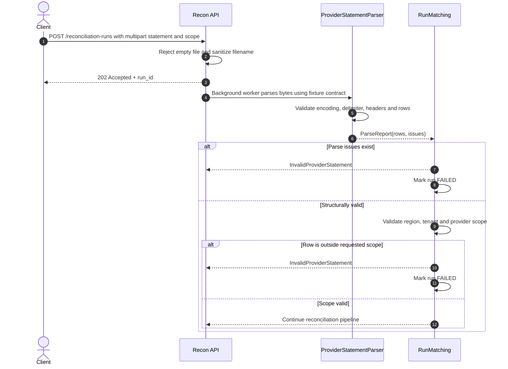

# F01 — Provider statement upload, parsing và validation

## 1. Overview

| Item | Detail |
|---|---|
| Feature | Provider statement upload, parsing và validation |
| Owner | `[TBD]` |
| Ticket | `[TBD]` |
| Status | `Implemented` |
| Purpose | Nhận statement qua HTTP, parse internal fixture CSV và chặn dữ liệu lỗi hoặc ngoài requested scope trước matching. |

## 2. Requirements

### Functional Requirements

- Endpoint nhận multipart file cùng `business_date`, `region`, `provider`, optional `tenant_id`.
- Sanitize filename bằng basename và reject empty file.
- CSV chấp nhận UTF-8 có/không BOM và chỉ dùng delimiter dấu phẩy.
- Validate required headers, column count, empty/duplicate rows, region/type, non-negative integer amount, currency và timezone-aware timestamp.
- Mọi row phải khớp requested region, tenant và normalized provider.
- Nếu có bất kỳ issue, toàn statement bị reject; hiện không hỗ trợ partial acceptance.

### Non-Functional Requirements

- Validation issue phải có row, field, code và message trong application model.
- Không log raw provider payload.
- Fixture/sample nội bộ không được coi là contract chính thức của provider.
- Khi chưa có sample/spec chính thức, chỉ triển khai qua parser interface và ghi rõ limitation.

## 3. Design

### Flow

### Processing

1. FastAPI parse form fields, đọc upload và sanitize filename.
2. `CsvFixtureParser` decode, detect delimiter, validate header/rows và tạo `ProviderTransaction`.
3. `RunMatching` validate toàn bộ rows thuộc requested scope; issue bất kỳ trả 422.

### Components

| Component | Change |
|---|---|
| `reconciliation.adapters.http.create_reconciliation_run` | Đã triển khai multipart command endpoint. |
| `ProviderStatementParser` / `ParseReport` | Đã triển khai port và validation model. |
| `CsvFixtureParser` | Đã triển khai internal fixture contract. |
| Official provider parser | Blocked: chờ team cung cấp sample/spec chính thức; không tự giả định contract. |

## 4. API & Data

### API

| Method | Endpoint | Description |
|---|---|---|
| POST | `/reconciliation-runs` | Upload statement, persist `PENDING` run và enqueue background processing. |
| GET | `/reconciliation-runs?run_id={run_id}` | Dùng endpoint danh sách hiện có để poll `PENDING`, `RUNNING`, `COMPLETED` hoặc `FAILED`. |

### Request/Response

- Request `multipart/form-data`: `statement`, `business_date`, `region`, `provider`, `tenant_id?`.
- Accepted `202`: `run_id`, `status=PENDING`.
- Empty upload/form/timezone lỗi trả `422`; CSV/scope validation trong background được phản ánh bằng trạng thái `FAILED`.

### Database

| Table / Collection | Change |
|---|---|
| `provider_txn` | Valid parsed rows được lưu bởi F04 sau matching. |
| Validation issue store | Chưa có; schema và retention `[TBD]`. |

## 5. Error & Edge Cases

| Scenario | Expected Behavior |
|---|---|
| Happy path | Parse rows, validate scope và chuyển sang matching. |
| Invalid input | Empty file hoặc parse/scope issue trả 422, không lưu run theo implementation hiện tại. |
| Duplicate request | Parser deterministic; run-level duplicate hiện có thể vướng unique constraint, xem F06. |
| Timeout / dependency error | Upload hiện được đọc toàn bộ vào memory; không có timeout/size policy riêng. |
| Retry / concurrent processing | Run-level idempotency và concurrency do F06 xử lý. |

## 6. Testing

| Test Case | Expected Result |
|---|---|
| Valid fixture CSV | Tạo đúng `ProviderTransaction` và feed được matching engine. |
| Invalid encoding/delimiter/header/value | `ParseReport.valid == false` với code tương ứng. |
| API forwarding | File bytes và sanitized filename được chuyển đúng vào runner. |
| Empty upload/out-of-scope row | HTTP 422. |

## 7. Open Questions

| Question | Owner | Status |
|---|---|---|
| API validation error schema chính thức là gì? | API owner | `[Need Confirm]` |
| Có cho phép partial acceptance hay luôn fail toàn file? | Product/Finance | `[Need Confirm]` |
| Schema, delimiter, encoding và timezone chính thức của từng provider? | Provider/Regional teams | `[Need Confirm]` |

---
