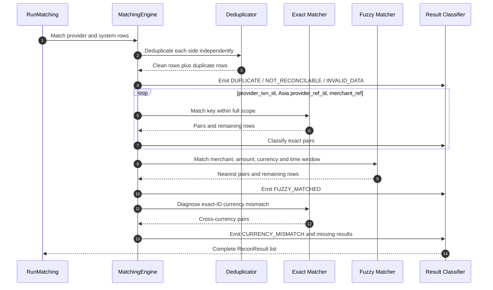

# F02 — Matching, deduplication và result classification

## 1. Overview

| Item | Detail |
|---|---|
| Feature | Matching, deduplication và result classification |
| Owner | `[TBD]` |
| Ticket | `[TBD]` |
| Status | `Implemented` |
| Purpose | Ghép mỗi system/provider row tối đa một lần, phát hiện duplicate/mismatch/missing và tạo kết quả giải thích được. |

## 2. Requirements

### Functional Requirements

- Deduplicate system theo global transaction key và provider theo identifier trong full scope.
- Exact match theo thứ tự: `provider_txn_id`, Asia `provider_ref_id`, `merchant_ref`.
- Fuzzy match theo full scope, `merchant_id`, amount và timestamp trong ±300 giây; chọn candidate gần nhất.
- Chỉ sau full-scope matching mới chẩn đoán exact-ID nhưng khác currency.
- Asia refund phải xóa inherited `provider_txn_id` trước provider dedup/match.
- Phân loại đủ: `MATCHED`, `AMOUNT_MISMATCH`, `CURRENCY_MISMATCH`, `MISSING_IN_SYSTEM`, `MISSING_IN_PROVIDER`, `DUPLICATE`, `FUZZY_MATCHED`, `NOT_RECONCILABLE`, `INVALID_DATA`.
- Loại non-monetary `CARD_LINK`/`TOKENIZATION` và invalid amount khỏi candidate matching nhưng vẫn tạo result.

### Non-Functional Requirements

- Matching deterministic theo input order; một provider row không được ghép nhiều lần.
- Kết quả giữ IDs, amounts/currencies hai phía, delta, source file/row và reason.
- Time window cần chuyển sang configuration trước production; hiện default cố định 300 giây.

## 3. Design

### Flow

### Processing

1. Normalize legacy Asia refund IDs và deduplicate riêng hai phía.
2. Emit duplicate/non-reconcilable/invalid results trước matching candidates.
3. Match exact keys, fuzzy composite, currency mismatch, rồi emit missing rows.

### Components

| Component | Change |
|---|---|
| `reconciliation.domain.MatchingEngine` | Đã triển khai matching pipeline. |
| `ProviderTransaction` | Đã triển khai provider-side domain validation/scope. |
| `ReconResult` / `ReconResultType` | Đã triển khai detailed result model và 9 classifications. |

## 4. API & Data

### API

| Method | Endpoint | Description |
|---|---|---|
| N/A | N/A | Domain service được gọi bởi F03. |

### Request/Response

- Input: `run_id`, list provider transactions, list canonical system transactions.
- Output: list `ReconResult`, mỗi input row được giải quyết thành match/duplicate/exclusion/missing phù hợp.

### Database

| Table / Collection | Change |
|---|---|
| `recon_result` | Lưu 9 result types và evidence fields. |

## 5. Error & Edge Cases

| Scenario | Expected Behavior |
|---|---|
| Happy path | Exact same ID/currency/amount tạo `MATCHED`, delta 0. |
| Invalid input | Invalid/no-currency system row tạo `INVALID_DATA`; provider invalid đã bị F01 chặn. |
| Duplicate request | N/A; duplicate row trong một dataset tạo `DUPLICATE`. |
| Timeout / dependency error | N/A; pure in-memory domain service. |
| Retry / concurrent processing | Cho cùng ordered input tạo cùng classifications; result DB key hiện phụ thuộc thứ tự list. |

## 6. Testing

| Test Case | Expected Result |
|---|---|
| Exact identifiers | Match đúng thứ tự key và không dùng Asia-only key cho region khác. |
| Amount/currency mismatch | Classification và delta đúng; cross-currency delta là null. |
| Duplicate hai phía | Duplicate rows được tách và không được match tiếp. |
| Fuzzy candidates | Candidate gần timestamp nhất trong window được chọn. |
| Missing/non-reconcilable/invalid | Tạo đúng result type và reason. |
| Synthetic oracle | Bao phủ đủ cả 9 result types cho mọi scope generated. |

## 7. Open Questions

| Question | Owner | Status |
|---|---|---|
| Fuzzy time window theo provider/tenant là bao nhiêu? | Product/Finance | `[Need Confirm]` |
| Tie-break khi hai fuzzy candidates có cùng time distance là gì? | Product/Finance | `[Need Confirm]` |

---
