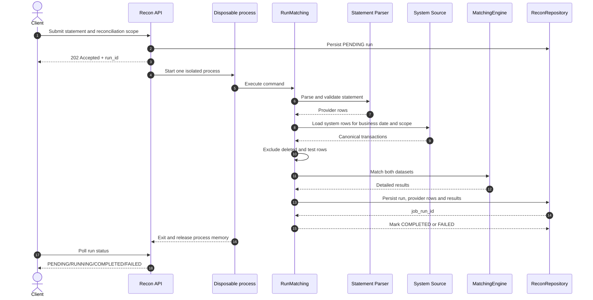

# F03 — Reconciliation application pipeline

## 1. Overview

| Item | Detail |
|---|---|
| Feature | Reconciliation application pipeline |
| Owner | `[TBD]` |
| Ticket | `[TBD]` |
| Status | `Implemented` |
| Purpose | Điều phối background reconciliation, parse, scope validation, system load, filtering, matching và persistence. |

## 2. Requirements

### Functional Requirements

- Normalize requested provider sang uppercase và reject empty provider.
- Không cho statement row vượt requested region/tenant/provider.
- Load system transactions qua port theo business date.
- Loại `is_deleted` và `is_test_data` trước matching.
- Tạo `run_id` nếu caller không truyền.
- API tạo durable `PENDING` run và trả `202 Accepted` cùng `run_id`.
- Background worker lưu run rồi chỉ trả row counts và result summary cho internal caller.
- Scheduler lọc `run_id` qua endpoint danh sách hiện có cho đến `COMPLETED` hoặc `FAILED`.

### Non-Functional Requirements

- Application phụ thuộc ports thay vì concrete Mongo/PostgreSQL implementation.
- Composition root chọn source theo region và quản lý connection pools.
- Background queue mặc định một worker, cấu hình qua `RECON_WORKER_COUNT`.
- Mỗi run chạy trong một process mới; process kết thúc sau run để OS thu hồi toàn bộ heap.
- Mongo source không giữ raw document trong `CanonicalTransaction` vì matching chỉ dùng normalized fields.
- Provider transactions và reconciliation results được insert theo batch 10.000.

## 3. Design

### Flow

### Processing

1. Parse provider statement và validate command scope.
2. Load/filter system rows và invoke domain matching.
3. Persist provider rows/results theo batch 10.000, count classifications và return summary-only output.

### Components

| Component | Change |
|---|---|
| `RunMatching` | Đã triển khai orchestration hiện tại. |
| `SystemTransactionSource` | Đã triển khai port và regional implementations. |
| `ReconRepository` | Đã triển khai write port hiện tại. |
| `bootstrap.main.lifespan` | Đã triển khai dependency wiring và resource lifecycle. |

## 4. API & Data

### API

| Method | Endpoint | Description |
|---|---|---|
| POST | `/reconciliation-runs` | Enqueue run và trả `202 Accepted`. |
| GET | `/reconciliation-runs?run_id={run_id}` | Poll metadata qua endpoint danh sách, không load result details. |
| GET | `/health` | Health response tĩnh; chưa probe dependencies. |

### Request/Response

- Xem F01 cho HTTP contract.
- Internal matching output không còn chứa detailed `results`; chi tiết được đọc phân trang từ persistence.

### Database

| Table / Collection | Change |
|---|---|
| Regional MongoDB | Read system transactions. |
| Reconciliation PostgreSQL tables | Write qua F04. |

## 5. Error & Edge Cases

| Scenario | Expected Behavior |
|---|---|
| Happy path | Trả `202`, sau đó status chuyển `PENDING → RUNNING → COMPLETED`. |
| Invalid input | Parse/scope/domain `ValueError` được API map sang 422. |
| Duplicate request | Chưa return existing run; xem F06. |
| Timeout / dependency error | Background run chuyển `FAILED`; scheduler không giữ một HTTP request dài trong lúc xử lý. |
| Retry / concurrent processing | Chưa có idempotent rerun/concurrency control của F06. |

## 6. Testing

| Test Case | Expected Result |
|---|---|
| Port-based happy path | Source request, persisted payload và output counts đúng. |
| Deleted/test filtering | Rows bị loại không đi vào matching. |
| Invalid statement scope | Fail trước system matching/persistence. |
| Composition smoke test | `[TBD]` — chưa có integration test với real dependencies. |

## 7. Open Questions

| Question | Owner | Status |
|---|---|---|
---
