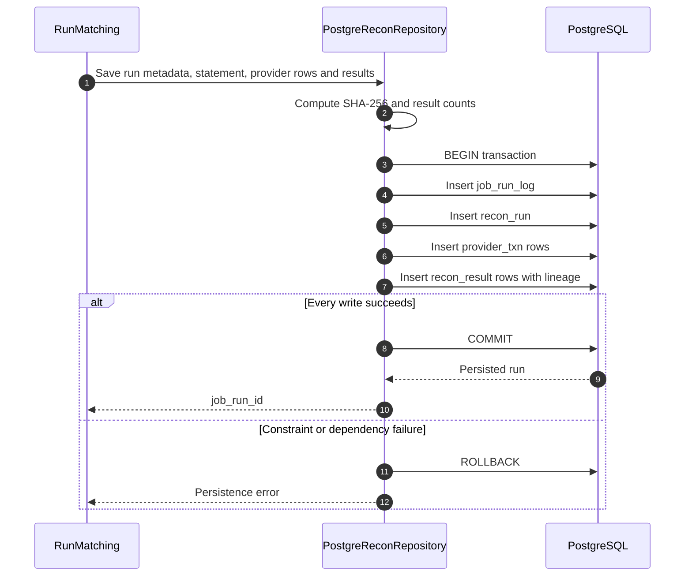

# F04 — Run persistence, checksum và lineage

## 1. Overview

| Item | Detail |
|---|---|
| Feature | Run persistence, checksum và lineage |
| Owner | `[TBD]` |
| Ticket | `[TBD]` |
| Status | `Implemented` |
| Purpose | Lưu run/provider/results nhất quán, giữ checksum và lineage từ result về job/run và input source. |

Trạng thái `Implemented` áp dụng cho persistence, checksum và lineage của F04. Idempotent rerun/durable failure record thuộc F06; cutoff và allowed lateness theo business policy thuộc F07.

## 2. Requirements

### Functional Requirements

- Tính SHA-256 từ statement bytes.
- Persist `job_run_log`, `recon_run`, `provider_txn` và `recon_result` với khóa ngoại tới run; result có phía provider giữ file/row để tra dòng nguồn.
- Detail result set phải commit toàn bộ hoặc rollback toàn bộ nếu insert thất bại.
- Lưu source file/row, provider raw JSON và evidence của từng phía có mặt trong result.
- Unique constraints ngăn trùng input/result/source row.
- Persist `tenant_id` ở run/job và business timezone đang áp dụng cho scope.
- `cutoff_time` và `allowed_lateness_seconds` chưa được cấu hình theo policy; chờ chốt rule và triển khai tại F07.

### Non-Functional Requirements

- Dùng PostgreSQL transaction và foreign keys tới run để bảo đảm lineage run/job.
- Mọi result truy được về đúng `run_id` và `job_run_id`. Result có phía provider giữ `(run_id, source_file, source_row_number)` để tra dòng `provider_txn`; result có phía hệ thống giữ `(region, tenant_id, system_txn_id)` để tra nguồn MongoDB.
- Result một phía chỉ có lineage của phía đó: `MISSING_IN_PROVIDER` không có provider row, `MISSING_IN_SYSTEM` không có system transaction.
- Không lưu raw system document trong result hiện tại.
- Raw provider payload cần masking/retention policy trước production `[Need Confirm]`.

## 3. Design

### Flow

### Processing

1. Repository tạo `job_run_id`, checksum và result counter.
2. Ghi bốn nhóm records trong cùng PostgreSQL transaction. Scope statement đã được `RunMatching` kiểm tra; matching engine tạo result từ chính các input rows đó.
3. Trả `job_run_id` sau commit; database exception propagate nếu rollback.

### Components

| Component | Change |
|---|---|
| `PostgreReconRepository.save_run` | Đã triển khai completed-run transaction. |
| Migrations `0002`–`0005` | Đã tạo schema, constraints, indexes và khóa ngoại tới run. |
| Durable lifecycle store | Chưa triển khai; thuộc F06. |

## 4. API & Data

### API

| Method | Endpoint | Description |
|---|---|---|
| N/A | N/A | Persistence được gọi bởi F03. |

### Request/Response

- Input: run metadata, statement bytes/path, provider transactions và results.
- Output: generated `job_run_id`.

### Database

| Table / Collection | Change |
|---|---|
| `job_run_log` | Hiện insert thẳng `COMPLETED` với count metrics. |
| `recon_run` | Insert `COMPLETED` với tenant/timezone; cutoff tạm giữ `00:00`, lateness dùng DB default `0` cho đến F07. |
| `provider_txn` | Mỗi record là một dòng input provider đã chuẩn hóa, kèm file/row và raw JSON. |
| `recon_result` | Mỗi record là một kết luận đối soát; giữ snapshot ID, amount/currency hai phía, delta và reason để đọc báo cáo. Các cột phía provider lặp có chủ ý; source file/row nối lại với `provider_txn`. |

`provider_txn_id` không phải khóa duy nhất của dòng nguồn: có thể null hoặc trùng trong dữ liệu cần phát hiện duplicate. Result tra provider row bằng `(run_id, source_file, source_row_number)`; bộ ba này unique trong `provider_txn` nhưng không có khóa ngoại từ `recon_result`. `RunMatching` kiểm tra scope của statement và matching engine tạo evidence từ input rows; repository không kiểm tra lại quan hệ result–provider row. Provider ID trong result có thể khác ID raw của nguồn với Asia refund legacy vì matching loại ID kế thừa trước khi đối soát.

System transactions vẫn nằm ở MongoDB; `system_txn_id` cùng `region`/`tenant_id` là tham chiếu logic, không phải khóa ngoại PostgreSQL. Collection/document reference đầy đủ còn chờ xác nhận.

## 5. Error & Edge Cases

| Scenario | Expected Behavior |
|---|---|
| Happy path | Cả bốn nhóm records commit cùng nhau. |
| Invalid input | DB constraints reject invalid/duplicate records và rollback. |
| Duplicate request | Unique input constraint raise database error; chưa có idempotent response. |
| Timeout / dependency error | Rollback transaction; hiện không để lại `FAILED` audit run. |
| Retry / concurrent processing | Concurrent same input chỉ một insert thắng constraint; caller thua nhận lỗi. |

## 6. Testing

| Test Case | Expected Result |
|---|---|
| Successful save | Job/run/provider/results cùng tồn tại và checksum đúng. |
| Insert failure midway | Không có partial detail records. |
| Duplicate input | Constraint hoạt động; desired existing-run behavior thuộc F06. |
| Tenant/timezone persistence | Tenant và business timezone được kiểm tra trong unit test repository. |
| Cutoff/lateness policy persistence | `[TBD]` — chờ rule F07 được xác nhận. |

## 7. Open Questions

| Question | Owner | Status |
|---|---|---|
| System source reference đầy đủ cần lưu collection/document ID nào? | Regional teams | `[Need Confirm]` |

---
