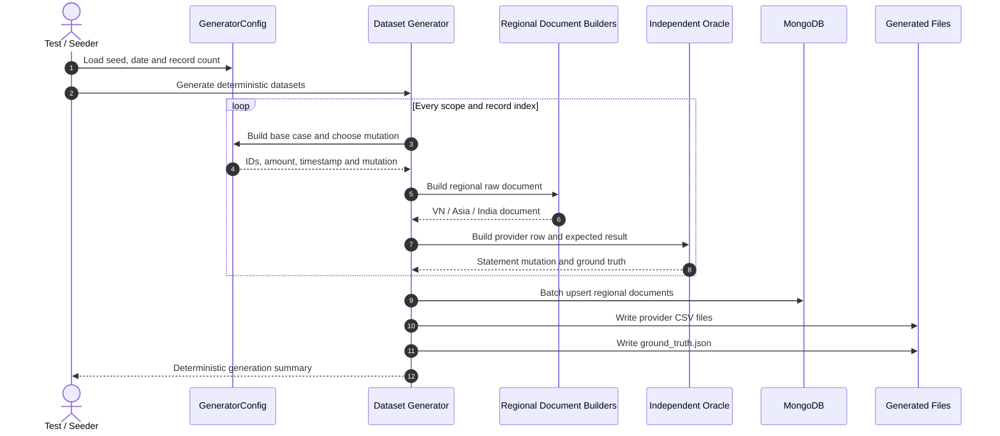

# F05 — Synthetic dataset và reconciliation ground truth

## 1. Overview

| Item | Detail |
|---|---|
| Feature | Synthetic dataset và reconciliation ground truth |
| Owner | `[TBD]` |
| Ticket | `[TBD]` |
| Status | `Implemented` |
| Purpose | Tạo dữ liệu regional Mongo, provider statements và đáp án reconciliation deterministic để kiểm chứng adapters/matching độc lập. |

## 2. Requirements

### Functional Requirements

- Cùng seed/config tạo cùng documents, CSV và ground truth.
- Tạo dữ liệu VN, Asia ID, Asia PH và India theo schema raw riêng.
- Chu kỳ 8 mutation bao phủ exact match, amount mismatch, currency mismatch, missing, duplicate, fuzzy, not reconcilable và invalid data.
- Sau mỗi cycle tạo thêm provider-only row cho `MISSING_IN_SYSTEM`.
- Oracle không được gọi `MatchingEngine` để tránh circular verification.
- Mongo seed dùng upsert theo batch và ghi generation metadata.

### Non-Functional Requirements

- Re-run cùng seed không nhân đôi Mongo documents và ghi đè output files ổn định.
- Generated fixtures phải parse được bằng F01.
- Test phải so sánh toàn bộ normalized result fields, không chỉ summary.

## 3. Design

### Flow

### Processing

1. Chọn mutation bằng `index % 8` và tạo deterministic IDs/time/amount.
2. Từ base case, hai nhánh độc lập tạo raw regional documents và provider/oracle output.
3. Seed Mongo theo batch, ghi CSV và ground truth vào `tests/generated`.

### Components

| Component | Change |
|---|---|
| `tests.data_generator.config` | Đã triển khai scope/base-case/mutation configuration. |
| `source_documents` | Đã triển khai raw documents theo region. |
| `oracle` | Đã triển khai provider statements và independent expected results. |
| `generator` / `mongo_seed` | Đã triển khai orchestration, files và Mongo upsert. |

## 4. API & Data

### API

| Method | Endpoint | Description |
|---|---|---|
| N/A | N/A | Test/local tooling, không expose production API. |

### Request/Response

- Input: seed, business date và record count từ config/environment.
- Output: Mongo raw datasets, provider CSV files và `ground_truth.json`.

### Database

| Table / Collection | Change |
|---|---|
| Regional Mongo collections | Upsert generated documents theo deterministic IDs. |
| Generation metadata collection | Upsert batch state `COMPLETED`. |

## 5. Error & Edge Cases

| Scenario | Expected Behavior |
|---|---|
| Happy path | Tạo đủ datasets/statements/oracle cho 4 scopes. |
| Invalid input | Reject non-positive record count hoặc invalid seed date. |
| Duplicate request | Cùng seed upsert/overwrite, không nhân bản output. |
| Timeout / dependency error | Seeder fail non-zero; API container chỉ nên start sau generator success. |
| Retry / concurrent processing | Cùng seed về logic idempotent; concurrent file writes chưa được thiết kế cho production. |

## 6. Testing

| Test Case | Expected Result |
|---|---|
| Determinism | Hai lần generate cho output bằng nhau. |
| Regional shapes | Mỗi document giữ field names/types đặc thù region. |
| Statement parseability | Mọi generated CSV parse hợp lệ. |
| Independent oracle | Matching output bằng full expected result set và đủ 9 types. |

## 7. Open Questions

| Question | Owner | Status |
|---|---|---|

---
