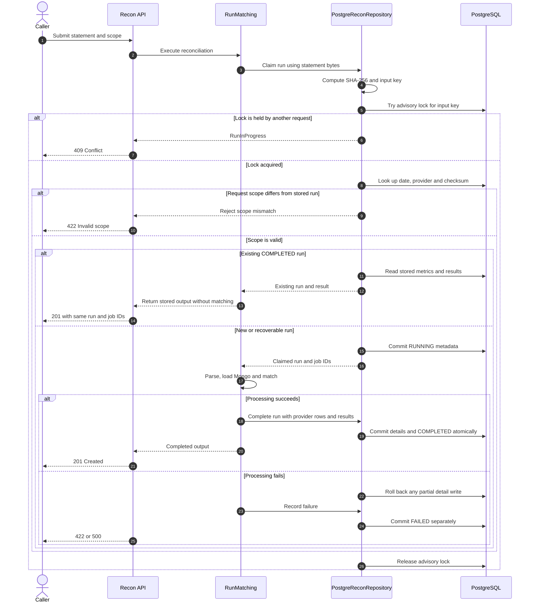

# F06 — Run lifecycle, idempotent rerun và concurrency control

## 1. Overview

| Item | Detail |
|---|---|
| Feature | Run lifecycle, idempotent rerun và concurrency control |
| Owner | `[TBD]` |
| Ticket | `[TBD]` |
| Status | `Implemented` |
| Purpose | Bảo đảm chạy lại cùng input cho cùng kết quả, không tạo result trùng và mỗi run có metadata/trạng thái phục vụ audit. |

## 2. Requirements

### Functional Requirements

- Mỗi run có `run_id`, file checksum, business date, cutoff, started/finished time và status.
- Persist `job_run_log`; mọi result có lineage qua `job_run_id`.
- Cùng `(business_date, provider, file_checksum)` phải cho cùng kết quả và không tạo thêm records.
- Dùng unique constraint kết hợp lookup/insert/update để rerun không biến thành database error.
- Request/job đồng thời cho cùng input không được tạo hai effective runs.
- Pipeline restart không làm sai hoặc nhân đôi số liệu.
- Persist region và tenant trong metadata. Statement hợp lệ chứa region/tenant ở từng dòng, nên file khác scope có checksum khác; nếu cùng checksum lại được gọi với scope khác, từ chối thay vì trả nhầm run cũ.

### Non-Functional Requirements

- Thao tác claim run và ghi kết quả phải có transaction/locking strategy rõ ràng.
- Concurrency control dùng PostgreSQL session advisory lock trên đúng `(business_date, provider, file_checksum)`, cộng unique constraint sẵn có ở DB; integration test xác minh hai connection không cùng sở hữu input.
- Không tự bổ sung retry API, retry attempts hoặc exponential backoff vào scope bắt buộc khi chưa có xác nhận.

## 3. Design

### Flow

### Processing

1. Sau kiểm tra file rỗng và chuẩn hóa provider, repository tính SHA-256 từ bytes trước khi parse/đọc Mongo/matching. Key gồm business date, provider và checksum.
2. Lấy session advisory lock không chờ trên chính key đó. Owner ghi `RUNNING` rồi commit metadata trước processing; request đồng thời nhận `409`, không tạo run khác.
3. Nếu đã `COMPLETED`, nạp metrics/results từ PostgreSQL và trả nguyên IDs, counts, summary và details đã lưu; không parse hoặc match lại. Response POST vẫn là `201` để giữ contract hiện tại. Nếu request khai báo region/tenant khác metadata của run có cùng key, trả `422` để không trả nhầm dữ liệu.
4. Nếu `FAILED` hoặc `RUNNING` không còn owner (worker chết, lock tự giải phóng khi connection đóng), claim lại cùng run/job IDs, không thêm attempt record. Sau khi thành công, detail rows và `COMPLETED` commit trong một transaction. Nếu lỗi, rollback detail và ghi `FAILED` trong transaction riêng.
5. Khóa được giải phóng khi context kết thúc hoặc connection mất. Cùng input không thể có hai owner sống; unique constraint là lớp bảo vệ bổ sung. Một request sau khi owner hoàn tất sẽ đọc kết quả cũ.

### Components

| Component | Change |
|---|---|
| `ReconRepository` port | `claim_run`, `complete_run`, `fail_run`; `RunClaim` và persisted `StoredRun`. |
| `PostgreReconRepository` | Session advisory lock, durable lifecycle, existing-run hydration và atomic detail write. |
| `RunMatching` | Claim trước parse/Mongo/matching; replay trả dữ liệu cũ ngay. |

## 4. API & Data

### API

| Method | Endpoint | Description |
|---|---|---|
| POST | `/recon/runs` | Tạo run mới hoặc trả run đã tồn tại cho cùng input. |

### Request/Response

- Request giữ statement, business date, region, tenant và provider.
- Response phải trả cùng `run_id` hoặc cùng persisted result khi exact rerun.
- Completed replay trả `201` như request mới (giữ tương thích response hiện tại); request trùng đang chạy trả `409 Conflict`. API hiện chưa trả `run_id` trong body lỗi; có thể bổ sung khi có status/query API F08.
- Không thêm retry endpoint trong scope hiện tại.

### Database

| Table / Collection | Change |
|---|---|
| `job_run_log` | Lưu lifecycle/status và metrics của job. |
| `recon_run` | Lưu checksum, scope, business date, cutoff, timestamps và status. |
| `recon_result` | Mọi row giữ `run_id` và `job_run_id`; không nhân đôi khi rerun. |
| Unique input constraint | `(business_date, provider, file_checksum)`; region/tenant được lưu và đối chiếu khi lookup. |

## 5. Error & Edge Cases

| Scenario | Expected Behavior |
|---|---|
| Happy path | Run được claim một lần, kết quả commit và status hoàn tất. |
| Invalid input | File rỗng bị API từ chối trước claim; lỗi parser/scope sau claim ghi `FAILED`, trả `422`. |
| Duplicate request | Trả run/result hiện hữu, không insert thêm detail. |
| Timeout / dependency error | Không để partial result; lưu status lỗi nếu run metadata đã được tạo. |
| Retry / concurrent processing | `FAILED`/orphan `RUNNING` dùng lại cùng IDs; concurrent caller nhận `409`. Không có retry tự động/backoff. |

## 6. Testing

| Test Case | Expected Result |
|---|---|
| Rerun cùng file 2–3 lần | Run/result counts và monetary totals không đổi. |
| Concurrent same input | Chỉ có một effective run và một result set. |
| Failure giữa transaction | Không có partial provider/result rows. |
| Restart sau khi đã hoàn tất | Lookup existing run, không xử lý lại gây trùng. |
| Scope isolation | Statement khác region/tenant có checksum khác; nếu request khai báo scope khác cho cùng file, từ chối thay vì trả run sai. |
| Lineage | Mọi result truy được về đúng `job_run_id` và `run_id`. |

## 7. Open Questions

| Question | Owner | Status |
|---|---|---|
| Có cần trả `200` thay vì giữ `201` cho completed replay hoặc expose `run_id` trong `409`? | API owner | `[Need Confirm]` |
