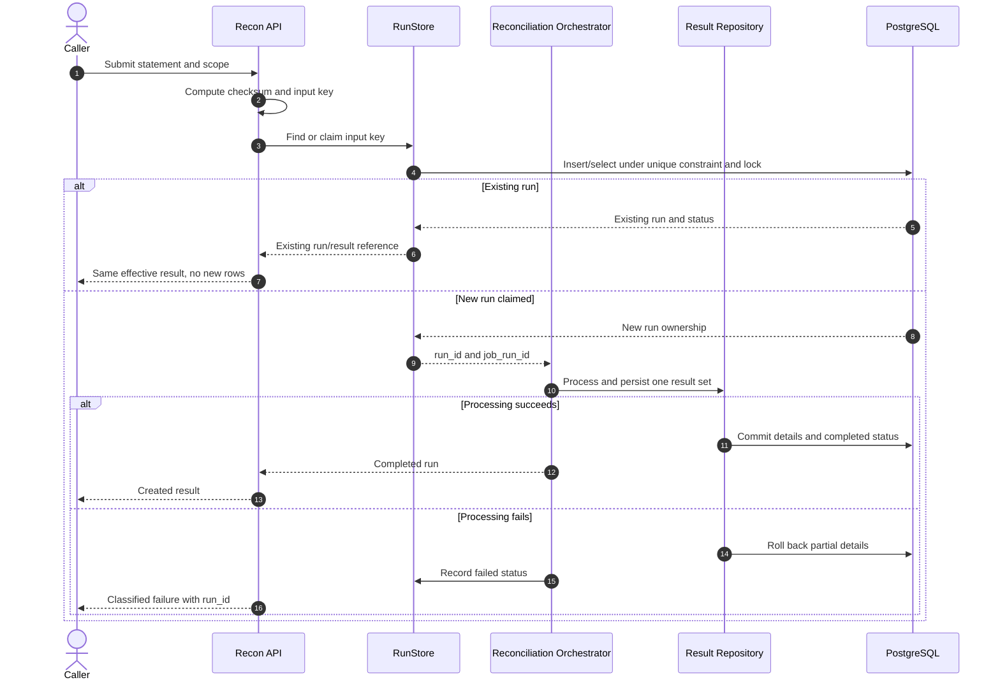

# F06 — Run lifecycle, idempotent rerun và concurrency control

## 1. Overview

| Item | Detail |
|---|---|
| Feature | Run lifecycle, idempotent rerun và concurrency control |
| Owner | `[TBD]` |
| Ticket | `[TBD]` |
| Status | `Designed` |
| Purpose | Bảo đảm chạy lại cùng input cho cùng kết quả, không tạo result trùng và mỗi run có metadata/trạng thái phục vụ audit. |

## 2. Requirements

### Functional Requirements

- Mỗi run có `run_id`, file checksum, business date, cutoff, started/finished time và status.
- Persist `job_run_log`; mọi result có lineage qua `job_run_id`.
- Cùng `(business_date, provider, file_checksum)` phải cho cùng kết quả và không tạo thêm records.
- Dùng unique constraint kết hợp lookup/upsert để rerun không biến thành database error.
- Request/job đồng thời cho cùng input không được tạo hai effective runs.
- Pipeline restart không làm sai hoặc nhân đôi số liệu.
- Persist đầy đủ region và tenant để cô lập scope dù unique key tối thiểu trong yêu cầu chưa nêu hai field này.

### Non-Functional Requirements

- Thao tác claim run và ghi kết quả phải có transaction/locking strategy rõ ràng.
- Concurrency control có thể dùng row lock, revision hoặc `SKIP LOCKED`; lựa chọn cuối cùng phải có test evidence.
- Không tự bổ sung retry API, retry attempts hoặc exponential backoff vào scope bắt buộc khi chưa có xác nhận.

## 3. Design

### Flow

### Processing

1. Tính checksum trước matching và tạo input key từ business date, provider và checksum; bổ sung region/tenant nếu Technical Lead xác nhận.
2. Claim input key bằng database uniqueness/lock. Nếu run đã có, đọc và trả kết quả hiện hữu thay vì insert lại.
3. Run mới ghi metadata và trạng thái, xử lý pipeline, commit result set rồi cập nhật finished time/status.
4. Khi restart hoặc concurrent request, chỉ owner hợp lệ được ghi kết quả; caller còn lại hội tụ về cùng run.

### Components

| Component | Change |
|---|---|
| `RunStore` port | New: lookup/claim run và cập nhật trạng thái. |
| PostgreSQL run adapter | New/refactor: unique claim, lock/revision và existing-run lookup. |
| `RunMatching` | Tính checksum/claim run trước processing thay vì chỉ lưu ở cuối. |
| `PostgreReconRepository` | Ghi detail cho run đã claim và không tạo duplicate result set. |
| Migrations | Review unique key; thêm revision/locking metadata nếu thiết kế được chọn cần. |

## 4. API & Data

### API

| Method | Endpoint | Description |
|---|---|---|
| POST | `/recon/runs` | Tạo run mới hoặc trả run đã tồn tại cho cùng input. |

### Request/Response

- Request giữ statement, business date, region, tenant và provider.
- Response phải trả cùng `run_id` hoặc cùng persisted result khi exact rerun.
- HTTP status cho existing run là `[Need Confirm]`.
- Không thêm retry endpoint trong scope hiện tại.

### Database

| Table / Collection | Change |
|---|---|
| `job_run_log` | Lưu lifecycle/status và metrics của job. |
| `recon_run` | Lưu checksum, scope, business date, cutoff, timestamps và status. |
| `recon_result` | Mọi row giữ `run_id` và `job_run_id`; không nhân đôi khi rerun. |
| Unique input constraint | Hiện là `(business_date, provider, file_checksum)`; có cần region/tenant phải được xác nhận. |

## 5. Error & Edge Cases

| Scenario | Expected Behavior |
|---|---|
| Happy path | Run được claim một lần, kết quả commit và status hoàn tất. |
| Invalid input | Fail với error classification; có tạo failed run hay không `[Need Confirm]`. |
| Duplicate request | Trả run/result hiện hữu, không insert thêm detail. |
| Timeout / dependency error | Không để partial result; lưu status lỗi nếu run metadata đã được tạo. |
| Retry / concurrent processing | Rerun thủ công vẫn idempotent; concurrent caller không được cùng ghi một result set. |

## 6. Testing

| Test Case | Expected Result |
|---|---|
| Rerun cùng file 2–3 lần | Run/result counts và monetary totals không đổi. |
| Concurrent same input | Chỉ có một effective run và một result set. |
| Failure giữa transaction | Không có partial provider/result rows. |
| Restart sau khi đã hoàn tất | Lookup existing run, không xử lý lại gây trùng. |
| Scope isolation | Input khác region/tenant không bị nhận nhầm là cùng run nếu unique key được mở rộng. |
| Lineage | Mọi result truy được về đúng `job_run_id` và `run_id`. |

## 7. Open Questions

| Question | Owner | Status |
|---|---|---|
