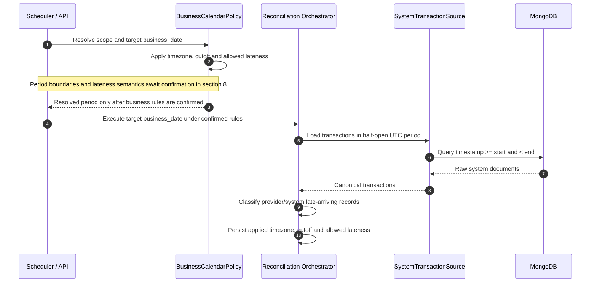

# F07 — Business calendar, cutoff và allowed lateness

## 1. Overview

| Item | Detail |
|---|---|
| Feature | Business calendar, cutoff và allowed lateness |
| Owner | `[TBD]` |
| Ticket | `[TBD]` |
| Status | `Draft — chờ xác nhận rule tại mục 8` |
| Purpose | Xác định đúng reconciliation period theo provider/tenant thay vì luôn dùng local midnight, đồng thời phân loại late-arriving transactions. |

## 2. Requirements

### Functional Requirements

- Resolve timezone, cutoff time và allowed lateness theo region/tenant/provider và business date.
- Tạo UTC start/end, cutoff instant và lateness boundary có xử lý DST đúng.
- Source query theo resolved business period thay vì hard-code midnight.
- Phân loại/lưu `late_arriving` cho provider/system records theo rule được duyệt.
- Persist timezone, cutoff và allowed lateness đã áp dụng để audit/replay deterministic.

### Non-Functional Requirements

- Policy phải versioned hoặc snapshot vào run; config thay đổi không được làm replay lịch sử đổi nghĩa.
- Dùng timezone database/IANA names.
- Không tự giả định ngày lễ, weekend hoặc provider settlement calendar.

## 3. Design

### Flow

### Processing

1. Policy registry resolve versioned calendar config cho run scope.
2. Calendar service tính aware local instants rồi convert UTC boundaries.
3. Orchestrator query/classify rows và persist applied policy + late flags.

### Components

| Component | Change |
|---|---|
| `BusinessCalendarPolicy` port | New. |
| Provider/tenant policy registry | New; source of truth `[TBD]`. |
| `SystemTransactionSource` | Change input từ `business_date` sang resolved period. |
| `ReconciliationCommand` / persistence | Add applied timezone/cutoff/lateness/version. |

## 4. API & Data

### API

| Method | Endpoint | Description |
|---|---|---|
| POST | `/reconciliation-runs` | Client có truyền policy override hay server tự resolve `[Need Confirm]`. |

### Request/Response

- Request tối thiểu vẫn có business date + scope.
- Response/query view nên expose applied timezone, cutoff, allowed lateness và policy version.

### Database

| Table / Collection | Change |
|---|---|
| `recon_run` | Các cột timezone/cutoff/lateness đã có; cần ghi giá trị thật và có thể thêm policy version. |
| `provider_txn.late_arriving` | Cột đã có, runtime hiện chưa set. |
| System late evidence | Schema/reference `[TBD]`. |

## 5. Error & Edge Cases

| Scenario | Expected Behavior |
|---|---|
| Happy path | Query/classify theo exact resolved business period. |
| Invalid input | Unknown timezone, negative lateness hoặc missing policy fail với stable error. |
| Duplicate request | Applied policy snapshot là một phần identity/replay decision `[Need Confirm]`. |
| Timeout / dependency error | Policy store unavailable phải fail run; fallback config chỉ dùng nếu được phê duyệt. |
| Retry / concurrent processing | Retry cùng run dùng policy snapshot ban đầu. |

## 6. Testing

| Test Case | Expected Result |
|---|---|
| Non-midnight cutoff | UTC boundaries đúng và không mất/nhân đôi row. |
| DST transition | Period được tính từ timezone-aware local instants. |
| Lateness boundary | Rows ngay trước/tại/sau boundary được phân loại rõ ràng. |
| Retry after config change | Vẫn dùng policy snapshot/version của run. |

## 7. Open Questions

| Question | Owner | Status |
|---|---|---|
| Cutoff/lateness rule của từng provider/tenant là gì? | Finance/Operations | `[Need Confirm]` |
| Boundary là inclusive hay exclusive? | Finance | `[Need Confirm]` |
| Có business holiday calendar hay chỉ calendar day? | Operations | `[Need Confirm]` |
| Late row được đưa vào run hiện tại, run kế tiếp hay report riêng? | Product/Finance | `[Need Confirm]` |

## 8. Câu hỏi cần xác nhận trước khi triển khai cutoff/allowed lateness

Phần này tạm để chờ xác nhận. Sequence diagram là luồng dự kiến sau khi có
rule; chưa triển khai logic chọn kỳ hoặc xử lý late-arriving theo giả định.

| Question | Owner | Status |
|---|---|---|
| `business_date` là ngày bắt đầu hay ngày kết thúc kỳ? Ví dụ cutoff 02:00 thì kỳ D là `[D 02:00, D+1 02:00)` hay `[D-1 02:00, D 02:00)`? | Technical Lead / Provider team | `[Need Confirm]` |
| Cutoff so sánh với timestamp nào: thời điểm tạo payment, provider ghi nhận hay thời điểm dữ liệu đến hệ thống? | Technical Lead / Provider team | `[Need Confirm]` |
| `allowed_lateness` dùng để chờ trước khi chốt, nhận bổ sung vào kỳ cũ hay xác định chuyển sang kỳ sau? Mốc bắt đầu tính là gì? | Technical Lead / Finance | `[Need Confirm]` |
| Payment có event time trước cutoff nhưng đến sau cutoff, còn trong allowed lateness, được đưa vào kỳ nào? | Finance / Provider team | `[Need Confirm]` |
Technical Lead / Finance | `[Need Confirm]` |
