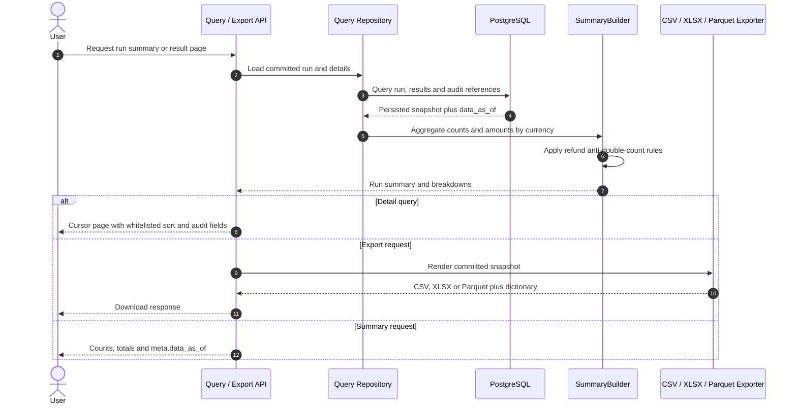

# F08 — Reconciliation summary, report, export và query API

## 1. Overview

| Item | Detail |
|---|---|
| Feature | Reconciliation summary, report, export và query API |
| Owner | `[TBD]` |
| Ticket | `[TBD]` |
| Status | `Designed` |
| Purpose | Cho phép đọc trạng thái/audit results, tổng hợp tiền đúng theo currency và tải report reconciliation. |

## 2. Requirements

### Functional Requirements

- Tính counts theo result type và monetary totals riêng từng currency, gồm system amount, provider amount và delta.
- Summary cần có `system_count`, `provider_count`
  và breakdown theo `region`, `tenant_id`, `provider`, `txn_type`, `result`.
  Transaction count không được thay bằng amount count vì transaction thiếu/invalid
  amount vẫn cần được thống kê.
- Tỷ lệ transaction đã refund lấy từ status/counter trên transaction gốc,
  tách biệt với refund volume/amount lấy từ refund document. Phạm vi parent và
  mẫu số của tỷ lệ cần xác nhận trước khi triển khai.
- Không coerce invalid/missing amount thành 0 và không cộng chéo currency.
- `delta_amount_minor` của summary là system total trừ provider total trong
  cùng currency, gồm cả giao dịch missing và hai phía của currency mismatch.
  Delta chi tiết từng cặp giữ nguyên. Nếu một currency chỉ có record ở một phía,
  phía không có record đóng góp tổng rỗng bằng 0 khi tính delta; amount hiển thị
  của phía đó vẫn là `null`. Nếu có record mang currency đó nhưng amount thiếu,
  delta summary trả `null`; totals chỉ cộng amount có giá trị. Record không có
  currency không thể phân bổ vào currency total và vẫn được thống kê theo result.
- Result `DUPLICATE` vẫn được đếm trong classification và giữ lại cho audit,
  nhưng không tham gia monetary totals, refund volume/amount hoặc refund
  cross-check. Summary chỉ tính tiền từ bản chính sau dedupe.
- Refund volume và refund amount lấy từ refund document thành công; không cộng
  `refunded_amount_minor` trên payment gốc vào monetary total.
- VN liên kết refund child với payment gốc bằng `refund_of = system txn_id` và
  tính tổng refund child thành công. India liên kết bằng provider transaction ID
  của payment gốc và cross-check tổng refund child thành công với
  `refunded_amount_minor` trên parent.
- Query run metadata và summary theo `run_id`.
- Query result details có result filter và cursor pagination ổn định.
- Persist/expose validation report và audit references an toàn.
- Export CSV/XLSX có source file/row và đầy đủ evidence hai phía.
- Export Parquet kèm data dictionary và kiểm tra được bằng DuckDB.
- Mọi response dữ liệu có `meta.data_as_of`; sort field dùng whitelist.

### Non-Functional Requirements

- Report totals phải tái tạo được từ persisted run snapshot.
- Pagination có stable ordering và giới hạn page size.
- Authorization, masking và retention `[Need Confirm]`.

## 3. Design

### Flow

### Processing

1. Summary builder aggregate detailed results theo currency/result type. Refund
   monetary volume lấy từ refund child thành công; parent refund counter chỉ dùng
   làm evidence cross-check để tránh double-count.
2. Persist summary snapshot hoặc tái tạo deterministic từ committed details; render CSV/XLSX/Parquet.
3. Query repository đọc run, cursor-paginated details và validation/audit references với `data_as_of`.

### Components

| Component | Change |
|---|---|
| `SummaryBuilder` | New: monetary aggregation và refund policy. |
| Query repository | New: run view và paginated result filters. |
| Report/export port | New: CSV, XLSX và Parquet cùng data dictionary. |
| FastAPI query routes | New. |
| Validation issue persistence | New schema/model `[TBD]`. |

## 4. API & Data

### API

| Method | Endpoint | Description |
|---|---|---|
| GET | `/recon/runs` | Danh sách run theo contract/filter `[TBD]`. |
| GET | `/recon/runs/{run_id}/summary` | Run status, scope, counts và totals. |
| GET | `/recon/runs/{run_id}/results` | Filtered/paginated detailed results. |
| GET | `/recon/runs/{run_id}/report` | Xuất/tải CSV hoặc XLSX `[TBD]`. |
| GET | `/recon/runs/{run_id}/export.parquet` | Export Parquet `[TBD]`. |
| GET | `/recon/runs/{run_id}/validation-issues` | Optional validation report endpoint `[Need Confirm]`. |

### Request/Response

- Result filter tối thiểu hỗ trợ `result`, ví dụ `AMOUNT_MISMATCH`; các filter khác `[TBD]`.
- Cursor pagination có stable ordering; sort chỉ nhận field trong whitelist.
- Money trả bằng minor unit + currency, không trả float.
- Summary trả `refunds_by_currency` từ refund child thành công và
  `refund_cross_checks`. Cross-check có trạng thái `LINKED` cho VN;
  `MATCHED`/`AMOUNT_MISMATCH` cho India; hoặc trạng thái evidence thiếu/sai
  gồm `MISSING_PARENT_REFERENCE`, `PARENT_NOT_IN_SNAPSHOT`,
  `PARENT_TOTAL_UNAVAILABLE`, `CURRENCY_MISMATCH`.
- Response có `meta.data_as_of`.

### Các trường summary cần bổ sung — đề xuất để review

Các trường dưới đây bổ sung contract theo mục 5.7 tài liệu gốc; chưa được
implement trong `ResultSummary`. Tên field và chính sách đếm là đề xuất để review.

| Field | Ý nghĩa / quy tắc |
|---|---|
| `system_count` | Số record phía system trong phạm vi run; không phụ thuộc amount có hợp lệ hay không. Cần thống nhất cách thể hiện raw count và unique count khi có duplicate. |
| `provider_count` | Số record phía provider trong phạm vi run; phân biệt với số result rows và số cặp matched. Cần thống nhất raw count/unique count như phía system. |
| `breakdowns[]` | Mỗi nhóm mang `region`, `tenant_id`, `provider`, `txn_type`, `result`; có counts hai phía và `totals_by_currency`. Dù run chỉ có một scope vẫn cần breakdown theo transaction type/result. |
| `refund_parent_metrics.eligible_parent_count` | Mẫu số: số transaction gốc thuộc phạm vi tính tỷ lệ refund; tập txn_type/status đủ điều kiện `[Need Confirm]`. Không tính refund child vào mẫu số. |
| `refund_parent_metrics.refunded_parent_count` | Tử số: số parent đã refund theo status/counter, mỗi parent chỉ đếm một lần. Quy tắc xử lý status/counter mâu thuẫn `[Need Confirm]`. |
| `refund_parent_metrics.refunded_transaction_rate` | `refunded_parent_count / eligible_parent_count`; trả `null` khi mẫu số bằng 0. Biểu diễn tỷ lệ và độ chính xác `[Need Confirm]`; không suy tỷ lệ từ số refund child. |

### Giả định hiện tại — India refund cross-check

- Implementation hiện chỉ đọc parent và refund children trong persisted snapshot
  của cùng run; không truy vấn lịch sử refund qua nhiều business date.
- Child total là tổng amount có giá trị của child có status `SUCCESS`, `REFUNDED`
  hoặc `PARTIAL_REFUNDED`. Khi không có child thỏa điều kiện, total là `None`.
- Khi tìm thấy parent cùng currency và có `refunded_amount_minor`, code so sánh
  counter này trực tiếp với child total: bằng nhau trả `MATCHED`, khác nhau trả
  `AMOUNT_MISMATCH`. Parent counter chỉ là evidence, không cộng vào monetary total.
- Cách so sánh hiện tại giả định snapshot chứa đủ child liên quan và counter parent
  phản ánh cùng thời điểm. Code chưa xác minh được giả định đó. Nếu counter tích
  lũy gồm refund ngoài run hoặc thiếu child amount, `AMOUNT_MISMATCH` có thể phản
  ánh thiếu evidence thay vì sai lệch tiền thực tế; `MATCHED` cũng chưa chứng minh
  lịch sử refund đầy đủ.
- Giữ nguyên implementation để review; đây là giả định tạm thời, chưa phải rule
  production đã được xác nhận.

### Database

| Table / Collection | Change |
|---|---|
| Run summary/totals | New normalized table hoặc JSONB snapshot `[Need Confirm]`. |
| `recon_result` | Dùng cho filtered pagination; lưu thêm system provider ID/status, `refund_of` và `refunded_amount_minor` để tái tạo refund summary/cross-check. |
| Validation issues | New table `[TBD]`. |
| Export artifact metadata | Chỉ thêm nếu report được lưu thay vì sinh theo request `[Need Confirm]`. |

## 5. Error & Edge Cases

| Scenario | Expected Behavior |
|---|---|
| Happy path | Summary khớp details; CSV/XLSX/Parquet nhất quán. |
| Invalid input | Invalid filter/cursor trả 422; unknown/unauthorized run trả status theo security policy. |
| Duplicate request | Repeated GET không thay đổi dữ liệu; report build phải idempotent theo run/version. |
| Timeout / dependency error | Query/export error trả stable code, không trả file thiếu. |
| Retry / concurrent processing | Query RUNNING/FAILED trả partial metadata, không expose uncommitted details. |

## 6. Testing

| Test Case | Expected Result |
|---|---|
| Multi-currency totals | Không cộng chéo currency; amounts/delta đúng. |
| Total delta với missing/currency mismatch | Chênh lệch tổng gồm amount không có counterpart và phân bổ mỗi phía currency mismatch về đúng currency. |
| Duplicate trong summary | Giữ duplicate count; không cộng lại amount hoặc refund child, không dùng duplicate parent cho cross-check. |
| Missing/invalid amounts | Không biến null thành zero. |
| System/provider counts | Đếm riêng hai phía, gồm record thiếu/invalid amount; kiểm tra matched pair, system-only, provider-only và duplicate theo chính sách count được chốt. |
| Dimension breakdowns | Có đủ region, tenant, provider, txn_type và result; totals trong mỗi nhóm vẫn tách theo currency. |
| Refunded transaction rate | Nhiều refund child của cùng parent không tăng tử số; dùng status/counter parent, không dùng child count; mẫu số 0 trả null. |
| Refund scenarios | Refund amount lấy từ child thành công; parent counter không được cộng lại; VN kiểm tra liên kết parent và India so sánh parent counter với tổng child. |
| Pagination/filter | Không thiếu/trùng rows giữa pages, stable ordering. |
| Report parity | CSV/XLSX/Parquet totals và details bằng persisted query view. |
| Cursor/sort safety | Không thiếu/trùng page; sort field ngoài whitelist bị reject. |
| Data dictionary | Mô tả đúng schema Parquet và query được bằng DuckDB. |
| Masking/authorization | Sensitive fields không lộ cho caller không đủ quyền. |

## 7. Open Questions

| Question | Owner | Status |
|---|---|---|
| Columns/order/locale chính thức của CSV/XLSX là gì? | Operations | `[Need Confirm]` |
| System/provider counts cần raw count, unique count hay cả hai khi có duplicate? | Product/Finance | `[Need Confirm]` |
| Tỷ lệ transaction đã refund áp dụng cho tập parent nào, mẫu số gồm txn_type/status nào và xử lý status/counter mâu thuẫn thế nào? | Product/Finance | `[Need Confirm]` |
| Cross-check refund của India có cần lấy toàn bộ refund children thành công qua nhiều business date để so với counter tích lũy `amountRefunded` trên payment gốc, hay chỉ kiểm tra dữ liệu trong run hàng ngày? Nếu cần dữ liệu nhiều ngày, phạm vi lịch sử và thời điểm chốt parent/children là gì; khi thiếu parent hoặc children thì report thể hiện chưa đủ dữ liệu như thế nào? | Product/Finance | `[Need Confirm]` |

---
