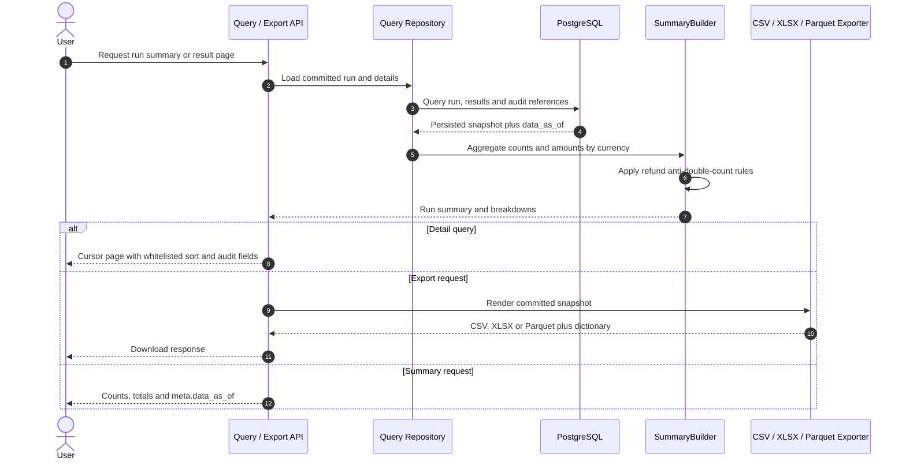

# F08 — Reconciliation summary, report, export và query API

## 1. Overview

| Item | Detail |
|---|---|
| Feature | Reconciliation summary, report, export và query API |
| Owner | `[TBD]` |
| Ticket | `[TBD]` |
| Status | `Designed` |
| Purpose | Cho phép đọc trạng thái/audit results, tổng hợp tiền đúng theo currency và tải report reconciliation. |

## 2. Requirements

### Functional Requirements

- Tính counts theo result type và monetary totals riêng từng currency, gồm system amount, provider amount và delta.
- Không coerce invalid/missing amount thành 0 và không cộng chéo currency.
- Áp dụng refund anti-double-count cho VN/India và cross-check refund relationships theo rule được duyệt.
- Query run metadata và summary theo `run_id`.
- Query result details có result filter và cursor pagination ổn định.
- Persist/expose validation report và audit references an toàn.
- Export CSV/XLSX có source file/row và đầy đủ evidence hai phía.
- Export Parquet kèm data dictionary và kiểm tra được bằng DuckDB.
- Mọi response dữ liệu có `meta.data_as_of`; sort field dùng whitelist.

### Non-Functional Requirements

- Report totals phải tái tạo được từ persisted run snapshot.
- Pagination có stable ordering và giới hạn page size.
- Authorization, masking và retention `[Need Confirm]`.

## 3. Design

### Flow

### Processing

1. Summary builder aggregate detailed results theo currency/result type và refund rules.
2. Persist summary snapshot hoặc tái tạo deterministic từ committed details; render CSV/XLSX/Parquet.
3. Query repository đọc run, cursor-paginated details và validation/audit references với `data_as_of`.

### Components

| Component | Change |
|---|---|
| `SummaryBuilder` | New: monetary aggregation và refund policy. |
| Query repository | New: run view và paginated result filters. |
| Report/export port | New: CSV, XLSX và Parquet cùng data dictionary. |
| FastAPI query routes | New. |
| Validation issue persistence | New schema/model `[TBD]`. |

## 4. API & Data

### API

| Method | Endpoint | Description |
|---|---|---|
| GET | `/recon/runs` | Danh sách run theo contract/filter `[TBD]`. |
| GET | `/recon/runs/{run_id}/summary` | Run status, scope, counts và totals. |
| GET | `/recon/runs/{run_id}/results` | Filtered/paginated detailed results. |
| GET | `/recon/runs/{run_id}/report` | Xuất/tải CSV hoặc XLSX `[TBD]`. |
| GET | `/recon/runs/{run_id}/export.parquet` | Export Parquet `[TBD]`. |
| GET | `/recon/runs/{run_id}/validation-issues` | Optional validation report endpoint `[Need Confirm]`. |

### Request/Response

- Result filter tối thiểu hỗ trợ `result`, ví dụ `AMOUNT_MISMATCH`; các filter khác `[TBD]`.
- Cursor pagination có stable ordering; sort chỉ nhận field trong whitelist.
- Money trả bằng minor unit + currency, không trả float.
- Response có `meta.data_as_of`.

### Database

| Table / Collection | Change |
|---|---|
| Run summary/totals | New normalized table hoặc JSONB snapshot `[Need Confirm]`. |
| `recon_result` | Dùng cho filtered pagination; indexes cần review theo query patterns. |
| Validation issues | New table `[TBD]`. |
| Export artifact metadata | Chỉ thêm nếu report được lưu thay vì sinh theo request `[Need Confirm]`. |

## 5. Error & Edge Cases

| Scenario | Expected Behavior |
|---|---|
| Happy path | Summary khớp details; CSV/XLSX/Parquet nhất quán. |
| Invalid input | Invalid filter/cursor trả 422; unknown/unauthorized run trả status theo security policy. |
| Duplicate request | Repeated GET không thay đổi dữ liệu; report build phải idempotent theo run/version. |
| Timeout / dependency error | Query/export error trả stable code, không trả file thiếu. |
| Retry / concurrent processing | Query RUNNING/FAILED trả partial metadata, không expose uncommitted details. |

## 6. Testing

| Test Case | Expected Result |
|---|---|
| Multi-currency totals | Không cộng chéo currency; amounts/delta đúng. |
| Missing/invalid amounts | Không biến null thành zero. |
| Refund scenarios | Không double-count theo approved regional rules. |
| Pagination/filter | Không thiếu/trùng rows giữa pages, stable ordering. |
| Report parity | CSV/XLSX/Parquet totals và details bằng persisted query view. |
| Cursor/sort safety | Không thiếu/trùng page; sort field ngoài whitelist bị reject. |
| Data dictionary | Mô tả đúng schema Parquet và query được bằng DuckDB. |
| Masking/authorization | Sensitive fields không lộ cho caller không đủ quyền. |

## 7. Open Questions

| Question | Owner | Status |
|---|---|---|
| Columns/order/locale chính thức của CSV/XLSX là gì? | Operations | `[Need Confirm]` |
| Query authorization và masking rules là gì? | Security/Product | `[Need Confirm]` |

---
