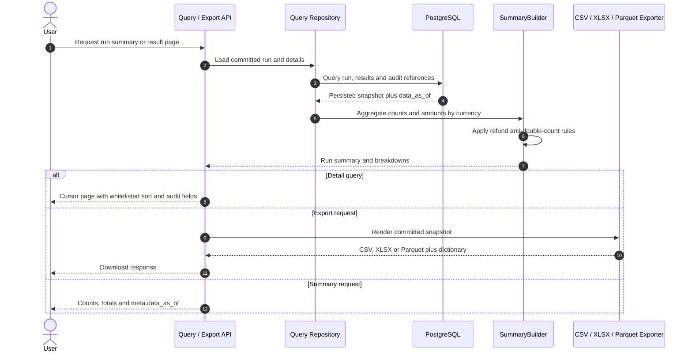

# F08 — Reconciliation summary, report, export và query API

## 1. Overview

| Item | Detail |
|---|---|
| Feature | Reconciliation summary, report, export và query API |
| Owner | `[TBD]` |
| Ticket | `[TBD]` |
| Status | `Partially implemented`: POST summary, GET query và CSV/XLSX/Parquet export đã có; validation issue persistence còn thiết kế. |
| Purpose | Cho phép đọc trạng thái/audit results, tổng hợp tiền đúng theo currency và tải report reconciliation. |

## 2. Requirements

### Functional Requirements

- Tính counts theo result type và monetary totals riêng từng currency, gồm system amount, provider amount và delta.
- Summary cần có `system_count`, `provider_count`
  và breakdown theo `region`, `tenant_id`, `provider`, `txn_type`, `result`.
  Transaction count không được thay bằng amount count vì transaction thiếu/invalid
  amount vẫn cần được thống kê.
- Tỷ lệ transaction đã refund lấy từ status/counter trên transaction gốc,
  tách biệt với refund volume/amount lấy từ refund document. Phạm vi parent và
  mẫu số của tỷ lệ đang dùng quy ước tạm thời bên dưới, cần xác nhận cho production.
- Không coerce invalid/missing amount thành 0 và không cộng chéo currency.
- `delta_amount_minor` của summary là system total trừ provider total trong
  cùng currency, gồm cả giao dịch missing và hai phía của currency mismatch.
  Delta chi tiết từng cặp giữ nguyên. Nếu một currency chỉ có record ở một phía,
  phía không có record đóng góp tổng rỗng bằng 0 khi tính delta; amount hiển thị
  của phía đó vẫn là `null`. Nếu có record mang currency đó nhưng amount thiếu,
  delta summary trả `null`; totals chỉ cộng amount có giá trị. Record không có
  currency không thể phân bổ vào currency total: tăng `unallocated_currency_count`
  và trả `null` cho mọi delta currency trong run vì chưa biết currency nào bị ảnh hưởng.
- Result `DUPLICATE` vẫn được đếm trong classification và giữ lại cho audit,
  nhưng không tham gia monetary totals, refund volume/amount hoặc refund
  cross-check. Summary chỉ tính tiền từ bản chính sau dedupe.
- `NOT_RECONCILABLE` cũng bị loại khỏi financial summary. Totals là tổng amount
  hợp lệ của records còn lại ở mỗi phía (mọi status), không phải net settlement.
  `INVALID_DATA` phía system không đóng góp amount, kể cả khi có số tiền.
- Refund volume và refund amount lấy từ refund document thành công; không cộng
  `refunded_amount_minor` trên payment gốc vào monetary total.
- VN liên kết refund child với payment gốc bằng `refund_of = system txn_id` và
  tính tổng refund child thành công. India liên kết bằng provider transaction ID
  của payment gốc và cross-check tổng refund child thành công với
  `refunded_amount_minor` trên parent.
- Query run metadata và summary theo `run_id`.
- Query result details có result filter và cursor pagination ổn định.
- Persist/expose validation report và audit references an toàn.
- Export CSV/XLSX có source file/row và đầy đủ evidence hai phía.
- Export Parquet kèm data dictionary và kiểm tra được bằng DuckDB.
- Mọi response dữ liệu có `meta.data_as_of`; sort field dùng whitelist.

### Non-Functional Requirements

- Report totals phải tái tạo được từ persisted run snapshot.
- Pagination có stable ordering và giới hạn page size.
- Authorization, masking và retention `[Need Confirm]`.

## 3. Design

### Flow

### Processing

1. Summary builder aggregate detailed results theo currency/result type. Refund
   monetary volume lấy từ refund child thành công; parent refund counter chỉ dùng
   làm evidence cross-check để tránh double-count.
2. Persist summary snapshot hoặc tái tạo deterministic từ committed details; render CSV/XLSX/Parquet.
3. Query repository đọc run, cursor-paginated details và validation/audit references với `data_as_of`.

### Components

| Component | Change |
|---|---|
| `SummaryBuilder` | New: monetary aggregation và refund policy. |
| Query repository | New: run view và paginated result filters. |
| Report/export port | New: CSV, XLSX và Parquet cùng data dictionary. |
| FastAPI query routes | New. |
| Validation issue persistence | New schema/model `[TBD]`. |

## 4. API & Data

### API

| Method | Endpoint | Description |
|---|---|---|
| POST | `/reconciliation-runs` | Đã có: trả counts cũ và `financial_summary`, gồm totals, tỷ lệ parent refund và cross-check. |
| GET | `/reconciliation-runs` | Danh sách run có filter và cursor; xem mục 8. |
| GET | `/reconciliation-runs/{run_id}/summary` | Run status, scope, counts và totals. |
| GET | `/reconciliation-runs/{run_id}/results` | Filtered/paginated detailed results. |
| GET | `/reconciliation-runs/{run_id}/report` | Xuất/tải CSV, XLSX hoặc Parquet. |
| GET | `/reconciliation-runs/{run_id}/report?format=parquet` | Export Parquet có data dictionary. |
| GET | `/reconciliation-runs/{run_id}/validation-issues` | Optional validation report endpoint `[Need Confirm]`. |

### Request/Response

POST đã trả `breakdowns` và `refunds_by_currency` trong `financial_summary`.
GET query, exports và metadata đã implement theo contract bên dưới.

- Result filter tối thiểu hỗ trợ `result`, ví dụ `AMOUNT_MISMATCH`; các filter khác `[TBD]`.
- Cursor pagination có stable ordering; sort chỉ nhận field trong whitelist.
- Money trả bằng minor unit + currency, không trả float.
- Summary trả `refunds_by_currency` từ refund child thành công và
  `refund_cross_checks`. Cross-check có trạng thái `LINKED` cho VN;
  `MATCHED`/`AMOUNT_MISMATCH` cho India; hoặc trạng thái evidence thiếu/sai
  gồm `MISSING_PARENT_REFERENCE`, `PARENT_NOT_IN_SNAPSHOT`,
  `PARENT_TOTAL_UNAVAILABLE`, `CURRENCY_MISMATCH`.
- Response có `meta.data_as_of`.

### Financial summary đã implement

`POST /reconciliation-runs` giữ `summary` là counts theo classification và bổ sung
`financial_summary` với các nhóm số liệu bên dưới. `build_financial_summary` tính từ
`ReconResult`; rerun dùng cùng hàm trên persisted results, không đọc lại nguồn.

| Field | Cách tính |
|---|---|
| `totals_by_currency[]` | Theo từng currency: tổng amount hợp lệ hai phía, delta tổng, `system_amount_count`/`provider_amount_count` và `system_missing_amount_count`/`provider_missing_amount_count`. Total là tổng phần biết được; dùng missing counts để nhận biết total chưa đầy đủ. Không có amount hợp lệ thì total là `null`. |
| `unallocated_currency_count` | Số record phía system/provider không có currency để phân bổ; không gán currency mặc định. |
| `refund_parent_metrics` | Count parent đủ điều kiện, count parent đã refund, count thiếu evidence và tỷ lệ theo quy ước bên dưới. |
| `refund_cross_checks[]` | Region, tenant, provider, parent reference, currency, count/amount child thành công, counter parent và trạng thái so sánh. Chỉ VN/India. |

`refunds_by_currency[]` đã implement với `currency`, `count`, `amount_minor`,
`missing_amount_count`. Chỉ lấy system refund child có status `SUCCESS`,
`REFUNDED` hoặc `PARTIAL_REFUNDED`, sau khi loại `DUPLICATE` và
`NOT_RECONCILABLE`; áp dụng cả VN, Asia và India. Không dựa vào provider status
vì persisted result hiện chưa có evidence này. Counter parent không được cộng.
Count gồm cả child thành công thiếu/invalid amount; amount chỉ cộng phần hợp lệ,
không có amount hợp lệ thì trả `null`. `missing_amount_count` đếm child thiếu
amount hoặc có result `INVALID_DATA`. Currency thiếu được giữ trong nhóm
`currency=null`, có count nhưng `amount_minor=null`, không gán currency mặc định.

`breakdowns[]` nhóm theo `(region, tenant_id, provider, txn_type, result)`;
`txn_type` thiếu được giữ là `null`. Mỗi nhóm có `system_count`, `provider_count`,
`totals_by_currency` và `unallocated_currency_count`, dùng cùng quy tắc tiền như
summary toàn run. Thứ tự nhóm/currency ổn định, không phụ thuộc thứ tự input.
Cả hai trường mới được tái tạo từ persisted results khi replay.

Quy ước tạm thời cho tỷ lệ parent đã refund:

- Mẫu số là mọi system `PAYMENT`/`LOAD` trong snapshot sau loại `DUPLICATE` và
  `NOT_RECONCILABLE`, gồm cả failed/pending; không gồm refund child.
- Tử số là parent có status `REFUNDED`/`PARTIAL_REFUNDED` **hoặc** counter
  `refunded_amount_minor > 0`. Mỗi parent chỉ đếm một lần dù có nhiều child.
  Nếu status/counter mâu thuẫn, rule OR vẫn áp dụng; chưa có metric riêng cho mâu thuẫn.
- Rate = tử số / mẫu số, trong khoảng 0–1, trả chuỗi thập phân 6 chữ số,
  ví dụ `"0.500000"` nghĩa là 50%; tính bằng Decimal, không dùng float.
- Mẫu số 0 hoặc có parent thiếu status/`UNKNOWN` mà không có evidence refund
  dương thì rate `null`; trường hợp sau tăng `missing_evidence_count`.
  Runs cũ không có refund evidence không được tự coi là chưa refund.

### Counts và breakdown

Các trường dưới đây bổ sung contract theo mục 5.7 tài liệu gốc. Counts hiện có
ở `system_rows`/`provider_rows` trước dedupe. Breakdown đã implement; count trong
mỗi nhóm đếm result record có `system_txn_id` / `source_row_number` tương ứng,
không phải unique transaction count và không phụ thuộc amount. Nhóm duplicate
và not-reconcilable vẫn có counts nhưng không có monetary totals.

| Field | Ý nghĩa / quy tắc |
|---|---|
| `system_count` | Số record phía system trong phạm vi run; không phụ thuộc amount có hợp lệ hay không. Cần thống nhất cách thể hiện raw count và unique count khi có duplicate. |
| `provider_count` | Số record phía provider trong phạm vi run; phân biệt với số result rows và số cặp matched. Cần thống nhất raw count/unique count như phía system. |
| `breakdowns[]` | Đã implement. Mỗi nhóm mang `region`, `tenant_id`, `provider`, `txn_type`, `result`; có counts hai phía và `totals_by_currency`. Dù run chỉ có một scope vẫn cần breakdown theo transaction type/result. |

### Giả định hiện tại — India refund cross-check

- Implementation hiện chỉ đọc parent và refund children trong persisted snapshot
  của cùng run; không truy vấn lịch sử refund qua nhiều business date.
- Child total là tổng amount của child có status `SUCCESS`, `REFUNDED` hoặc
  `PARTIAL_REFUNDED`, loại duplicate. Child thành công thiếu/invalid amount hoặc
  child thiếu status/`UNKNOWN` trả `INCOMPLETE_CHILD_DATA` và total `null`.
  Nếu có children với status đã biết nhưng không child nào thành công, tổng là 0.
- Parent đã refund nhưng không có children trong snapshot trả
  `CHILDREN_NOT_IN_SNAPSHOT`; thiếu currency trả `MISSING_CURRENCY`; nhiều parent
  cùng reference trả `AMBIGUOUS_PARENT`. Liên kết được giới hạn theo region,
  tenant và provider, sau đó kiểm tra currency. VN trả `LINKED` theo internal ID;
  India liên kết bằng provider transaction ID của parent.
- Khi tìm thấy parent cùng currency và có `refunded_amount_minor`, code so sánh
  counter này trực tiếp với child total: bằng nhau trả `MATCHED`, khác nhau trả
  `AMOUNT_MISMATCH`. Parent counter chỉ là evidence, không cộng vào monetary total.
- Cách so sánh hiện tại giả định snapshot chứa đủ child liên quan và counter parent
  phản ánh cùng thời điểm. Code chưa xác minh được giả định đó. Nếu counter tích
  lũy gồm refund ngoài run, `AMOUNT_MISMATCH` có thể phản
  ánh thiếu evidence thay vì sai lệch tiền thực tế; `MATCHED` cũng chưa chứng minh
  lịch sử refund đầy đủ.
- Giữ nguyên implementation để review; đây là giả định tạm thời, chưa phải rule
  production đã được xác nhận.

### Database

| Table / Collection | Change |
|---|---|
| Run summary/totals | Financial summary tái tạo từ persisted `recon_result`; classification counts vẫn ở `job_run_log.metrics`. |
| `recon_result` | Dùng cho filtered pagination; lưu thêm system provider ID/status, `refund_of` và `refunded_amount_minor` để tái tạo refund summary/cross-check. |
| Validation issues | New table `[TBD]`. |
| Export artifact metadata | Chỉ thêm nếu report được lưu thay vì sinh theo request `[Need Confirm]`. |

Migration `0006` thêm bốn field refund evidence mà repository đọc/ghi. Chạy
`alembic upgrade head` trước API phiên bản này. Runs cũ giữ evidence `null`;
migration không backfill từ dữ liệu hiện tại vì sẽ thay đổi snapshot lịch sử.

## 5. Error & Edge Cases

| Scenario | Expected Behavior |
|---|---|
| Happy path | Summary khớp details; CSV/XLSX/Parquet nhất quán. |
| Invalid input | Invalid filter/cursor trả 422; unknown/unauthorized run trả status theo security policy. |
| Duplicate request | Repeated GET không thay đổi dữ liệu; report build phải idempotent theo run/version. |
| Timeout / dependency error | Query/export error trả stable code, không trả file thiếu. |
| Retry / concurrent processing | Query RUNNING/FAILED trả partial metadata, không expose uncommitted details. |

## 6. Testing

| Test Case | Expected Result |
|---|---|
| Multi-currency totals | Không cộng chéo currency; amounts/delta đúng. |
| Total delta với missing/currency mismatch | Chênh lệch tổng gồm amount không có counterpart và phân bổ mỗi phía currency mismatch về đúng currency. |
| Duplicate trong summary | Giữ duplicate count; không cộng lại amount hoặc refund child, không dùng duplicate parent cho cross-check. |
| Missing/invalid amounts | Không biến null thành zero. |
| System/provider counts | Đếm riêng hai phía, gồm record thiếu/invalid amount; kiểm tra matched pair, system-only, provider-only và duplicate theo chính sách count được chốt. |
| Dimension breakdowns | Có đủ region, tenant, provider, txn_type và result; totals trong mỗi nhóm vẫn tách theo currency. |
| Refunded transaction rate | Nhiều refund child của cùng parent không tăng tử số; dùng status/counter parent, không dùng child count; mẫu số 0 trả null. |
| Refund scenarios | Refund amount lấy từ child thành công; parent counter không được cộng lại; VN kiểm tra liên kết parent và India so sánh parent counter với tổng child. |
| Pagination/filter | Không thiếu/trùng rows giữa pages, stable ordering. |
| Report parity | CSV/XLSX/Parquet totals và details bằng persisted query view. |
| Cursor/sort safety | Không thiếu/trùng page; sort field ngoài whitelist bị reject. |
| Data dictionary | Mô tả đúng schema Parquet và query được bằng DuckDB. |
| Masking/authorization | Sensitive fields không lộ cho caller không đủ quyền. |

## 7. Open Questions

| Question | Owner | Status |
|---|---|---|
| Columns/order/locale chính thức của CSV/XLSX là gì? | Operations | `[Need Confirm]` |
| System/provider counts cần raw count, unique count hay cả hai khi có duplicate? | Product/Finance | `[Need Confirm]` |
| Tỷ lệ transaction đã refund áp dụng cho tập parent nào, mẫu số gồm txn_type/status nào và xử lý status/counter mâu thuẫn thế nào? | Product/Finance | `[Need Confirm]` |
| Cross-check refund của India có cần lấy toàn bộ refund children thành công qua nhiều business date để so với counter tích lũy `amountRefunded` trên payment gốc, hay chỉ kiểm tra dữ liệu trong run hàng ngày? Nếu cần dữ liệu nhiều ngày, phạm vi lịch sử và thời điểm chốt parent/children là gì; khi thiếu parent hoặc children thì report thể hiện chưa đủ dữ liệu như thế nào? | Product/Finance | `[Need Confirm]` |

---

## 8. Query/export API đã triển khai

- `GET /reconciliation-runs`: filter `region`, `tenant_id`, `provider`, `business_date`,
  `status` (`RUNNING`, `FAILED`, `COMPLETED`); `limit` mặc định 50, tối đa 200;
  `cursor`; whitelist sort hiện chỉ có `run_id` tăng dần.
- `GET /reconciliation-runs/{run_id}/summary`: metadata run, `system_count`,
  `provider_count` (counts đầu vào đã lưu), classification summary và financial summary.
- `GET /reconciliation-runs/{run_id}/results`: filter `result`, `limit`, `cursor`;
  whitelist sort chỉ có `result_key` tăng dần. Mỗi item có result key và evidence
  từ persisted result, không có raw payload. Cursor ràng buộc với run/filter/sort;
  cursor sai hoặc dùng sai query trả 422.
- `GET /reconciliation-runs/{run_id}/report?format=csv|xlsx|parquet`: mặc định CSV UTF-8 BOM;
  XLSX lưu tiền dưới dạng text để bảo toàn integer lớn. Chuỗi CSV có thể được
  spreadsheet hiểu thành công thức được escape bằng dấu nháy đơn.
- `GET /reconciliation-runs/{run_id}/report?format=parquet`: monetary fields là decimal128(38,0),
  giữ null và currency từng phía; schema metadata có `data_dictionary`, `data_as_of`.
  Test dùng DuckDB để kiểm tra count và tổng tiền.

JSON GET có `meta.data_as_of`: summary/results dùng `finished_at` của snapshot
hoàn tất; metadata run chưa hoàn tất dùng `started_at`; danh sách run dùng thời
điểm đọc. POST dùng thời điểm tạo response. Downloads có header `X-Data-As-Of`,
XLSX có sheet Metadata, Parquet có schema metadata tương ứng.

Run không tồn tại trả 404. RUNNING/FAILED trả summary metadata với counts và
financial summary null; results/export trả 409. Snapshot metadata/results đọc
trong transaction repeatable-read, không query lại MongoDB.

Giới hạn hiện tại: phân trang thực hiện trong bộ nhớ sau khi đọc dữ liệu;
export cũng tạo toàn bộ file trong bộ nhớ. Danh sách run là dữ liệu sống giữa
các request; cursor không đóng băng tập run khi có run mới. Authorization/masking
chi tiết vẫn chờ policy chung. Endpoint validation-issues và persistence cho
validation issues chưa triển khai (endpoint optional trong contract).
