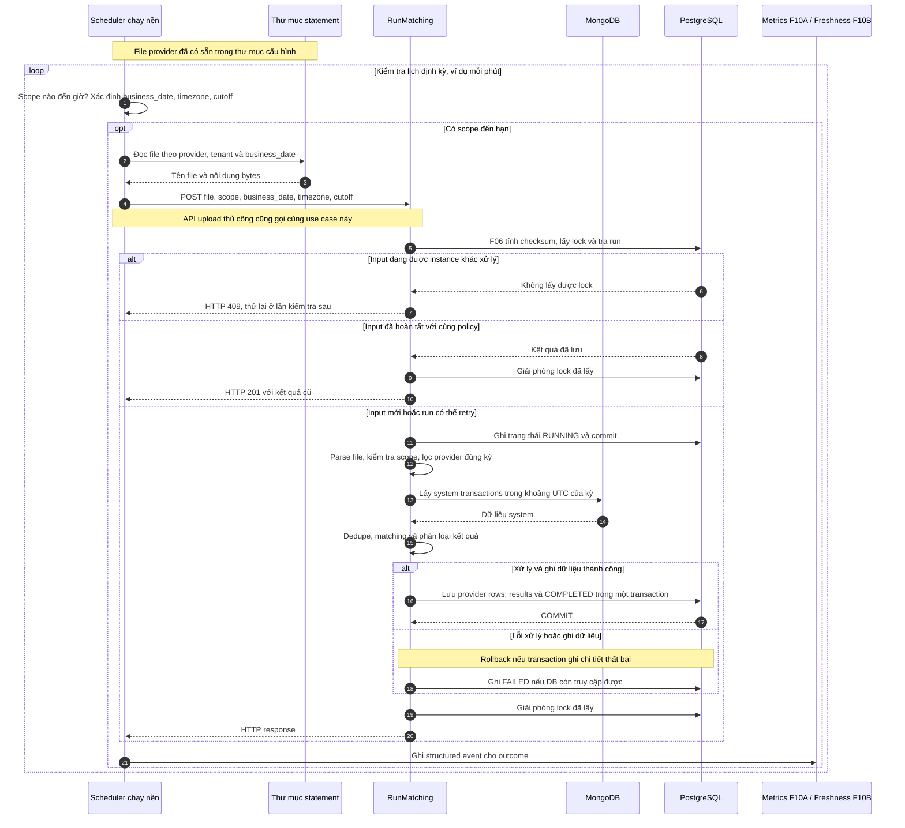

# F09 — Daily scheduling và operational safety

## 1. Overview

| Item | Detail |
|---|---|
| Feature | Daily scheduling và operational safety |
| Owner | `[TBD]` |
| Ticket | `[TBD]` |
| Status | `Partially implemented — filesystem scheduler có; HA/watchdog/timeout policy còn TBD` |
| Purpose | Chạy đối soát hằng ngày đúng scope/business period, không chạy trùng khi có nhiều instance và fail nhanh khi dependency chậm. |

## 2. Requirements

### Functional Requirements

- Kích hoạt daily reconciliation job cho từng provider/tenant.
- Scheduled job dùng cùng application command với manual API.
- Nhiều instance không được đồng thời sở hữu cùng một job/input.
- Job đến giờ nhưng không chạy phải tạo tín hiệu cho freshness watchdog ở F10B; alert delivery dùng F10A.
- Graceful shutdown không để job hoàn tất giả hoặc tạo kết quả một phần.
- Database chậm phải timeout, không giữ request/job vô hạn.

### Non-Functional Requirements

- Tối thiểu hai instance sau nginx; tắt một instance không làm request lỗi theo acceptance setup.
- Job lock phải hoạt động giữa các process/instance.
- Scheduler/queue/cron technology chưa được tài liệu chỉ định.
- Timezone/cutoff lấy từ F07, không hard-code trong scheduler.

## 3. Design

### Flow

Filesystem scheduler đã được triển khai thành process riêng. Nó gọi endpoint
`POST /reconciliation-runs`, nhận `202 Accepted`, rồi lọc `run_id` qua endpoint danh sách trong
khi background worker gọi cùng `RunMatching.execute()` với luồng upload thủ công.
Scheduler dùng thời gian thực theo mặc định. Khi có `RECON_SIMULATION_START_DATE`,
nó truyền lần lượt các ngày ảo vào cùng `run_due()`; không có pipeline hay metrics
server riêng cho simulation.

Giả định của luồng này: **file provider đã có sẵn và ghi hoàn tất trong thư mục
được cấu hình**, ví dụ `/statements`. Scheduler đến giờ sẽ đọc file theo
provider/tenant và business date. Việc đưa file vào thư mục nằm ngoài luồng này.



Đọc sơ đồ từ trên xuống: **đến giờ → đọc file trong thư mục → gọi pipeline
đối soát → lưu kết quả**. Sơ đồ giả định đọc file thành công. Nếu file thực tế
bị thiếu hoặc không đọc được, ghi nhận lỗi trước khi gọi pipeline. Cảnh báo thiếu
file quá hạn thuộc F10A; watchdog phát hiện job không chạy thuộc F10B. Policy không khớp và shutdown xử lý theo các mục bên dưới.

### Processing

1. Scheduler đọc `RECON_SCHEDULES_JSON` và kiểm tra lịch theo `RECON_SCHEDULER_POLL_SECONDS` (mặc định 60 giây).
2. Khi đến giờ, xác định kỳ cần chạy và đọc file đã có trong thư mục cấu hình. Đường dẫn phải xác định được region/provider/tenant và business date.
3. Gửi multipart request tới API, nhận `run_id`, rồi poll status. Mỗi HTTP request có timeout riêng; thời gian xử lý reconciliation không còn bị giới hạn bởi request upload.
4. Dùng claim/lock của F06: input đang chạy thì skip; input đã hoàn tất thì replay kết quả; input mới hoặc run lỗi đủ điều kiện retry thì thực thi pipeline.
5. Pipeline đọc system, lọc provider theo kỳ và matching. Ghi chi tiết cùng trạng thái `COMPLETED` trong một transaction; lỗi ghi chi tiết thì rollback. Khi lỗi, ghi `FAILED` nếu còn kết nối DB.
6. Scheduler chỉ nhớ scope/date sau khi poll được `COMPLETED`. Sau restart, nó có thể submit lại; idempotency F06 trả run đã lưu. Lỗi hoặc file thiếu được thử lại ở lần kiểm tra sau. SIGTERM/SIGINT dừng vòng lặp sau lần xử lý hiện tại.

Bản hiện tại chỉ xét business date của ngày địa phương đang chạy, chưa tự backfill
ngày bị bỏ lỡ khi scheduler dừng qua ngày. Watchdog F10B dùng để phát hiện trường
hợp đó trước khi bổ sung chính sách backfill.

### Cấu hình tối thiểu

```json
[
  {
    "region": "VN",
    "tenant_id": null,
    "provider": "ONEPAY",
    "business_timezone": "Asia/Ho_Chi_Minh",
    "cutoff_time": "02:00",
    "run_time": "03:00",
    "filename": "onepay_{business_date_compact}.csv"
  }
]
```

Đặt JSON trên vào `RECON_SCHEDULES_JSON`. `filename` hỗ trợ
`{business_date}` (`2026-10-02`), `{business_date_compact}` (`20261002`),
`{provider}` và `{tenant_id}`. `run_time` phải bằng hoặc sau `cutoff_time` vì
business date chỉ hoàn tất tại cutoff. Chạy local bằng:

```bash
docker compose --profile scheduler up
```

### Ví dụ giờ chạy và cutoff

Ví dụ cấu hình timezone `Asia/Ho_Chi_Minh`, cutoff `02:00`, giờ chạy `03:00`:

| Mốc | Ý nghĩa |
|---|---|
| 02/10 lúc 02:00 | Kết thúc kỳ `business_date=02/10`, theo quy ước F07: `[01/10 02:00, 02/10 02:00)`. |
| Trước 02/10 lúc 03:00 | File kỳ 02/10 đã có sẵn, ghi hoàn tất trong thư mục. |
| 02/10 lúc 03:00 | Scheduler đọc file cho kỳ đó và gọi đối soát. |

**Cutoff xác định giao dịch thuộc kỳ nào; giờ chạy xác định lúc job bắt đầu;
deadline file xác định khi nào cần cảnh báo thiếu file.** Khoảng cách giữa các
mốc trong ví dụ không phải `allowed_lateness`; phần đó hiện chưa xử lý ở F07.
Scheduler không tự chuyển các provider row ngoài kỳ sang run khác.

Nếu scheduler chết hẳn, nó không thể tự báo mình bỏ lỡ lịch. Watchdog F10B cần
đối chiếu lịch dự kiến với lịch sử chạy để phát hiện “job đến giờ không chạy”.

### Components

| Component | Change |
|---|---|
| Daily trigger adapter | Implemented: process Python polling, dừng bằng SIGTERM/SIGINT. |
| Scope schedule registry | Implemented: `RECON_SCHEDULES_JSON`. |
| Filesystem statement adapter | Implemented: đọc file có sẵn từ `RECON_STATEMENT_DIR`. |
| Distributed job lock | Reuse claim/advisory lock của F06 qua API. |
| Application command | Reuse `RunMatching` qua `POST /reconciliation-runs`. |
| Health endpoints | Bổ sung liveness/readiness cho process dài. |

## 4. API & Data

### API

| Method | Endpoint | Description |
|---|---|---|
| POST | `/reconciliation-runs` | Manual trigger; dùng cùng command với scheduler. |
| GET | `/reconciliation-runs?run_id={run_id}` | Scheduler poll metadata bằng endpoint danh sách hiện có. |
| GET | `/health/live` | Process liveness `[Need Confirm]`. |
| GET | `/health/ready` | Dependency readiness `[Need Confirm]`. |

### Request/Response

- Scheduler command chứa business date, region, tenant, provider, business_timezone, cutoff_time và statement input theo nguồn được team cung cấp.
- Khi PostgreSQL timeout, HTTP path dự kiến trả 503; exact error envelope `[TBD]`.

### Database

| Table / Collection | Change |
|---|---|
| `job_run_log` | Lưu scheduled execution và outcome. |
| Job lock/lease storage | Dùng PostgreSQL advisory lock hiện có của F06. |
| Schedule configuration | `RECON_SCHEDULES_JSON`; chưa có config store động. |

## 5. Error & Edge Cases

| Scenario | Expected Behavior |
|---|---|
| Happy path | Mỗi due scope chạy đúng một lần và tạo run có lineage. |
| Invalid input | Config/scope lỗi được classify, không dùng giá trị tự đoán. |
| Duplicate request | Scheduler/manual overlap hội tụ bằng F06. |
| Timeout / dependency error | Fail bounded, ghi trạng thái/metric và không treo. |
| Retry / concurrent processing | Hai instance không cùng sở hữu job; recovery sau owner crash `[Need Confirm]`. |

## 6. Testing

| Test Case | Expected Result |
|---|---|
| Hai instance cùng trigger | Chỉ một instance thực thi effective run. |
| Tắt một instance sau nginx | Instance còn lại tiếp tục phục vụ theo acceptance setup. |
| DB chậm/unavailable | Timeout bounded, API trả 503 và không có partial results. |
| Job đến hạn | Trigger đúng business scope/date. |
| Graceful shutdown | Không mark completed trước khi persistence hoàn tất. |

## 7. Open Questions

| Question | Owner | Status |
|---|---|---|
| Đường dẫn thư mục và quy tắc đặt tên file theo scope/business date là gì? | Operations/Provider team | `[Need Confirm]` |
