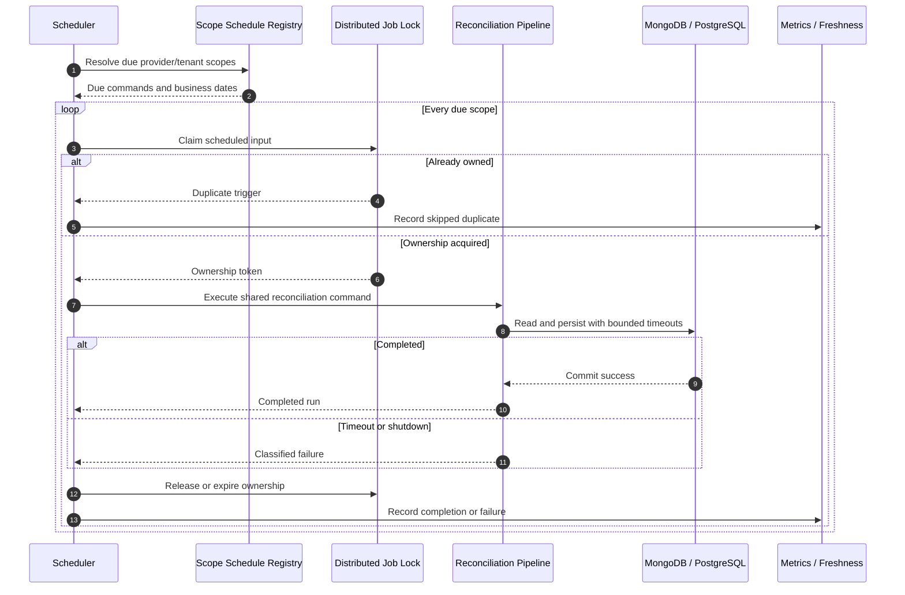

# F09 — Daily scheduling và operational safety

## 1. Overview

| Item | Detail |
|---|---|
| Feature | Daily scheduling và operational safety |
| Owner | `[TBD]` |
| Ticket | `[TBD]` |
| Status | `Designed` |
| Purpose | Chạy đối soát hằng ngày đúng scope/business period, không chạy trùng khi có nhiều instance và fail nhanh khi dependency chậm. |

## 2. Requirements

### Functional Requirements

- Kích hoạt daily reconciliation job cho từng provider/tenant.
- Scheduled job dùng cùng application command với manual API.
- Nhiều instance không được đồng thời sở hữu cùng một job/input.
- Job đến giờ nhưng không chạy phải tạo tín hiệu cho freshness/alert ở F10.
- Graceful shutdown không để job hoàn tất giả hoặc tạo kết quả một phần.
- Database chậm phải timeout, không giữ request/job vô hạn.

### Non-Functional Requirements

- Tối thiểu hai instance sau nginx; tắt một instance không làm request lỗi theo acceptance setup.
- Job lock phải hoạt động giữa các process/instance.
- Scheduler/queue/cron technology chưa được tài liệu chỉ định.
- Timezone/cutoff lấy từ F07, không hard-code trong scheduler.

## 3. Design

### Flow

### Processing

1. Scheduler xác định scope đến hạn theo cấu hình provider/tenant.
2. Tạo reconciliation command và claim distributed ownership qua cơ chế tương thích F06.
3. Owner chạy pipeline và cập nhật lifecycle; duplicate trigger chỉ ghi nhận/skip.
4. Shutdown/dependency timeout giải phóng hoặc chuyển giao ownership theo policy.

### Components

| Component | Change |
|---|---|
| Daily trigger adapter | New; cron/worker/queue implementation `[TBD]`. |
| Scope schedule registry | New; cấu hình lịch theo provider/tenant. |
| Distributed job lock | New hoặc dùng claim mechanism của F06. |
| Application command | Reuse cho scheduler và API. |
| Health endpoints | Bổ sung liveness/readiness cho process dài. |

## 4. API & Data

### API

| Method | Endpoint | Description |
|---|---|---|
| POST | `/reconciliation-runs` | Manual trigger; dùng cùng command với scheduler. |
| GET | `/health/live` | Process liveness `[Need Confirm]`. |
| GET | `/health/ready` | Dependency readiness `[Need Confirm]`. |

### Request/Response

- Scheduler command chứa business date, region, tenant, provider và statement input theo nguồn được team cung cấp.
- Khi PostgreSQL timeout, HTTP path dự kiến trả 503; exact error envelope `[TBD]`.

### Database

| Table / Collection | Change |
|---|---|
| `job_run_log` | Lưu scheduled execution và outcome. |
| Job lock/lease storage | Dùng PostgreSQL hoặc backend khác `[Need Confirm]`. |
| Schedule configuration | Environment/config store; schema `[TBD]`. |

## 5. Error & Edge Cases

| Scenario | Expected Behavior |
|---|---|
| Happy path | Mỗi due scope chạy đúng một lần và tạo run có lineage. |
| Invalid input | Config/scope lỗi được classify, không dùng giá trị tự đoán. |
| Duplicate request | Scheduler/manual overlap hội tụ bằng F06. |
| Timeout / dependency error | Fail bounded, ghi trạng thái/metric và không treo. |
| Retry / concurrent processing | Hai instance không cùng sở hữu job; recovery sau owner crash `[Need Confirm]`. |

## 6. Testing

| Test Case | Expected Result |
|---|---|
| Hai instance cùng trigger | Chỉ một instance thực thi effective run. |
| Tắt một instance sau nginx | Instance còn lại tiếp tục phục vụ theo acceptance setup. |
| DB chậm/unavailable | Timeout bounded, API trả 503 và không có partial results. |
| Job đến hạn | Trigger đúng business scope/date. |
| Graceful shutdown | Không mark completed trước khi persistence hoàn tất. |

## 7. Open Questions

| Question | Owner | Status |
|---|---|---|
| Statement của scheduled run được lấy từ đâu? | Operations/Provider team | `[Need Confirm]` |
