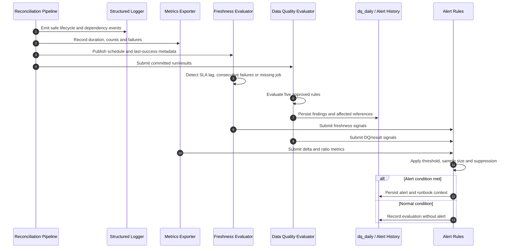

# F10 — Observability, reconciliation alerts và data quality

## 1. Overview

| Item | Detail |
|---|---|
| Feature | Observability, reconciliation alerts và data quality |
| Owner | `[TBD]` |
| Ticket | `[TBD]` |
| Status | `Designed` |
| Purpose | Cho vận hành biết dữ liệu có mới, đủ và đúng hay không; phát hiện bất thường mà không lộ raw/PII. |

## 2. Requirements

### Functional Requirements

- Structured JSON logs có `run_id`, region, tenant, provider và transaction ID khi áp dụng.
- Metrics endpoint và metrics cho run, results, duration, failures và dependency latency.
- Ba alert có runbook: currency delta vượt ngưỡng; provider file không đến hạn; tỷ lệ `MISSING_IN_SYSTEM` tăng bất thường.
- Freshness watchdog/API phát hiện: trễ vượt SLA, lỗi hai lần liên tiếp và job đến giờ không chạy.
- Có năm data-quality rules; mỗi issue chỉ rõ kết quả bị ảnh hưởng và lưu vào `dq_daily`.
- Test cả trường hợp có sự cố và dữ liệu bình thường không bắn alert.
- Error có classification và trace về input; không dùng `except: pass`.

### Non-Functional Requirements

- Không log raw payload hoặc PII; raw chỉ dùng trace nội bộ sau masking.
- Alert có threshold, sample size và reason rõ ràng.
- Đo precision/recall alert trên bộ lệch cố ý.
- Backend logging/metrics/alert chưa được chỉ định.

## 3. Design

### Flow

### Processing

1. Pipeline emit safe structured events/metrics tại state transitions và dependency boundaries.
2. Freshness evaluator so sánh last successful/data-as-of time với SLA và expected schedule.
3. DQ evaluator chạy năm rules đã chốt, lưu issue cùng affected references.
4. Alert evaluator áp dụng threshold/sample size và phát context phục vụ runbook.

### Components

| Component | Change |
|---|---|
| Structured logging adapter | New; masking và correlation fields. |
| Metrics endpoint/exporter | New. |
| Freshness service/API | New: `/_meta/freshness`. |
| Reconciliation alert rules | New: 3 mandatory rules. |
| DQ evaluator/repository | New: 5 rules và `dq_daily`. |

## 4. API & Data

### API

| Method | Endpoint | Description |
|---|---|---|
| GET | `/_meta/freshness` | Freshness theo scope và last successful run. |
| GET | `/metrics` | Metrics endpoint; format/backend `[Need Confirm]`. |
| GET | `/internal/data-quality` | Query DQ findings nếu API được chọn `[Need Confirm]`. |

### Request/Response

- Freshness response gồm scope, expected/latest time, lag, status và `data_as_of`.
- Alert gồm start time, dimensions, actual value, threshold, sample size, top reason và sample transaction IDs.
- Internal endpoints có quyền riêng và không trả raw.

### Database

| Table / Collection | Change |
|---|---|
| `dq_daily` | New: date, scope, rule, severity, affected references và counts. |
| Alert history | Store/backend `[Need Confirm]`. |
| `job_run_log.metrics` | Lưu/serve run metrics; normalization `[TBD]`. |

## 5. Error & Edge Cases

| Scenario | Expected Behavior |
|---|---|
| Happy path | Metrics/logs đầy đủ; normal data không tạo alert. |
| Invalid input | Unknown rule/config fail validation, không tự dùng threshold mặc định. |
| Duplicate request | Re-evaluate cùng run không tạo duplicate DQ/alert. |
| Timeout / dependency error | Telemetry failure không làm sai reconciliation data; delivery retry `[Need Confirm]`. |
| Retry / concurrent processing | Rule evaluation idempotent theo run/rule/version. |

## 6. Testing

| Test Case | Expected Result |
|---|---|
| Currency delta vượt ngưỡng | Alert đúng scope/currency và runbook metadata. |
| Provider file vắng mặt | Alert dù không có transaction row. |
| MISSING_IN_SYSTEM spike | Alert theo threshold/sample size. |
| Normal dataset | Không alert nào bắn. |
| Freshness scenarios | Bắt trễ, hai lần fail liên tiếp và missing job. |
| Log safety | Không raw/PII/secret; có correlation fields. |
| Precision/recall dataset | Tính và báo cáo đúng precision/recall. |

## 7. Open Questions

| Question | Owner | Status |
|---|---|---|
| Năm data-quality rules cụ thể là gì? | Technical Lead/Finance | `[Need Confirm]` |
| Threshold, minimum sample size và SLA của ba alerts? | Operations | `[Need Confirm]` |
