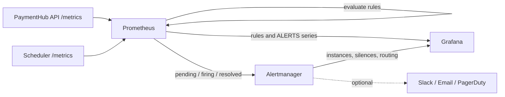

# F10A — Prometheus alerting và Grafana operations

## 1. Overview

| Item | Detail |
|---|---|
| Feature | Prometheus metrics, reconciliation alerts và Grafana operations |
| Status | `Implemented — metrics, 3 Prometheus rules, Alertmanager và Grafana integration` |
| Purpose | Thu thập tín hiệu vận hành, phát cảnh báo và quản lý alert trực tiếp bằng Prometheus, Alertmanager và Grafana. |

Luồng chuẩn là **metrics endpoint → Prometheus scrape/evaluate → Alertmanager → Grafana/notification receiver**. Ứng dụng nghiệp vụ không nhận webhook và không lưu bản sao trạng thái alert.

## 2. Requirements

- API expose reconciliation metrics tại `GET /metrics/`.
- Scheduler expose statement-presence metric tại `GET /metrics` trên port `9101`.
- Prometheus scrape và evaluate rules mỗi 15 giây.
- Ba alert có severity, summary và runbook: currency delta vượt ngưỡng, provider statement bị thiếu và tỷ lệ `MISSING_IN_SYSTEM` cao.
- Alert chỉ firing sau khi điều kiện đúng liên tục một phút.
- Alertmanager là nguồn trạng thái active alert, grouping, silence và notification routing.
- Grafana hiển thị Prometheus-managed rules ở chế độ read-only và kết nối trực tiếp tới Alertmanager.
- API ứng dụng không expose `/alerts` hoặc `/internal/alerts/webhook`.

### Điều kiện alert hiện tại

| Alert | Điều kiện phát | Không phát khi |
|---|---|---|
| `CurrencyDeltaExceeded` | `abs(currency_delta) > 100000` liên tục 1 phút. | Delta nhỏ hơn hoặc bằng `100000`. |
| `ProviderStatementMissing` | `paymenthub_provider_statement_present == 0` liên tục 1 phút. | Statement tồn tại (`1`). |
| `MissingInSystemRateHigh` | Có ít nhất `100` provider rows và tỷ lệ missing lớn hơn `5%` liên tục 1 phút. | Mẫu nhỏ hơn `100` hoặc tỷ lệ không vượt `5%`. |

Các ngưỡng trên là ngưỡng demo; production policy thuộc F10B.

## 3. Design

### Responsibilities

| Component | Trách nhiệm |
|---|---|
| Application | Chỉ expose metrics; không phụ thuộc alert delivery. |
| Prometheus | Scrape, lưu time series và evaluate rules. |
| Alertmanager | Deduplicate, group, silence, inhibit và route notification. |
| Grafana | Hiển thị rules, alert instances, silences và dashboard summary. |

Prometheus datasource bật `manageAlerts` và liên kết tới datasource UID `alertmanager`. Vì rules nằm trong file Prometheus nên Grafana chỉ đọc; thay đổi rule phải thực hiện ở `docker/prometheus/rules/reconciliation.yml`.

Alertmanager local dùng receiver rỗng `grafana-only`. Khi có notification destination thật, thay receiver này bằng Slack, email, PagerDuty hoặc webhook của hệ thống on-call; không gửi ngược vào API nghiệp vụ.

## 4. Interfaces and storage

| Interface | Purpose |
|---|---|
| API `GET /metrics/` | Metrics reconciliation của API. |
| Scheduler `GET :9101/metrics` | Statement-presence metrics. |
| Prometheus `/api/v1/rules` | Rule definitions và evaluation state. |
| Prometheus query `ALERTS{alertstate=~"pending|firing"}` | Active alert instances cho dashboard. |
| Alertmanager `/api/v2/alerts` | Alert instances và trạng thái Alertmanager. |
| Grafana `/alerting/list` | Giao diện rules và alert instances. |

Prometheus samples nằm trong `prometheus_data`, mặc định 15 ngày. Alertmanager giữ trạng thái active/resolved theo cơ chế riêng; không có in-memory alert store trong application.

## 5. Error and edge cases

| Scenario | Expected behavior |
|---|---|
| Metrics target không truy cập được | Prometheus đánh dấu target `DOWN`; cần rule riêng dựa trên `up == 0` nếu muốn cảnh báo target outage. |
| Rule expression lỗi | Prometheus đánh dấu rule health error và hiển thị trong Grafana Alerting. |
| Alertmanager tạm thời unavailable | Prometheus tiếp tục evaluate; notification delivery bị gián đoạn cho tới khi Alertmanager trở lại. |
| API restart | Không làm mất alert state vì ứng dụng không còn sở hữu state này. |
| Không có notification destination local | Alert vẫn xuất hiện trong Prometheus, Alertmanager và Grafana; receiver `grafana-only` không gửi ra ngoài. |

## 6. Testing

- `promtool check rules docker/prometheus/rules/reconciliation.yml`.
- `promtool test rules docker/prometheus/rules/reconciliation.test.yml`.
- `amtool check-config docker/alertmanager/alertmanager.yml`.
- Kiểm tra Grafana datasource health cho Prometheus và Alertmanager.
- Kiểm tra dashboard query `ALERTS` và Grafana Alerting UI.
- Kiểm tra OpenAPI không còn `/alerts` và `/internal/alerts/webhook`.

## 7. Implementation references

- Metrics: `src/reconciliation/adapters/metrics.py`, `src/bootstrap/main.py`, `src/bootstrap/scheduler.py`.
- Scrape và rules: `docker/prometheus/prometheus.yml`, `docker/prometheus/rules/reconciliation.yml`.
- Alertmanager routing: `docker/alertmanager/alertmanager.yml`.
- Grafana datasources: `docker/grafana/provisioning/datasources/`.
- Grafana dashboard: `docker/grafana/dashboards/reconciliation-api.json`.
- Runbooks: `docs/runbooks/`.
