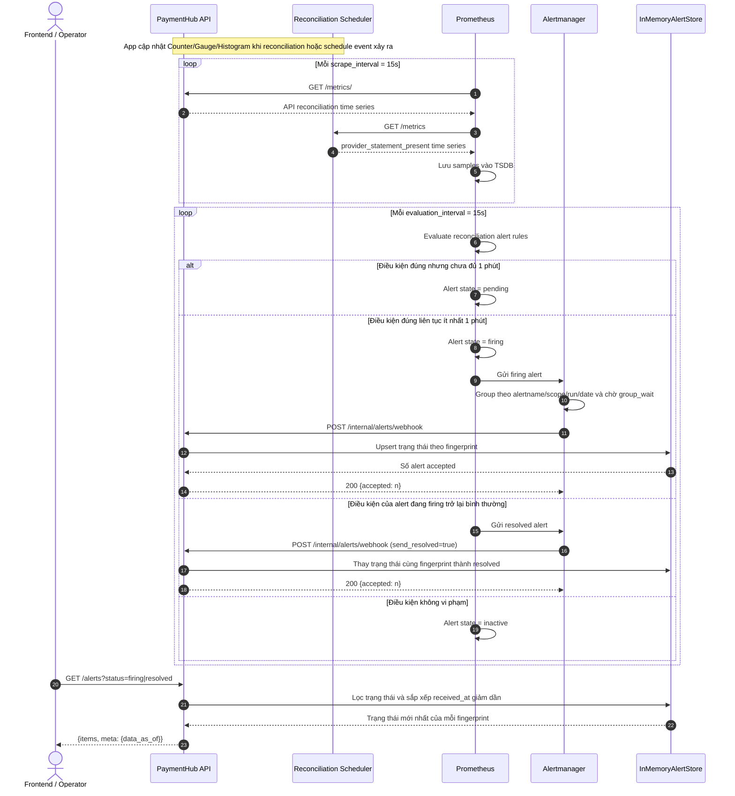

# F10A — Prometheus metrics, alert delivery và read API

## 1. Overview

| Item | Detail |
|---|---|
| Feature | Prometheus metrics, reconciliation alerts và alert read API |
| Owner | `[TBD]` |
| Ticket | `[TBD]` |
| Status | `Implemented — API/scheduler metrics, 3 Prometheus rules, Alertmanager webhook và GET /alerts đã có` |
| Purpose | Thu thập tín hiệu vận hành của reconciliation, phát cảnh báo và cung cấp trạng thái alert mới nhất cho frontend/operator. |

Phạm vi feature này là luồng đã triển khai: **metrics endpoint → Prometheus scrape/evaluate → Alertmanager webhook → API lưu trạng thái → client đọc alert**. Freshness watchdog, data-quality evaluation và việc duyệt ngưỡng production thuộc F10B.

## 2. Requirements

### Functional Requirements

- API expose reconciliation metrics tại `GET /metrics/`.
- Scheduler expose statement-presence metric tại `GET /metrics` trên port metrics riêng.
- Prometheus scrape cả hai target mỗi 15 giây và evaluate rules mỗi 15 giây.
- Có ba alert kèm severity, summary và runbook: currency delta vượt ngưỡng, provider statement bị thiếu và tỷ lệ `MISSING_IN_SYSTEM` cao.
- Alert chỉ firing sau khi điều kiện đúng liên tục một phút.
- Alertmanager group notification và gửi cả trạng thái `firing` lẫn `resolved` vào webhook của API.
- API deduplicate theo Alertmanager fingerprint, giữ trạng thái mới nhất và cho phép lọc `firing|resolved`.

### Non-Functional Requirements

- Counter/histogram labels chỉ dùng dimension hữu hạn. Các gauge `run_*` mang
  thêm `run_id` và `business_date` để correlate alert. Series của run cũ được
  giữ khi run mới xuất hiện; retention và thao tác resolve/purge cần policy
  riêng trước production để kiểm soát cardinality.
- Replay không cộng lại business counters/gauges nên không tự tạo spike.
- Alert payload không chứa raw statement hoặc PII.
- Lỗi telemetry không được làm thay đổi reconciliation result đã commit.

### Điều kiện alert hiện tại

Các giá trị dưới đây là ngưỡng demo. Việc chốt và cấu hình ngưỡng production thuộc F10B.

| Alert | Điều kiện phát | Không phát khi |
|---|---|---|
| `CurrencyDeltaExceeded` | Trị tuyệt đối của delta mới nhất theo scope/currency lớn hơn `100000` minor units liên tục 1 phút. | Delta nhỏ hơn hoặc bằng `100000`. |
| `ProviderStatementMissing` | Scheduler đã tới `run_time`, không tìm thấy statement và metric `paymenthub_provider_statement_present` bằng `0` liên tục 1 phút. | Chưa tới `run_time`, hoặc file tồn tại (`1`). |
| `MissingInSystemRateHigh` | Run mới nhất có ít nhất `100` provider rows và `MISSING_IN_SYSTEM / provider_rows > 5%` liên tục 1 phút. | Mẫu nhỏ hơn `100`, hoặc tỷ lệ nhỏ hơn hay bằng `5%`. |

Metric `paymenthub_provider_statement_present` được export bởi scheduler tại
port `9101`. Simulation không mở metrics server riêng.

## 3. Design

### Flow

### Processing

1. Reconciliation pipeline cập nhật registry của `prometheus_client`; scheduler cập nhật gauge statement presence khi file thiếu, run lỗi hoặc đã submit.
2. Prometheus pull API metrics từ `api:8000/metrics/` và scheduler metrics từ `reconciliation-scheduler:9101/metrics`.
3. Prometheus lưu sample vào TSDB rồi evaluate `docker/prometheus/rules/reconciliation.yml`.
4. Điều kiện phải đúng liên tục trong `for: 1m` mới chuyển từ `pending` sang `firing`.
5. Prometheus gửi alert sang `alertmanager:9093`. Alertmanager group theo
   alert name, scope, `run_id` và `business_date`, chờ `group_wait: 5s`, rồi
   POST batch vào API. Alert thiếu statement không có `run_id` vì pipeline chưa
   tạo reconciliation run; alert này correlate bằng scope và `business_date`.
6. API validate payload và upsert theo `fingerprint`. Một notification `resolved` thay trạng thái `firing` trước đó thay vì tạo bản ghi logic mới.
7. `GET /alerts` trả toàn bộ trạng thái mới nhất hoặc lọc theo query `status`; kết quả mới nhận đứng trước.

### Components

| Component | Trách nhiệm | Trạng thái |
|---|---|---|
| `ReconciliationMetrics` | Counter, Gauge và Histogram của pipeline | Implemented |
| Scheduler metrics server | Export `paymenthub_provider_statement_present` trên port 9101 | Implemented |
| Prometheus | Scrape, TSDB và evaluate ba rules | Implemented |
| Alertmanager | Group, repeat và gửi firing/resolved webhook | Implemented |
| `InMemoryAlertStore` | Giữ trạng thái mới nhất theo fingerprint, tối đa 1000 alert | Implemented |
| Grafana | Query Prometheus qua provisioned datasource | Implemented |

## 4. API & Data

### API

| Method | Endpoint | Description |
|---|---|---|
| GET | `/metrics/` | Metrics của API ở Prometheus exposition format. |
| GET | Scheduler `:9101/metrics` | Metric statement presence của scheduler. |
| POST | `/internal/alerts/webhook` | Nhận batch `firing`/`resolved` từ Alertmanager. |
| GET | `/alerts` | Trả trạng thái mới nhất của mọi alert. |
| GET | `/alerts?status=firing|resolved` | Lọc alert theo trạng thái mới nhất. |

`GET /alerts` trả `items` và `meta.data_as_of`. Mỗi item gồm fingerprint, status, name, severity, labels, annotations, start/end time, generator URL và thời điểm API nhận notification.

### Storage

- Prometheus samples được giữ trong volume `prometheus_data`, mặc định 15 ngày.
- Alert API chỉ dùng `InMemoryAlertStore`; dữ liệu mất khi API restart và không phải audit history.
- Store giữ tối đa 1000 fingerprint và loại các item nhận lâu nhất khi vượt giới hạn.

## 5. Error & Edge Cases

| Scenario | Expected Behavior |
|---|---|
| Metrics target không truy cập được | Prometheus đánh dấu target `DOWN`/`up=0`; business alert dựa trên series bị thiếu không tự firing. |
| Payload webhook thiếu trường bắt buộc | API trả HTTP 422. |
| Nhận lại cùng fingerprint | Ghi đè trạng thái mới nhất, không thêm duplicate logic. |
| Alert resolved | Cùng fingerprint được cập nhật thành `resolved` và biến mất khỏi filter `status=firing`. |
| API restart | Alert store rỗng cho tới khi Alertmanager gửi notification tiếp theo. |
| Nhiều currency cùng scope | Alertmanager có thể gom cùng batch vì `currency` không nằm trong `group_by`. |

## 6. Testing

| Test Case | Expected Result |
|---|---|
| Store ban đầu | `GET /alerts` trả danh sách rỗng và có `data_as_of`. |
| Firing webhook | Alert xuất hiện trong `GET /alerts?status=firing`. |
| Resolved webhook | Cùng fingerprint không còn trong firing và xuất hiện trong resolved. |
| Invalid webhook | API trả 422. |
| Prometheus rules | Cần duy trì `promtool test rules` cho normal và violation cases. |

## 7. Open Questions

| Question | Owner | Status |
|---|---|---|
| Alert history có cần persist để audit qua restart không? | Operations/Technical Lead | `[Need Confirm]` |
| Webhook dùng shared secret, network policy hay mTLS? | Platform/Security | `[Need Confirm]` |
| Có thêm alert `up == 0` cho API/scheduler targets không? | Operations | `[Need Confirm]` |

## 8. Implementation References

- Metrics: `src/reconciliation/adapters/metrics.py`, `src/bootstrap/main.py`, `src/bootstrap/scheduler.py`.
- Scrape và rules: `docker/prometheus/prometheus.yml`, `docker/prometheus/rules/reconciliation.yml`.
- Delivery: `docker/alertmanager/alertmanager.yml`.
- Webhook/read API: `src/reconciliation/adapters/alerts.py`.
- API tests: `tests/unit/test_alert_api.py`.
- Runbooks: `docs/runbooks/`.
