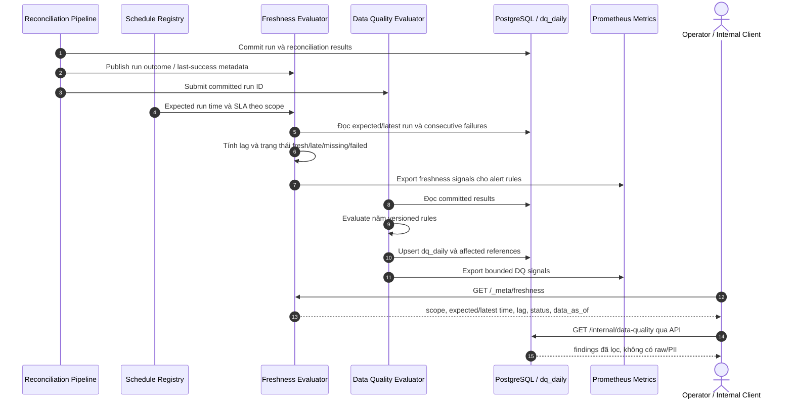

# F10B — Freshness, data quality và production policy

## 1. Overview

| Item | Detail |
|---|---|
| Feature | Freshness watchdog/API, data-quality findings và production alert policy |
| Owner | `[TBD]` |
| Ticket | `[TBD]` |
| Status | `Partially implemented — freshness và DQ đã có; production thresholds/approval chưa được chốt` |
| Purpose | Cho vận hành biết dữ liệu có mới, đủ và đúng hay không; dùng policy đã được Operations/Finance duyệt thay cho các ngưỡng demo của F10A. |

## 2. Requirements

### Functional Requirements

- Freshness watchdog phát hiện trễ vượt SLA, lỗi hai lần liên tiếp và job đến giờ không chạy.
- `GET /_meta/freshness` trả freshness theo scope và lần chạy thành công gần nhất.
- DQ evaluator chạy năm rule đã được phê duyệt trên run/results đã commit.
- Mỗi DQ finding chỉ rõ rule, severity, affected count và references bị ảnh hưởng; kết quả được lưu vào `dq_daily`.
- `GET /internal/data-quality` cho phép truy vấn findings nếu API này được chọn.
- Production policy cấu hình threshold, minimum sample size, evaluation duration và suppression theo scope/currency/provider.
- Evaluation phải idempotent theo run/rule/version.

### Non-Functional Requirements

- Không log hoặc trả raw payload/PII; affected references phải đủ để trace nội bộ sau masking.
- Unknown rule/config phải fail validation, không tự dùng threshold mặc định.
- Đo precision/recall trên bộ dữ liệu có lỗi cố ý trước khi phê duyệt policy production.
- Freshness/DQ failure không được làm sai hoặc rollback reconciliation data đã commit.

## 3. Design

### Flow dự kiến

### Processing

1. Freshness evaluator so sánh lịch dự kiến với last-success/data-as-of và lịch sử outcome.
2. DQ evaluator chỉ chạy trên reconciliation run đã commit, áp dụng đúng rule version và upsert kết quả idempotently.
3. Production policy cung cấp threshold/SLA theo dimension phù hợp; cấu hình không hợp lệ phải bị từ chối.
4. Tín hiệu freshness/DQ đủ ổn định mới được expose thành bounded metrics cho Prometheus/F10A.

## 4. API & Data

### API

| Method | Endpoint | Description |
|---|---|---|
| GET | `/_meta/freshness` | Freshness của mọi configured scope; hỗ trợ lọc `region`, `tenant_id`, `provider`. |
| GET | `/internal/data-quality` | Query theo run/date/scope/rule/status/severity; trả `data_as_of`. |

### Database

| Table / Collection | Nội dung |
|---|---|
| `dq_daily` | Date, scope, rule/version, severity, counts và affected references. |
| Job/run history | Nguồn tính last success, consecutive failures và missing scheduled run. |
| Production policy store | Threshold, SLA, sample size, effective dates và approval metadata `[Need Confirm]`. |

### Năm DQ rules hiện tại

| Rule | Recon result bị đánh dấu | Severity |
|---|---|---|
| `DUPLICATE_TRANSACTION` | `DUPLICATE` | `WARNING` |
| `INVALID_DATA` | `INVALID_DATA` | `CRITICAL` |
| `CURRENCY_MISMATCH` | `CURRENCY_MISMATCH` | `CRITICAL` |
| `MISSING_IN_SYSTEM` | `MISSING_IN_SYSTEM` | `CRITICAL` |
| `MISSING_IN_PROVIDER` | `MISSING_IN_PROVIDER` | `WARNING` |

Mỗi run lưu đủ năm rule với trạng thái `PASSED` hoặc `FAILED`. References là
`result_key` nội bộ kết hợp với `run_id`, không chứa raw payload hoặc PII.

## 5. Production Thresholds

Các giá trị `100000` minor units, `100` rows, `5%` và `for: 1m` của F10A hiện chỉ phục vụ demo. Trước production, Operations/Finance phải chốt tối thiểu:

- Currency-delta threshold theo currency, provider và scope; không dùng một minor-unit value chung cho mọi currency.
- Missing-rate threshold và minimum sample size.
- Expected run time, grace period và freshness SLA theo provider/scope.
- Số lần failure liên tiếp trước khi warning/critical.
- Evaluation duration, repeat interval và suppression/maintenance-window policy.
- Rule version, effective date, owner và bằng chứng phê duyệt.

Không có approval/config hợp lệ thì hệ thống không được âm thầm coi ngưỡng demo là production default.

## 6. Error & Edge Cases

| Scenario | Expected Behavior |
|---|---|
| Scheduler chết trước khi emit metric | Watchdog độc lập đối chiếu schedule với run history và phát hiện missing job. |
| Không có run trước đó | Trả trạng thái rõ ràng như `missing/unknown`, không giả định lag bằng 0. |
| Duplicate evaluation | Không tạo duplicate finding cho cùng run/rule/version. |
| Rule/config không hợp lệ | Fail validation và không evaluate bằng fallback ngầm. |
| Dữ liệu mẫu quá nhỏ | Không phát rate alert; response vẫn nêu sample size và reason. |
| Currency khác nhau | Tính/đánh giá riêng, không cộng chéo currency. |

## 7. Testing

| Test Case | Expected Result |
|---|---|
| Run trễ SLA | Freshness trả late và phát đúng signal. |
| Hai lần fail liên tiếp | Trạng thái failure đúng scope. |
| Job đến giờ không chạy | Watchdog phát hiện dù scheduler không tự emit metric. |
| DQ violation | Lưu đúng rule/version, affected count và references. |
| Re-evaluate cùng run | Không tạo duplicate finding. |
| Normal dataset | Không tạo DQ/freshness alert sai. |
| Precision/recall dataset | Báo cáo precision/recall theo policy candidate. |

## 8. Open Questions

| Question | Owner | Status |
|---|---|---|
| Threshold, minimum sample size và SLA chính thức? | Operations/Finance | `[Need Confirm]` |
| Policy lưu trong config file hay database có version? | Technical Lead/Operations | `[Need Confirm]` |
| Authorization và retention của DQ API/findings? | Security/Data Governance | `[Need Confirm]` |

## 9. Implementation References

- Evaluator và HTTP route: `src/reconciliation/adapters/freshness.py`.
- Schedule và `freshness_sla_seconds`: `src/reconciliation/adapters/daily_scheduler.py`.
- Unit tests: `tests/unit/test_freshness_api.py`.
- DQ evaluator, persistence query và API: `src/reconciliation/adapters/data_quality.py`.
- DQ schema: `migrations/versions/0009_dq_daily.py`.
- DQ tests: `tests/unit/test_data_quality_api.py`, `tests/integration/test_run_lifecycle.py`.
