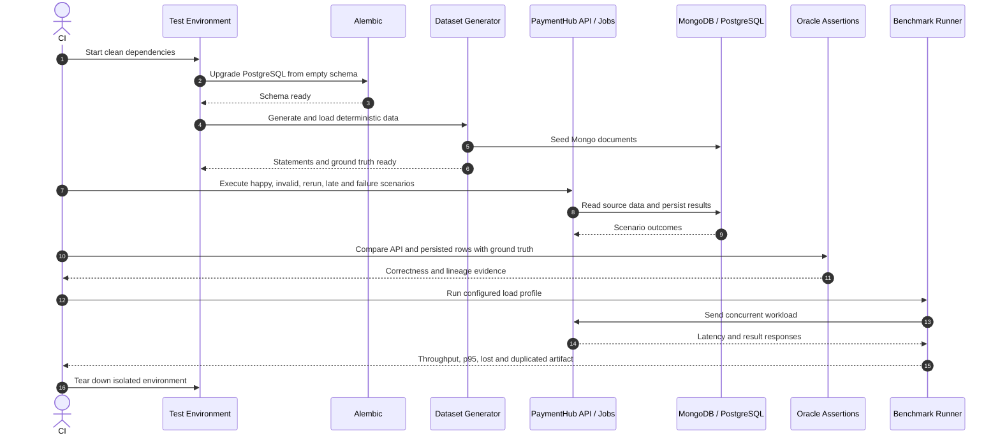

# F11 — Integration verification và performance evidence

## 1. Overview

| Item | Detail |
|---|---|
| Feature | Integration verification và performance evidence |
| Owner | `[TBD]` |
| Ticket | `[TBD]` |
| Status | `Designed` |
| Purpose | Chứng minh toàn pipeline đúng, idempotent, chịu failure theo yêu cầu và có số liệu hiệu năng tái tạo được. |

## 2. Requirements

### Functional Requirements

- Integration tests bao phủ golden dataset, replay/rerun không đổi, late data, reprocessing không trùng, alert khi có sự cố và không alert khi bình thường.
- E2E chạy migrations từ database trống, seed data, gọi API/job và kiểm tra persisted results.
- So sánh results với ground truth cho matched, missing, mismatch, duplicate và refund.
- Kiểm tra amount lớn, precision boundary, Asia legacy refund và India PAYMENT identity.
- Ghi benchmark evidence gồm throughput, latency, lost và duplicated khi áp dụng.
- Hệ thống dựng được bằng một lệnh theo README/Docker Compose.

### Non-Functional Requirements

- Test deterministic, cô lập scope và không chứa production data chưa ẩn danh.
- CI chạy unit, integration và architecture checks phù hợp.
- Tài liệu không đặt một SLA hiệu năng production cố định; phải ghi số đo và giải thích bottleneck.
- Correctness gate không được thay bằng benchmark.

## 3. Design

### Flow

### Processing

1. Tạo clean Mongo/PostgreSQL environment, chạy migrations và deterministic seed.
2. Chạy API/job cho từng statement và failure/concurrency scenario.
3. So sánh summary, details, lineage và rerun state với independent ground truth.
4. Thu latency/throughput/lost/duplicated, lưu artifact cùng config và dataset size.

### Components

| Component | Change |
|---|---|
| Integration test harness | New: dependency lifecycle, migrations và cleanup. |
| Generated dataset/ground truth | Reuse F05. |
| API/database assertions | New: full persisted result comparison. |
| Failure/concurrency fixtures | New. |
| Benchmark runner/artifacts | New: `bench/result-w*.json`. |
| CI workflow | New/update: unit, integration và architecture gates. |

## 4. API & Data

### API

| Method | Endpoint | Description |
|---|---|---|
| POST | `/reconciliation-runs` | E2E command path. |
| GET | Run summary/results endpoints | Verify F08 contracts. |
| GET | Freshness/metrics endpoints | Verify F10 scenarios. |

### Request/Response

- Inputs lấy từ deterministic statements và explicit malicious/edge-case fixtures.
- Benchmark artifact ghi dataset size, concurrency, config, throughput, p95 và lost/duplicated khi áp dụng.

### Database

| Table / Collection | Change |
|---|---|
| Test Mongo/PostgreSQL | Ephemeral hoặc isolated database/schema; cleanup theo batch/run ID. |
| `bench/result-w*.json` | Versioned evidence; không chứa production data. |

## 5. Error & Edge Cases

| Scenario | Expected Behavior |
|---|---|
| Happy path | API và persisted rows khớp ground truth. |
| Invalid input | Validation/error envelope đúng và không tạo báo cáo thiếu. |
| Duplicate request | Rerun không đổi counts, totals hoặc detail cardinality. |
| Timeout / dependency error | Không partial data; bounded timeout và lifecycle phù hợp. |
| Retry / concurrent processing | Concurrent triggers không tạo duplicate effective run/result. |

## 6. Testing

| Test Case | Expected Result |
|---|---|
| Golden E2E | Full detailed result set khớp đáp án. |
| Replay/rerun | Results và totals không đổi. |
| Late data | Đúng period/classification của F07. |
| Alert positive/negative | Sự cố bắn alert; bình thường không alert. |
| Dependency failure | Transaction/lifecycle/error response đúng. |
| Performance run | Artifact tái tạo được và lost/duplicated bằng 0 ngoài business duplicate fixture. |
| Clean-machine bootstrap | Một lệnh dựng được seed, pipeline, API và dependencies. |

## 7. Open Questions

| Question | Owner | Status |
|---|---|---|
| Benchmark artifacts nào bắt buộc commit? | Mentor/Technical Lead | `[Need Confirm]` |
| HA/nginx scenario chạy trong CI hay demo environment? | Platform | `[Need Confirm]` |
