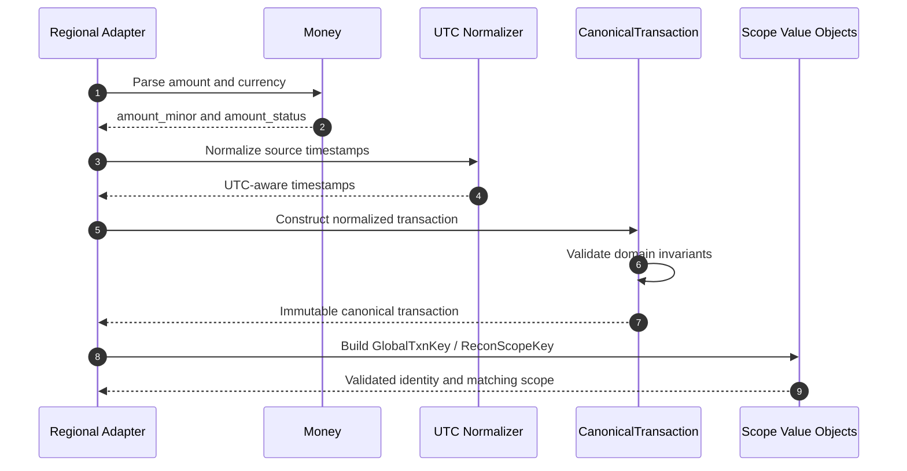

# F01 — Canonical transaction, money và reconciliation scope

## 1. Overview

| Item | Detail |
|---|---|
| Feature | Canonical transaction, money và reconciliation scope |
| Owner | `[TBD]` |
| Ticket | `[TBD]` |
| Status | `Implemented` |
| Purpose | Chuẩn hóa transaction từ nhiều region thành một domain model, biểu diễn tiền không dùng floating point và cô lập matching theo scope. |

## 2. Requirements

### Functional Requirements

- `Money` nhận major unit bằng `Decimal` hoặc minor unit bằng `int`, chuẩn hóa mã currency và kiểm tra precision.
- Hỗ trợ currency hiện tại: VND, IDR, INR, PHP và USD.
- `CanonicalTransaction` chuẩn hóa provider, bắt buộc `txn_id`, bảo đảm datetime có timezone và chuyển về UTC.
- Asia bắt buộc `tenant_id`.
- Global identity là `(region, tenant_id, txn_id)`; reconciliation scope là `(region, tenant_id, provider, currency)`.
- Transaction thiếu currency hoặc có amount không áp dụng không được tạo reconciliation scope hợp lệ.

### Non-Functional Requirements

- Cấm `float` trong money conversion để tránh sai số.
- Domain objects bất biến sau khi khởi tạo.
- Validation phải deterministic và fail sớm khi vi phạm invariant.

## 3. Design

### Flow

### Processing

1. Adapter ánh xạ raw amount/currency vào `Money` rồi chuyển sang minor unit.
2. Domain model chuẩn hóa provider/currency và datetime về UTC.
3. Matching sử dụng global key để deduplicate system rows và scope key để không match chéo tenant/provider/currency.

### Components

| Component | Change |
|---|---|
| `shared_kernel.money.Money` | Đã triển khai conversion và precision validation. |
| `shared_kernel.scope.GlobalTxnKey` | Đã triển khai identity theo region/tenant/transaction. |
| `shared_kernel.scope.ReconScopeKey` | Đã triển khai scope matching. |
| `canonical.domain.CanonicalTransaction` | Đã triển khai canonical domain model. |

## 4. API & Data

### API

| Method | Endpoint | Description |
|---|---|---|
| N/A | N/A | Domain feature, không trực tiếp thay đổi HTTP API. |

### Request/Response

N/A.

### Database

| Table / Collection | Change |
|---|---|
| `canonical_event` | Schema canonical đã có nhưng runtime reconciliation hiện đọc trực tiếp Mongo, chưa dùng bảng này. |

## 5. Error & Edge Cases

| Scenario | Expected Behavior |
|---|---|
| Happy path | Trả về canonical object có amount minor-unit và thời gian UTC. |
| Invalid input | Reject unknown currency, excessive precision, float, empty provider/ID hoặc naive datetime. |
| Duplicate request | N/A; duplicate domain rows được xử lý ở Reconciliation F02. |
| Timeout / dependency error | N/A. |
| Retry / concurrent processing | Value objects không có state mutable nên cho cùng kết quả khi xử lý lại. |

## 6. Testing

| Test Case | Expected Result |
|---|---|
| Convert major/minor units | Đúng exponent của từng currency. |
| Invalid precision/currency/float | Raise `ValueError` hoặc `TypeError`. |
| Normalize scope | Region/provider/currency được chuẩn hóa, Asia thiếu tenant bị reject. |
| Normalize datetime | Aware datetime được chuyển về UTC; naive datetime bị reject. |

## 7. Open Questions

| Question | Owner | Status |
|---|---|---|

---
