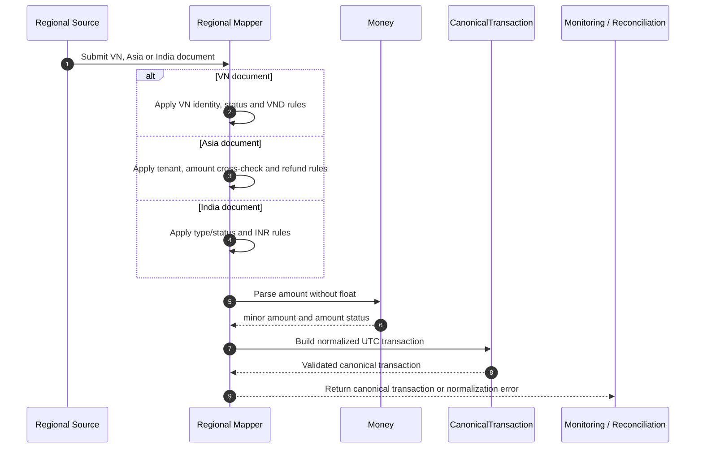

# Feature Technical Design — Canonical Transaction Normalization

## 1. Overview
| Item | Detail |
|---|---|
| Feature | Canonical transaction và regional mapping |
| Owner | P1 + P2 |
| Ticket | `[TBD]` |
| Status | Implemented nền tảng |
| Purpose | Chuẩn hóa document VN, Asia và India thành một model dùng chung cho monitoring và reconciliation |
## 2. Requirements
### Functional Requirements
- Map document nguồn thành `CanonicalTransaction` bằng hàm thuần, không I/O.
- Dùng `_id` của region làm `txn_id`; không fallback sang provider ID.
- Asia bắt buộc có `tenant_id`; các phép xử lý giữ scope `(region, tenant_id)`.
- Status lạ map thành `UNKNOWN`, không làm adapter crash.
- VN gán VND với `ASSUMED_CURRENCY` vì nguồn không persist currency.
- Asia dùng `AmountAsDecimal` và cross-check `Amount`.
- India đọc `Decimal128.to_decimal()` và chuyển INR major unit sang minor unit.
- Giữ document nguồn trong `raw` cho audit nội bộ.
### Non-Functional Requirements
- Không sử dụng `float` cho tiền.
- Tất cả datetime phải timezone-aware và chuẩn hóa UTC.
- P1 và P2 phải import cùng canonical package và mapping.
- Hàm map và `Money` có 100% coverage theo yêu cầu tuần 2.
## 3. Design
### Flow

### Processing
1. Validate identity và các field bắt buộc.
2. Chuẩn hóa transaction type, provider, status và instrument.
3. Parse tiền bằng `Money`, xác định `amount_status` và `amount_minor`.
4. Chuẩn hóa các timestamp về UTC.
5. Xác định các cờ terminal, money movement và reconcilable.
6. Tạo immutable `CanonicalTransaction` kèm `raw`.
### Components
| Component | Change |
|---|---|
| `shared_kernel.money.Money` | Parse Decimal và chuyển minor unit; từ chối float |
| `canonical.domain.CanonicalTransaction` | Entity dùng chung và invariant |
| `canonical.adapters.vn` | Mapping VN |
| `canonical.adapters.asia` | Mapping Asia theo tenant |
| `canonical.adapters.india` | Mapping India theo `(type, status)` |
## 4. API & Data
### API
| Method | Endpoint | Description |
|---|---|---|
| N/A | N/A | Mapping là logic thuần, không mở endpoint riêng |
### Request/Response
Input là source document; output là `CanonicalTransaction` hoặc normalization error.
### Database
| Table / Collection | Change |
|---|---|
| `paymenthub_vn.payment_transactions` | Chỉ đọc document nguồn |
| `paymenthub_asia_id/payment_transactions` | Chỉ đọc tenant Asia ID |
| `paymenthub_asia_ph/payment_transactions` | Chỉ đọc tenant Asia PH |
| `paymenthub_india.payment_transactions` | Chỉ đọc document India |
## 5. Error & Edge Cases
| Scenario | Expected Behavior |
|---|---|
| Happy path | Trả canonical object đầy đủ và đúng scope |
| Thiếu `_id` hoặc created time | Trả normalization error có field/reason |
| Status mới | Map `UNKNOWN` và vẫn giữ raw status để trace |
| Amount vượt precision | `amount_status=INVALID`, không coi amount là 0 |
| Asia thiếu currency | `amount_status=NO_CURRENCY` |
| Asia refund legacy | Không dùng `ExternalTxnId` kế thừa làm provider ID |
| India thiếu cờ delete/test | Dùng rule đã xác minh là `false` |
## 6. Testing
| Test Case | Expected Result |
|---|---|
| VN/Asia/India happy path | Field canonical khớp mapping contract |
| Decimal128 INR 100.50 | `amount_minor=10050` |
| Amount đi qua float | Bị từ chối |
| Timestamp có timezone địa phương | Chuyển đúng UTC |
| Unknown status | Canonical status là `UNKNOWN` |
| Asia `Amount` lệch `AmountAsDecimal` | Amount status là `INVALID` |
## 7. Open Questions

Các điểm Asia dưới đây chờ Technical Lead/Asia team xác nhận. Cấu hình và
mapping trong fixture/code local chưa phải bằng chứng xác nhận production.
Giữ phần liên quan ở trạng thái `[Need Confirm]`, không tự chốt mapping.

| Question | Owner | Status |
|---|---|---|
| Bảng giá trị `Type` chính thức là gì? Mapping local `1 → PAYMENT`, `2 → REFUND`, `3 → CARD_LINK`, `4 → TOKENIZATION` có đúng với dữ liệu production, đặc biệt DirectDebit/PaymentLink/LinkPaymentMethod không? | Asia team | `[Need Confirm]` |
| `PaymentMethodId` có những giá trị production nào và map sang `Instrument` thế nào? Code hiện tra `AsiaMapping.instrument_code`; cần bảng mapping đã xác minh. | Asia team | `[Need Confirm]` |
| `isSyntheticTestData` có kiểu dữ liệu và các giá trị thực tế nào? Giá trị nào nghĩa là test/non-test, thiếu field xử lý thế nào? Code hiện chỉ nhận string có cấu hình trong `synthetic_flag_value`. | Asia team | `[Need Confirm]` |
