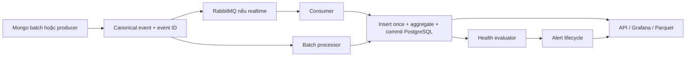
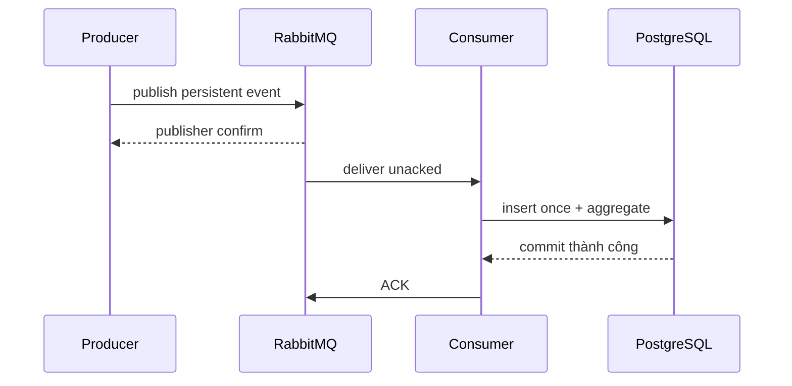

# Giải thích sâu các thành phần P1 của PaymentHub

> Đọc sau [bản đồ hệ thống](huong-dan-hieu-he-thong-paymenthub.md). Tài liệu này bám theo [Sổ tay P1](../reference/Intern/p1/so-tay-p1.md), [assignment chung](../reference/Intern/paymenthub/PaymentHub_Intern_Assignment.md) và code trong workspace ngày 13/10/2026. “Sổ tay yêu cầu” và “code hiện làm được” được phân biệt rõ: tài liệu yêu cầu là đích thiết kế, không tự động chứng minh tính năng đã chạy. Các ví dụ thời gian dưới đây dùng UTC.

## 1. Bức tranh một câu

P1 trả lời: **Trong các giao dịch đi qua từng provider, điều gì đang xảy ra, dữ liệu có còn mới và có cần báo người trực không?** Để trả lời đáng tin, hệ thống phải biết mỗi cập nhật là **event nào**, xử lý event đó tối đa một lần về mặt kết quả, đưa nó vào **đúng cửa sổ thời gian**, rồi đánh giá **rule** trên số liệu đã lưu. RabbitMQ giúp vận chuyển event; PostgreSQL quyết định kết quả nghiệp vụ; health/alert biến số liệu thành tín hiệu vận hành.



Đường batch Mongo đi thẳng vào processor, không qua RabbitMQ. Đường realtime hiện nhận **JSON canonical đã chuẩn hóa** từ producer; consumer không gọi mapper Mongo cho message đó. Vì vậy “Source → Regional Adapter → Canonical Event → RabbitMQ” là kiến trúc mục tiêu cho nguồn thô, còn simulator hiện bắt đầu ở bước canonical JSON.

## 2. Canonical model và scope: nền của mọi phần sau

### Vấn đề

VN, Asia và India có tên field, kiểu tiền, trạng thái và timezone khác nhau. Một `txn_id` chỉ có nghĩa khi đi cùng region và tenant. Nếu gộp Asia ID và Asia PH hoặc lấy `provider_txn_id` thay `_id` để nhận diện giao dịch, dữ liệu hai nguồn có thể đè lên nhau; báo cáo và đối soát sai dù SQL vẫn chạy.

### Cách PaymentHub làm

- [`CanonicalTransaction`](../src/canonical/domain/model.py) mang region, tenant, `txn_id`, provider, status, amount, timestamps, cờ terminal/money movement/reconcilable và `raw`. `global_key` là `(region, tenant_id, txn_id)`; Asia bắt buộc tenant.
- Các mapper ở [`canonical/adapters`](../src/canonical/adapters/) đổi document nguồn sang kiểu chung. Hàm mapper thuần giúp test một document mà không cần MongoDB; class `Mongo*Source` chỉ làm phần đọc DB.
- [`Money`](../src/shared_kernel/money.py) dùng `Decimal`, từ chối `float` và chuyển sang `amount_minor`: VND/IDR không có phần lẻ, INR/PHP/USD có 2 chữ số phần lẻ theo cấu hình hiện tại.
- [`ensure_utc`](../src/shared_kernel/datetime.py) buộc datetime có timezone và chuẩn về UTC; ngày nghiệp vụ của đối soát vẫn dùng timezone từng vùng/tenant khi lọc nguồn.
- `amount_status` phân biệt `OK`, `ASSUMED_CURRENCY`, `NO_CURRENCY`, `INVALID`, `NOT_APPLICABLE`; giá trị tiền không biết/không hợp lệ không bị đổi thành 0.

**Vì sao không dùng float?** Giá trị nhị phân như `0.1` không biểu diễn chính xác trong `float`; sau nhiều phép tính/làm tròn có thể lệch đơn vị nhỏ nhất. `Decimal('100.50')` × 100 cho ra 10050 INR minor units một cách xác định. `Money.to_minor()` còn từ chối số có precision không hợp lệ, ví dụ INR `10.001`.

**Điểm cần nhớ:** `raw` giúp audit/mapping lại nhưng có thể chứa thông tin nhạy cảm; không dùng nó làm khóa event, không đưa nguyên văn ra API/log. Xem [`data-dictionary.md`](data-dictionary.md) để biết field nguồn nào được map.

## 3. Idempotency: tại sao cần và code xử lý thế nào?

### Bài toán thực tế

“Giao message một lần duy nhất” rất khó bảo đảm qua broker + database. Ví dụ consumer ghi PostgreSQL thành công, rồi chết **trước khi ACK**. RabbitMQ chưa thấy ACK nên giao lại message. Nếu mỗi lần nhận đều `INSERT` và `+1` vào aggregate, một event sẽ bị đếm hai lần. Batch Mongo cũng có thể được chạy lại cùng seed, hoặc worker retry sau timeout dù lần đầu đã commit.

**Idempotency** nghĩa là xử lý cùng một input nhiều lần nhưng **trạng thái dữ liệu cuối cùng vẫn như xử lý một lần**. Nó không có nghĩa consumer chỉ chạy một lần. Trong PaymentHub đây là “at-least-once delivery + idempotent effect”, không phải phép màu exactly-once xuyên RabbitMQ và PostgreSQL.

### Phân biệt transaction ID với event ID

Một giao dịch `txn_id=T1` có thể phát ba event `T1:created`, `T1:pending`, `T1:success`. Khóa duy nhất theo `txn_id` sẽ bỏ mất hai lần cập nhật sau. Khóa chống trùng phải mô tả **một lần cập nhật**. Batch Mongo tạo `event_id = testBatchId|database|_id` ở [`MongoCanonicalBatchSource`](../src/monitoring/adapters/mongo.py); simulator tạo ID theo transaction và status ở [`realtime_transaction_simulator.py`](../src/bootstrap/realtime_transaction_simulator.py). Contract đầu vào RabbitMQ yêu cầu `event_id` trong [`decode_canonical_event`](../src/monitoring/adapters/rabbitmq.py).

```text
Transaction identity: (region, tenant_id, txn_id)
Event identity:       event_id do nguồn/adapter cấp
Database key:         event_date UTC + "trusted:" + event_id
```

### Các lớp chống trùng trong code

1. [`ProcessCanonicalEvents`](../src/monitoring/application/processor.py) gọi `events.contains(event)` trước khi phân loại muộn. Event đã có được tính `duplicated`, không tính late lần nữa.
2. [`PostgresCanonicalEventRepository`](../src/monitoring/adapters/postgres.py) đổi `event_id` sang UUID ổn định bằng `uuid5(event_date|idempotency_key)`, lưu vào `ingest_message`, và lưu `canonical_event` với `ON CONFLICT (event_date, idempotency_key) DO NOTHING`.
3. Nếu cùng identity nhưng hash payload được kiểm tra khác, repository báo **collision** thay vì âm thầm coi là duplicate. Hash hiện chỉ lấy tập field chính được khai báo trong `_payload_hash`; không phải mọi field của canonical object đều tham gia kiểm tra.
4. Aggregate được **tính lại từ tập event đã lưu** và upsert giá trị đầy đủ, không cộng `+1` trực tiếp khi replay. Vì vậy một event duplicate không làm số đếm/tổng tiền tăng.

| Tình huống | Kết quả mong đợi |
|---|---|
| Nhận lại cùng `event_id`, cùng payload | `duplicated += 1`; số event/aggregate không đổi |
| Cùng `txn_id`, `event_id` mới cho status mới | Lưu thêm event hợp lệ; lịch sử được giữ |
| Cùng `event_id`, payload chính khác | Báo collision; không âm thầm nhận là một event |
| Consumer chết sau DB commit, trước ACK | RabbitMQ giao lại; DB dedupe, sau đó ACK |
| Batch chạy lại sau khi checkpoint chưa ghi | Đọc lại; DB dedupe, checkpoint có thể được ghi lại |

### Ranh giới và điều kiện còn sai

- Source/producer **phải giữ `event_id` ổn định** qua retry. Nếu một update cũ được phát lại với ID mới, hệ thống sẽ xem là event mới và có thể đếm trùng.
- Unique trên `canonical_event` có `event_date` vì bảng partition theo ngày; nó không tự bảo đảm uniqueness xuyên các ngày. Cùng source ID nhưng bị gắn event time sang ngày UTC khác có thể thành identity DB khác. [Thiết kế schema](technical-design/09-postgres-schema-and-migrations.md) nêu lựa chọn registry toàn cục nếu cần.
- Sổ tay/assignment mô tả fallback `(region, tenant, txn_id, updated_at, status)` khi nguồn không có event ID tin cậy. **Đường Postgres hiện dùng `CanonicalEvent.event_id` có sẵn**; fallback cho producer bất kỳ không được tự động tạo trong consumer RabbitMQ. Chưa thể coi fallback trong thiết kế là bảo đảm chung cho mọi nguồn.
- Nếu cùng một sự kiện được đưa qua **hai source khác nhau** với hai event ID khác nhau, idempotency hiện không tự hợp nhất chúng theo business transaction.

**Tự chứng minh:** xem [`test_process_canonical_events.py`](../tests/unit/test_process_canonical_events.py) cho replay/status update và [`test_rabbitmq_monitoring.py`](../tests/integration/test_rabbitmq_monitoring.py) cho giao lặp qua broker.

## 4. RabbitMQ: nó đóng góp gì và không làm gì?

### Vì sao thêm broker?

Producer có thể phát nhanh hơn PostgreSQL xử lý, consumer có thể restart, database có thể chậm. RabbitMQ giữ message ở giữa, tạo **buffer**, cho consumer lấy theo khả năng (`prefetch`), và cho phép giao lại message chưa ACK. Producer không phải đợi toàn bộ aggregate/health/API hoàn tất. Khi consumer xử lý lỗi tạm thời, message có đường retry riêng thay vì chặn toàn luồng.

RabbitMQ **không** tự bảo đảm “mỗi event chỉ được tính một lần”, không quyết định metric nào đúng, và không thay database. Các việc đó thuộc idempotency key, transaction PostgreSQL và domain aggregator.

### Topology đang dùng

[`rabbitmq.py`](../src/monitoring/adapters/rabbitmq.py) khai báo direct exchange `payment.events`, routing key `monitoring.canonical`, main quorum queue `payment.monitoring.ingest`; retry exchange và ba queue TTL 5/30/300 giây; DLX và `payment.monitoring.dlq`. Producer publish persistent message với publisher confirms. [`rabbitmq_consumer.py`](../src/bootstrap/rabbitmq_consumer.py) manual ACK, nhận theo batch và giới hạn prefetch. Consumer giải mã JSON schema v1 sang `CanonicalEvent`, gắn `received_at` lúc nhận.



**ACK sau commit là điểm mấu chốt.** Nếu ACK trước commit mà DB sau đó lỗi, broker đã xóa message và event có thể mất. Nếu commit trước ACK rồi process chết, broker giao lại; idempotency chặn kết quả trùng. Publisher confirm chỉ xác nhận broker đã nhận message, chưa xác nhận PostgreSQL đã xử lý.

### Retry, DLQ và reprocess

| Loại lỗi | Cách xử lý hiện tại | Lý do |
|---|---|---|
| JSON/schema/mapping không hợp lệ | Publish vào DLQ rồi ACK bản gốc | Gửi y nguyên lần nữa vẫn sai |
| `OSError`, `TimeoutError`, lỗi kết nối/interface PostgreSQL | Retry qua TTL 5 → 30 → 300 giây; hết lượt vào DLQ | Có khả năng tự hết khi dependency phục hồi |
| Lỗi xử lý khác | Vào DLQ với `PROCESSING_ERROR` | Tránh lặp vô hạn khi chưa biết có thể phục hồi không |
| Publish retry/DLQ thất bại | Không ACK thành công | Broker vẫn có thể giao lại bản gốc |

Retry hiện là **ba khoảng tăng dần cố định**, chưa có jitter; đừng gọi đó là exponential backoff tổng quát. DLQ envelope lưu error code/detail, reference, retry count và payload đã mask một số khóa nhạy cảm. [`rabbitmq_dlq_reprocess.py`](../src/bootstrap/rabbitmq_dlq_reprocess.py) chỉ republish payload **đang hợp lệ** về main exchange rồi mới ACK DLQ; script không có chức năng tự sửa message sai. Payload vẫn lỗi validation sẽ bị giữ trong DLQ; payload hợp lệ nhưng lỗi xử lý chưa được giải quyết có thể quay lại DLQ. Masking theo danh sách khóa không thay thế kiểm soát PII đầy đủ.

**Một nhầm lẫn quan trọng:** [`PostgresMonitoringQueue`](../src/monitoring/adapters/postgres_queue.py) và bảng `monitoring_queue_message` là cơ chế queue khác có `SKIP LOCKED`, retry và reclaim. Worker `rabbitmq-consumer` trong Compose **không claim bảng này**. Do đó metric `queue_pressure` trong [`PostgresHealthMetricSource`](../src/monitoring/adapters/postgres_health.py) hiện đọc queue PostgreSQL, **không phải độ sâu RabbitMQ main/DLQ**. Dashboard RabbitMQ đọc metric broker qua Prometheus. Nếu muốn rule sức khỏe thật sự dựa trên RabbitMQ, cần nối metric broker vào health evaluator và xác định cùng scope/thời điểm đo.

**Quan sát:** dùng [`runbook ingest`](runbooks/rabbitmq-monitoring-ingest.md); `messages_ready` là đang chờ, `messages_unacknowledged` là đã giao nhưng chưa ACK, `consumers` là số consumer đang nối. Backlog tăng liên tục cho thấy đầu vào nhanh hơn tốc độ xử lý hoặc consumer lỗi; riêng một snapshot queue rỗng không chứng minh producer khỏe.

## 5. Database transaction, checkpoint và crash recovery

### Vì sao phải bàn thứ tự?

Event, aggregate và dấu “đã đọc đến đâu” là ba trạng thái liên quan. Nếu checkpoint đi trước event/aggregate, crash ở giữa sẽ khiến lần sau bỏ qua dữ liệu chưa lưu. Code chọn thứ tự: **ghi event + aggregate + job log trong một PostgreSQL transaction → commit → persist checkpoint trong transaction kế tiếp → RabbitMQ ACK** (đường realtime). Batch Mongo không có ACK broker nhưng cùng nguyên tắc checkpoint sau commit.

[`PostgresEventUnitOfWork`](../src/monitoring/adapters/postgres.py) giữ transaction, advisory transaction lock để tránh hai run cùng tính lại/upsert aggregate gây lost update, và ghi `job_run_log` với run ID, source, range, counts. `ProcessCanonicalEvents` chỉ gọi `persist_checkpoint()` sau `commit()`.

| Process chết ở đâu? | Điều còn lại | Lần sau xử lý thế nào? |
|---|---|---|
| Trước DB commit | Event/aggregate rollback; checkpoint chưa tiến; RabbitMQ chưa ACK | Đọc/giao lại và xử lý bình thường |
| Sau DB commit, trước checkpoint | Event/aggregate đã có; checkpoint cũ; RabbitMQ chưa ACK | Replay, `event_id` bị dedupe; checkpoint được ghi lại |
| Sau checkpoint, trước ACK | DB và checkpoint đã có; RabbitMQ có thể giao lại | Replay, dedupe rồi ACK |

Checkpoint hiện là **watermark `max(event_time)` theo `(source_name, region, tenant_scope)`**, không phải offset/sequence của Mongo cursor. Mongo batch vẫn đọc lại cả snapshot `testBatchId`; checkpoint dùng để phân loại event time và phục hồi an toàn, không giúp bỏ qua N document đầu tiên. `job_run_id` trên event/aggregate/audit tạo **lineage**: từ một hàng báo cáo lần ngược tới lần xử lý đã tạo/cập nhật nó.

**Giới hạn:** ghi checkpoint ở transaction riêng làm cho “business commit thành công nhưng checkpoint fail” là tình huống có thật; thiết kế dựa vào replay + idempotency để hồi phục. Không nên mô tả hai transaction này là atomic cùng nhau.

## 6. Event time, watermark và late event

### Ba đồng hồ khác nhau

| Đồng hồ | Lấy từ đâu | Dùng để làm gì? |
|---|---|---|
| `created_at` | Lúc giao dịch được tạo ở source | Tuổi giao dịch/pending; fallback event time |
| `event_time` | `updated_at` nếu có, không thì `created_at` | Chọn cửa sổ và ngày partition |
| `received_at` / `computed_at` | Lúc hệ thống nhận/tính | Đo arrival lag/freshness, không đổi cửa sổ của event |

Ví dụ giao dịch tạo 10:00, chuyển SUCCESS 10:07 nhưng consumer nhận lúc 10:10. Event SUCCESS thuộc window **10:05–10:10**, vì `updated_at=10:07`; `received_at=10:10` chỉ nói nó tới chậm. Nếu dùng processing time để chia window, replay ngày mai sẽ làm lịch sử “di chuyển” sang ngày mai.

[`WatermarkPolicy`](../src/monitoring/domain/watermark.py) so event time với watermark đã commit **trước batch hiện tại**. Điều này giúp thứ tự các phần tử trong cùng batch không làm thay đổi phân loại. Mặc định demo: allowed lateness 5 phút, retention 24 giờ.

```text
W = 12:00 (watermark đã lưu)
E = 11:58 → ON_TIME (không cũ hơn W − 5 phút)
E = 11:40 → LATE (cũ hơn 5 phút, còn trong 24 giờ)
E = hôm trước 11:00 → EXPIRED (cũ hơn W − 24 giờ)
```

Điều kiện trong code dùng dấu **`<`**, nên event đúng bằng boundary không bị đưa vào bucket cũ hơn. Event `LATE` vẫn vào `canonical_event` và được tính lại window cũ; `late_event_count` tăng. Event `EXPIRED` vào `late_event_audit` với `OUTSIDE_RETENTION`, không vào aggregate. Replay cùng event được dedupe trước khi phân loại nên không tăng late/audit lần hai.

Với RabbitMQ, [`classify_arrival`](../src/monitoring/domain/watermark.py) còn so `received_at - event_time` với allowed lateness. Nó bắt được trường hợp nguồn đứng im, watermark không tiến nhưng event vẫn tới rất chậm. Batch lịch sử không gắn `received_at`, tránh gọi tất cả dữ liệu backfill là arrival-late. `source_activity` giữ mốc message/event/heartbeat gần nhất để phân biệt thời điểm nguồn phát với thời điểm business event.

**Thiết kế cần cân nhắc:** giá trị 5 phút/24 giờ chỉ là demo. Muốn chọn production retention phải biết nguồn có thể trễ tối đa bao lâu, chi phí tính lại window cũ và chính sách sửa báo cáo đã công bố. Quá retention nghĩa là chấp nhận audit mà không sửa aggregate; đó là một quyết định nghiệp vụ, không chỉ tối ưu kỹ thuật.

## 7. Window aggregation: vì sao rollup, và các bẫy tính số

Một dashboard không nên quét toàn bộ event thô mỗi lần refresh. [`WindowAggregator`](../src/monitoring/domain/aggregate.py) gom event vào **tumbling window** 1/5/15 phút; mỗi row được xác định bởi window size/start + region/tenant/provider/type/instrument/channel/currency. Các cửa sổ là `[start, end)`: event đúng 10:05:00 vào window bắt đầu 10:05, không vào 10:00.

**Rollup** ở `window_aggregate` giúp API/Grafana đọc nhanh và có thể rebuild từ canonical event. Trong code, mỗi lần xử lý UoW lấy event đã lưu (`list_events`), tính lại rồi upsert **giá trị hoàn chỉnh**. Consumer realtime giới hạn vùng đọc bằng `MONITORING_REALTIME_LOOKBACK_HOURS` (mặc định 24 giờ). Nếu event còn hợp lệ nhưng nằm ngoài vùng lookback này, cần kiểm tra liệu window cũ có được cập nhật như kỳ vọng; không nên tuyên bố mọi late event đều sửa được mọi lịch sử.

### Ba tập dữ liệu, ba nghĩa số lượng

1. **Base event:** không deleted/test. Tất cả loại giao dịch hợp lệ có thể vào `total_event_count`.
2. **Operation event:** PAYMENT/LOAD/REFUND và `is_reconcilable=true`. Mẫu số success/failed/unknown rate là `operation_event_count`.
3. **Monetary event:** operation có chuyển tiền, amount và currency hợp lệ. Chỉ tập này vào `monetary_count` và `monetary_amount_minor`.

CARD_LINK/TOKENIZATION có thể vào total nhưng không vào operation/monetary. Tiền được tách theo currency; `100000 VND + 10000 INR minor` không có một “tổng tiền” có nghĩa. Rate với denominator 0 trả `null`, không trả 0%; 0% là một kết luận khác với “không có mẫu”.

**Hai loại pending:** `pending_count` đếm **event** CREATED/PENDING trong window. `non_terminal_count` và pending age dùng **trạng thái mới nhất của mỗi transaction** (theo event time và event ID) khi aggregator tính. Nếu `T1` có PENDING rồi SUCCESS, pending event lịch sử vẫn có trong count, nhưng latest-state pending của T1 biến mất. Vì vậy không thể dùng `pending_count` để suy ra chính xác “đang có bao nhiêu giao dịch treo” nếu không hiểu grain.

**Ba cỡ window cùng tồn tại:** cùng event có mặt trong 1 phút, 5 phút và 15 phút. Dashboard phải chọn một size trước khi cộng; cộng tất cả rows sẽ nhân ba. Tương tự, không lấy trung bình `success_rate` của các provider/window nếu sample khác nhau: phải tính `sum(success_count) / sum(operation_event_count)`.

Golden fixture ở [`tests/fixtures/monitoring/`](../tests/fixtures/monitoring/) và test [`test_window_aggregator.py`](../tests/unit/test_window_aggregator.py) là nơi kiểm công thức bằng dữ liệu biết trước.

## 8. Health rule: biến metric thành quyết định như thế nào?

Metric chỉ nói “đã thấy gì”; rule nói “điều đó có đáng báo không?”. Ví dụ failure rate 50% nghe xấu, nhưng nếu chỉ có 2 event thì một lần fail đã là 50%. Rule cần threshold **và** minimum sample. Volume bằng 0 cần so với baseline cùng khung giờ; không thể chỉ nhìn window không có row và kết luận provider chết.

[`health_evaluation.py`](../src/bootstrap/health_evaluation.py) chạy một chu kỳ: đọc config → lấy window đã đóng theo scope → đánh giá từng rule → cập nhật state/alert → ghi trạng thái runner. [`MetricRule`](../src/monitoring/domain/rules.py) phân biệt `PASS`, `BREACH`, `INSUFFICIENT_DATA`, `CONFIG_ERROR`. [`HealthEvaluator`](../src/monitoring/domain/health.py) kết hợp reason thành `HEALTHY`, `DEGRADED`, `UNHEALTHY`, `NO_DATA`; policy mặc định yêu cầu **ít nhất hai metric khác nhau** vi phạm để kết luận `UNHEALTHY` khi có rule impact tương ứng. Hai threshold cùng đo failure rate vẫn chỉ là một tín hiệu.

### Vì sao có consecutive và recovery?

Nếu một window xấu rồi window sau bình thường, alert tức thì có thể là nhiễu. `health_rule_state` giữ số lần BREACH liên tiếp và PASS liên tiếp theo `(region, tenant, provider, rule_id, rule_version)`. `breach_windows` đạt ngưỡng mới xác nhận vi phạm; `recovery_windows` đạt ngưỡng mới xác nhận hồi phục. Khi dùng runner hiện tại, counter tăng theo **chu kỳ evaluation có `evaluated_at` mới**; code không chứng minh mỗi lần tăng tương ứng một window đóng mới. Scheduler production cần tránh đánh giá lặp cùng một window ở các thời điểm khác nhau như thể đó là nhiều window độc lập.

| Trạng thái từng chu kỳ | `breach_windows=2`, `recovery_windows=2` | Alert |
|---|---|---|
| BREACH lần 1 | Chưa xác nhận | Chưa OPEN |
| BREACH lần 2 | Xác nhận | OPEN một alert |
| BREACH lần 3 | Vẫn vi phạm | UPDATE cùng alert |
| PASS lần 1 | Chưa xác nhận hồi phục | Vẫn OPEN |
| PASS lần 2 | Xác nhận hồi phục | RESOLVED |

[`AlertManager`](../src/monitoring/application/health.py) dùng open alert hiện tại, tăng `occurrence_count`, áp dụng cooldown cho **thời điểm gửi thông báo**, và chỉ tạo alert mới khi chưa có OPEN alert. Partial unique index trong [`0011_alert_lifecycle.py`](../migrations/versions/0011_alert_lifecycle.py) bảo vệ DB khỏi hai OPEN alert cùng key. `health_evaluation_run` là replay key theo scope + `evaluated_at`; state/alert/evaluation commit cùng transaction. `NullNotificationPort` trong bootstrap hiện không gửi email/Slack; lifecycle đã lưu trong DB nhưng external notification chưa có.

### Chín nhóm rule trong sổ tay và trạng thái code

| Nhóm yêu cầu P1 | Dữ liệu/logic đang có | Điều cần hiểu đúng |
|---|---|---|
| Volume giảm/về 0 | `VOLUME_RATIO`, baseline cùng slot trong `PostgresHealthMetricSource` | Cần window/baseline có dữ liệu; absence tuyệt đối không được suy ra chỉ từ “không có row” |
| Failure rate + min sample | `FAILURE_RATE`, `minimum_sample` | Mẫu là **operation event**, không phải distinct transaction |
| Freshness | `FRESHNESS_LAG_SECONDS`, heartbeat/source activity, runner status | Phải phân biệt nguồn im lặng hợp lệ với nguồn không còn heartbeat |
| UNKNOWN/invalid amount | `DATA_QUALITY_ERROR_COUNT` từ unknown + invalid | Không bao quát toàn bộ taxonomy DQ trong sổ tay |
| Queue lag/DLQ | `QUEUE_PRESSURE` | Hiện đọc `monitoring_queue_message`, chưa phản ánh RabbitMQ chính |
| Asia QR/VA pending >24h | Truy vấn latest canonical transaction, instrument/status/age | Phụ thuộc nhận diện instrument và event history đúng |
| Asia refund Shape B pending | Truy vấn REFUND có `refund_of` và pending age | Đây là proxy hiện tại cho Shape B; contract thực cần xác nhận |
| India non-terminal quá tuổi | Truy vấn latest status/age | Không nên suy từ một tỷ lệ PAYMENT pending chung |
| India REFUND/created quá tuổi | Truy vấn latest REFUND CREATED/age | Cần kiểm chính xác source status mapping |

[`config/health-rules.week5-provisional.yaml`](../config/health-rules.week5-provisional.yaml) khai báo đủ 9 nhóm với threshold/runbook để kiểm thử acceptance; nội dung file hiện là JSON hợp lệ dưới đuôi YAML. Nó mang `AWAITING_TECHNICAL_LEAD_APPROVAL`, không phải rule production. **Compose hiện chạy `config/health-rules.demo.json`**, và `FileRuleConfigRepository` mặc định yêu cầu profile `DEMO_ONLY`; chỉ đổi `HEALTH_RULES_FILE` sang provisional sẽ bị từ chối profile nếu không đổi cách khởi tạo repository. Test 9 rule và báo cáo số ở [`test_week5_health_rules.py`](../tests/unit/test_week5_health_rules.py) và [`precision-recall-mttd.md`](evidence/p1-week5/precision-recall-mttd.md).

### Precision, recall, MTTD là gì?

- **Precision = cảnh báo đúng / mọi cảnh báo đã bắn.** Thấp nghĩa là nhiều báo giả, người trực dễ mất niềm tin.
- **Recall = sự cố phát hiện được / mọi sự cố có thật trong fixture.** Thấp nghĩa là bỏ lọt sự cố.
- **MTTD (mean time to detect) = trung bình thời gian từ lúc sự cố bắt đầu tới lúc alert đầu tiên mở.** Min sample, consecutive và cửa sổ dài thường giảm báo giả nhưng tăng MTTD.

Các số này chỉ có nghĩa khi so với `incidents.yaml` có ground truth và cửa sổ đo rõ ràng; threshold demo không tự biến thành SLA production.

## 9. Freshness, heartbeat và data quality

### Freshness có nhiều nghĩa

`window_aggregate.freshness_lag_seconds` là `computed_at - last_event_at` của một row. `health_runner_status` là snapshot của lần đánh giá provider gần nhất: `last_run_at`, `last_success_at`, `data_as_of`, lag/SLA/status, số failure liên tiếp. Endpoint [`/_meta/freshness`](../src/monitoring/adapters/http.py) **đọc snapshot đã lưu**, không chạy watchdog mới mỗi request.

[`classify_source_freshness`](../src/monitoring/domain/freshness.py) dùng heartbeat để phân biệt:

| Event mới? | Heartbeat mới? | Ý nghĩa |
|---|---|---|
| Có | Có | `FRESH` |
| Không | Có | `IDLE`: nguồn sống nhưng không có giao dịch mới |
| Bất kỳ | Heartbeat quá cũ | `UNAVAILABLE` |
| Không | Không có heartbeat để xét, event cũ | `STALE` theo nguồn legacy |
| Chưa có gì | Chưa có gì | `NO_DATA` |

Heartbeat được consumer ghi vào `source_activity`; simulator giao dịch hiện chủ yếu phát transaction event, nên đừng mặc định mọi scope đều có heartbeat. Runner Compose chạy một lần sau batch, vì vậy trạng thái `/_meta/freshness` có thể cũ nếu realtime tiếp tục chạy mà không đánh giá lại.

### Data quality khác business failure

UNKNOWN status, invalid amount, missing currency và parse error nói về **độ tin cậy dữ liệu**, không nhất thiết là giao dịch thất bại. Aggregate có `unknown_count`, `invalid_amount_count`, `missing_currency_count`, `parse_error_count`. Amount invalid vẫn có thể được đếm vào operation outcome nhưng **không cộng vào monetary amount**. Mapper thất bại trước khi tạo canonical event được batch ghi `mapping_failures` trong summary; nó không tự trở thành một row `window_aggregate`.

Sổ tay tuần 6 yêu cầu từ năm DQ rule và `dq_daily` nêu metric bị ảnh hưởng. [Thiết kế data quality](technical-design/10-data-quality-monitoring.md) vẫn đánh dấu `dq_daily`/DQ API là công việc sau; không nên nói hệ thống đã có DQ daily pipeline đầy đủ chỉ vì đã có một số counter trong window.

## 10. API, cursor, Parquet và observability

### Vì sao API cần cursor, sort whitelist và `data_as_of`?

Danh sách metrics/alerts có thể lớn. API giới hạn mỗi trang, trả `next_cursor` để client đọc tiếp. [`OffsetCursorCodec` và `AlertCursorCodec`](../src/monitoring/application/health_query.py) ký cursor bằng HMAC, ràng buộc version/endpoint hoặc key sort; client không nên tự sửa offset/ID. Sort whitelist trong query model chỉ cho phép những thứ tự SQL đã thiết kế, tránh ghép trực tiếp input vào `ORDER BY`. `meta.data_as_of` giúp người xem biết dữ liệu phản ánh đến lúc nào; “API trả 200” không có nghĩa dữ liệu vẫn mới.

[`http.py`](../src/monitoring/adapters/http.py) thêm trace ID, validation 422, lỗi DB 503 và che `raw` trong `/txns`. Giới hạn bảo mật hiện tại: filter `tenant_id` không phải authorization; API chưa có phân quyền đa tenant đầy đủ. [`logging.py`](../src/monitoring/adapters/logging.py) mask trường tên `raw` theo cấu trúc, còn RabbitMQ DLQ mask danh sách khóa nhạy cảm; cả hai cần được đánh giá thêm nếu dữ liệu production có PII ở field khác.

### Vì sao có Parquet?

[`export_monitoring_parquet.py`](../src/bootstrap/export_monitoring_parquet.py) đi qua cursor của bốn endpoint monitoring, ghi dataset Parquet bằng DuckDB rồi đọc lại để so row count; `data-dictionary.json` đi kèm tên cột/kiểu/nullable. Đây là **đầu ra phân tích/trao đổi**, không phải luồng realtime hoặc nguồn truth mới. Nếu muốn chứng minh export phản ánh cùng một snapshot trong lúc dữ liệu liên tục thay đổi, cần cơ chế snapshot/as-of nhất quán hơn việc phân trang API đang chạy.

### Vì sao cần log, job ID, metric broker?

Khi “dashboard sai”, cần truy ngược: producer đã phát? queue còn backlog? consumer đã ACK? job nào ghi event? window nào bị tính lại? health runner đã chạy sau window đó chưa? `job_run_log`, `job_run_id`, trace ID, source activity và RabbitMQ Prometheus metric trả lời các câu khác nhau. Grafana PostgreSQL cho dữ liệu nghiệp vụ; Grafana Prometheus cho queue/consumer. Không thể dùng riêng một biểu đồ để kết luận cả pipeline khỏe.

## 11. Bảng đối chiếu nhanh với Sổ tay P1

| Hạng mục trong sổ tay | Trạng thái thực tế nên trình bày khi bảo vệ |
|---|---|
| Canonical 3 vùng, Decimal, UTC, scope | Có model/mapper/test; các assumption mapping vẫn cần phân biệt với source contract |
| Event idempotency, replay, crash recovery | Có insert-once, aggregate recompute, checkpoint sau commit và test; điều kiện là source ID ổn định |
| RabbitMQ retry/DLQ | Có main quorum queue, TTL retry, DLQ, reprocess và integration test; đây là realtime canonical input hiện tại |
| Window 1/5/15, late/expired | Có domain/persistence; ngưỡng lateness/retention là demo, realtime lookback có giới hạn |
| 9 health rule | Có profile provisional và test; Compose dùng demo profile, production contract/threshold chưa phê duyệt |
| Alert dedup, cooldown, recovery | Có DB lifecycle và rule state; external notification port hiện là no-op |
| API health/metrics/alerts/freshness | Có endpoint và cursor; tenant filter chưa phải authorization |
| Parquet + dictionary | Có exporter và kiểm row count bằng DuckDB |
| Callback/polling metrics đầy đủ | Chưa có input outcome/latency và aggregate đủ để kết luận chính xác |
| `dq_daily`, HA hai API sau nginx | Chưa thấy implementation trong Compose/code hiện tại |
| `ph-ingest` và `--scale client=3` của track bản tin | Không nằm trong Compose hiện tại; realtime simulator xuất canonical event qua RabbitMQ |

Khi nói về thiết kế, hãy bắt đầu bằng **vấn đề → bất biến cần giữ → cơ chế trong code → test → giới hạn**. Cách này giúp phân biệt một ý tưởng đúng về mặt kiến trúc với bằng chứng nó đã hoạt động ở repo.

## 12. Bốn bài tập tự kiểm tra để hiểu thật

1. **Crash sau commit, trước ACK:** vẽ trạng thái RabbitMQ/`canonical_event`/`window_aggregate`/checkpoint trước và sau lần giao lại. Chỉ ra nơi ngăn đếm trùng.
2. **Một transaction có ba status:** tạo CREATED 10:01, PENDING 10:03, SUCCESS 10:07. Với window 5 phút, điền `operation_event_count`, `pending_count`, `success_count`, `non_terminal_count` cho từng window. Giải thích vì sao transaction ID không thể là idempotency key.
3. **Nguồn im lặng:** có heartbeat đều nhưng không có giao dịch 20 phút; sau đó heartbeat cũng mất. So `IDLE` với `UNAVAILABLE`, và hỏi health runner có được chạy lại chưa.
4. **Rule failure rate:** 1/2 fail và 200/400 fail đều là 50%. Đặt `minimum_sample=100`, `breach_windows=2`, rồi chỉ ra chu kỳ nào được OPEN. Nếu cùng window bị evaluate lại với `evaluated_at` mới, code hiện tăng counter thế nào?

### Đường đọc code theo chủ đề

| Muốn hiểu | Đọc theo thứ tự |
|---|---|
| Idempotency/crash | [`processor.py`](../src/monitoring/application/processor.py) → [`postgres.py`](../src/monitoring/adapters/postgres.py) → [`test_postgres_monitoring.py`](../tests/integration/test_postgres_monitoring.py) |
| Broker/retry/DLQ | [`rabbitmq.py`](../src/monitoring/adapters/rabbitmq.py) → [`rabbitmq_consumer.py`](../src/bootstrap/rabbitmq_consumer.py) → [`test_rabbitmq_monitoring.py`](../tests/integration/test_rabbitmq_monitoring.py) |
| Late/window | [`watermark.py`](../src/monitoring/domain/watermark.py) → [`aggregate.py`](../src/monitoring/domain/aggregate.py) → [`test_window_aggregator.py`](../tests/unit/test_window_aggregator.py) |
| Health/alert | [`rules.py`](../src/monitoring/domain/rules.py) → [`health.py` domain](../src/monitoring/domain/health.py) → [`health.py` application](../src/monitoring/application/health.py) → [`postgres_health.py`](../src/monitoring/adapters/postgres_health.py) |
| API/freshness/export | [`http.py`](../src/monitoring/adapters/http.py) → [`health_query.py`](../src/monitoring/application/health_query.py) → [`export_monitoring_parquet.py`](../src/bootstrap/export_monitoring_parquet.py) |

Các thao tác chạy thật và query kiểm chứng nằm ở [testing guide](testing-guide.md), [RabbitMQ runbook](runbooks/rabbitmq-monitoring-ingest.md) và [data dictionary](data-dictionary.md).
