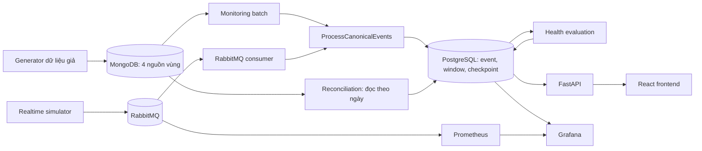
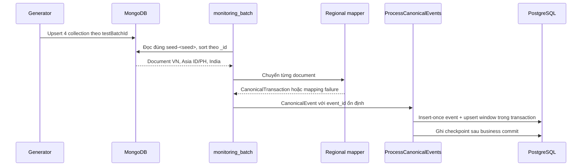
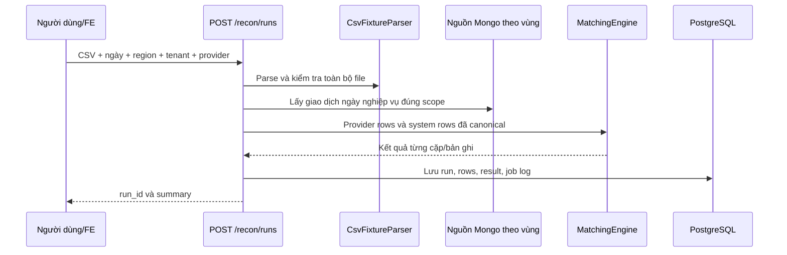

# Hiểu PaymentHub từ đầu đến cuối

> Tài liệu này mô tả **code đang có trong workspace** vào ngày 13/10/2026. Nó dành cho người mới đọc hệ thống: bắt đầu từ khái niệm, theo đường đi của dữ liệu, rồi mới tới file code. Một số tài liệu thiết kế cũ ghi trạng thái triển khai chưa cập nhật; khi có khác biệt, hãy xem code được dẫn ở đây là nguồn tham chiếu. Backend nằm trong repo `PaymentHub`; giao diện React nằm trong repo kế bên `PaymentHub-FE`.

## 1. PaymentHub giải quyết việc gì?

Hãy tưởng tượng cùng một khoản thanh toán xuất hiện dưới nhiều hình dạng: hệ thống Việt Nam ghi `CreatedOn` và `Amount`, hệ thống Asia ghi `CreatedAt`, `AmountAsDecimal` và bắt buộc biết tenant, còn India dùng `createdAt` và BSON `Decimal128`. Nếu mỗi màn hình và phép đối soát tự hiểu từng kiểu dữ liệu, logic sẽ bị lặp và dễ sai. PaymentHub chuẩn hóa chúng thành một **giao dịch chung** (canonical transaction), rồi dùng dữ liệu đó cho hai nghiệp vụ:

1. **Monitoring:** ghi nhận các sự kiện giao dịch, tính số lượng/tỷ lệ theo khung thời gian, đánh giá sức khỏe provider, tạo alert và đưa dữ liệu cho API/Grafana.
2. **Reconciliation (đối soát):** so sánh giao dịch trong hệ thống với file sao kê CSV của provider để tìm bản ghi khớp, thiếu, trùng hoặc sai tiền/tệ.

Repo còn có **bộ sinh dữ liệu giả**, **simulator thời gian thực**, **cơ chế queue/retry**, **API**, **dashboard**, **migration** và **test** để chạy và kiểm chứng hai nghiệp vụ trên. Đây chủ yếu là một hệ thống xử lý/quan sát dữ liệu thanh toán; code hiện tại không phải cổng trực tiếp thu tiền từ người dùng.

### Từ điển 30 giây

| Từ | Hiểu đơn giản | Ví dụ trong code |
|---|---|---|
| Transaction | Một giao dịch có danh tính ổn định, có thể đổi trạng thái | `txn_id=rt-...`, `CREATED → PENDING → SUCCESS` |
| Event | Một lần ghi nhận trạng thái/cập nhật của giao dịch | `event_id=...:created`, `...:success` |
| Canonical | Dạng dữ liệu chung sau khi đổi từ từng vùng | `CanonicalTransaction` |
| Region / tenant / provider | Ba lớp phạm vi: vùng, đơn vị con, bên xử lý thanh toán | `ASIA / asia-id / ESPAY` |
| Window | Khoảng thời gian nửa mở để cộng số liệu | 10:00:00–10:05:00 UTC, gồm đầu nhưng không gồm cuối |
| Watermark | Mốc event time lớn nhất đã thấy của một nguồn và scope | Dùng để nhận biết event đến muộn |
| Idempotency | Xử lý lại cùng event mà không nhân đôi dữ liệu | `event_id` đã tồn tại thì đếm duplicate |
| DLQ | Hàng đợi chứa thông điệp không xử lý được | `payment.monitoring.dlq` |
| Ground truth | Đáp án kỳ vọng của dữ liệu giả | `tests/generated/ground_truth.json` |

## 2. Bản đồ hệ thống



**Hai đường đi vào monitoring:** batch chụp dữ liệu giả từ MongoDB và consumer nhận event từ RabbitMQ. Chúng gặp nhau ở `ProcessCanonicalEvents`, sau đó dùng cùng bảng PostgreSQL. **Đối soát là nhánh riêng:** API đọc giao dịch nguồn từ MongoDB theo ngày nghiệp vụ và so với CSV; nó không lấy trực tiếp các window monitoring để ghép cặp. Frontend gọi FastAPI; Grafana đọc PostgreSQL trực tiếp và đọc metric RabbitMQ qua Prometheus.

### Mỗi nơi lưu gì, vì sao?

| Thành phần | Vai trò | Lý do trong thiết kế hiện tại |
|---|---|---|
| MongoDB | Giữ document nguồn có schema khác nhau theo vùng; generator upsert dữ liệu giả | Giữ hình dạng nguồn để kiểm tra mapping và phục vụ đối soát theo ngày |
| RabbitMQ | Chuyển canonical event thời gian thực, có queue bền, retry và DLQ | Producer và consumer có thể chạy khác tốc độ; message vẫn chờ khi consumer chậm/ngắt |
| PostgreSQL | Lưu event đã chuẩn hóa, aggregate, job log, health/alert, kết quả đối soát | Cần ràng buộc, transaction và truy vấn có cấu trúc để chống ghi trùng, kiểm tra và báo cáo |
| Prometheus | Thu metric vận hành của RabbitMQ | Theo dõi queue depth, consumer, retry/DLQ; không thay thế dữ liệu giao dịch |
| Grafana | Hiển thị dashboard từ PostgreSQL và Prometheus | Quan sát trực tiếp trạng thái giao dịch và hạ tầng |
| React frontend | Màn hình Overview, Transactions, Reconciliation | Cho người vận hành thao tác qua API, không truy cập database trực tiếp |

## 3. Cách đọc code: lớp nào làm việc gì?

| Thư mục/file | Nhiệm vụ | Vì sao tách ra? |
|---|---|---|
| [`src/shared_kernel/`](../src/shared_kernel/) | Enum, tiền (`Money`), thời gian UTC, khóa scope | Monitoring và reconciliation phải hiểu cùng một nghĩa về tiền, trạng thái và danh tính |
| [`src/canonical/domain/model.py`](../src/canonical/domain/model.py) | `CanonicalTransaction` và bất biến cơ bản | Một kiểu dữ liệu chung cho cả ba vùng |
| [`src/canonical/adapters/`](../src/canonical/adapters/) | Mapper VN/Asia/India và nguồn MongoDB | Cô lập khác biệt schema nguồn khỏi nghiệp vụ chung |
| [`src/monitoring/domain/`](../src/monitoring/domain/) | Event, window, watermark, aggregate, rule sức khỏe | Quy tắc tính toán độc lập với FastAPI/DB/queue |
| [`src/monitoring/application/`](../src/monitoring/application/) | Điều phối xử lý event, truy vấn, đánh giá health/alert | Diễn đạt thứ tự các bước nghiệp vụ và giao tiếp qua port |
| [`src/monitoring/adapters/`](../src/monitoring/adapters/) | Mongo, PostgreSQL, RabbitMQ, HTTP, rule config | Nối nghiệp vụ với công nghệ cụ thể |
| [`src/reconciliation/`](../src/reconciliation/) | Parse CSV, matching engine, lưu kết quả, API | Đối soát có input và quy tắc ghép riêng |
| [`src/bootstrap/`](../src/bootstrap/) | Điểm khởi chạy API, batch, worker, simulator, health runner, export | Lắp các thành phần và đọc biến môi trường |
| [`migrations/versions/`](../migrations/versions/) | Lịch sử schema PostgreSQL | DB được tạo/nâng cấp theo thứ tự có thể tái lập |
| [`tests/`](../tests/) | Unit/integration, generator và fixture | Kiểm chứng mapping, idempotency, aggregate, alert, API, queue |
| [`docker-compose.yml`](../docker-compose.yml) | Cấu hình service và thứ tự khởi động demo | Chạy được cả hệ thống trên máy phát triển |

Mẫu điển hình là **domain → application → adapter → bootstrap**: domain định nghĩa quy tắc; application gọi các quy tắc theo một use case; adapter đọc/ghi bên ngoài; bootstrap chọn adapter và cấu hình thực tế. Khi cần hiểu *vì sao tính như vậy*, đọc domain/application. Khi cần hiểu *dữ liệu đến/tới đâu*, đọc adapter/bootstrap.

## 4. Dữ liệu đi từ MongoDB vào monitoring batch như thế nào?



1. [`tests/data_generator/generator.py`](../tests/data_generator/generator.py) tạo kịch bản giả theo seed/profile. [`mongo_seed.py`](../tests/data_generator/mongo_seed.py) ghi vào bốn database `paymenthub_vn`, `paymenthub_asia_id`, `paymenthub_asia_ph`, `paymenthub_india`; collection đều là `payment_transactions`. Asia có hai tenant nhưng được tính chung là một region khi tổng hợp theo region. `_id` và `testBatchId` cho phép chạy lại cùng batch một cách ổn định. [`verify_ground_truth.py`](../tests/data_generator/verify_ground_truth.py) đối chiếu với đáp án kỳ vọng.
2. [`src/bootstrap/monitoring_batch.py`](../src/bootstrap/monitoring_batch.py) đọc `seed-<GENERATOR_SEED>` qua [`MongoCanonicalBatchSource`](../src/monitoring/adapters/mongo.py). Nó đếm document từng region, map từng document và báo mapping failure. `event_id` batch là `batch_id|database|source_id`: chạy lại cùng seed sẽ có đúng danh tính event cũ.
3. Mapper vùng đưa tên field, trạng thái, tiền và thời gian về `CanonicalTransaction`. `txn_id` lấy từ `_id`; Asia bắt buộc `tenant_id`; VN giả định VND và đánh dấu `ASSUMED_CURRENCY`; amount sai/thiếu currency được biểu thị bằng `amount_status`, không âm thầm biến thành 0. `Money` dùng `Decimal` rồi chuyển sang đơn vị nhỏ nhất (`amount_minor`), từ chối `float`; timestamp được chuẩn hóa về UTC.
4. Batch gọi [`ProcessCanonicalEvents`](../src/monitoring/application/processor.py), truyền policy watermark và kích thước window 1/5/15 phút. Kết quả gồm read/inserted/duplicated/filtered/failed/late/expired và số aggregate. Batch có thể replay nhiều lần để chứng minh không cộng trùng.

**Ví dụ:** một document VN `Amount=100000` có thể thành canonical `amount_minor=100000`, `currency=VND`, `amount_status=ASSUMED_CURRENCY`. Một document India INR 100.50 thành `amount_minor=10050`. Đơn vị nhỏ nhất phụ thuộc currency, nên **không cộng số tiền khác currency**.

## 5. Luồng RabbitMQ thời gian thực và simulator

[`src/bootstrap/realtime_transaction_simulator.py`](../src/bootstrap/realtime_transaction_simulator.py) tạo giao dịch ở bốn scope mẫu: VN/ONEPAY, Asia ID/ESPAY, Asia PH/2C2P, India/RAZORPAY. Mỗi giao dịch phát `CREATED`, rồi `PENDING`, rồi thường là `SUCCESS` hoặc `FAILED`; một tỷ lệ được để pending. Các event của cùng giao dịch có **cùng `txn_id` nhưng khác `event_id`**. Simulator gửi JSON schema v1 dạng persistent vào direct exchange `payment.events`, routing key `monitoring.canonical`; nó không ghi PostgreSQL hay Grafana.

[`src/bootstrap/rabbitmq_consumer.py`](../src/bootstrap/rabbitmq_consumer.py) lấy tối đa `RABBITMQ_BATCH_SIZE` message hoặc chờ tối đa `RABBITMQ_BATCH_WAIT_SECONDS`, giải mã bằng [`rabbitmq.py`](../src/monitoring/adapters/rabbitmq.py), rồi đưa event vào cùng `ProcessCanonicalEvents` như batch Mongo. `received_at` được gắn lúc giải mã để đo độ trễ thực tế. Heartbeat là một loại message riêng, ghi vào `source_activity` thay vì tạo transaction event.

**Ranh giới an toàn:** consumer ACK sau khi xử lý PostgreSQL hoàn tất. Nếu consumer chết trước ACK, RabbitMQ có thể giao lại; PostgreSQL dùng `event_id` để tránh cộng lại. JSON/schema sai được đưa vào DLQ; lỗi tạm thời được publish vào các retry queue có TTL 5 giây, 30 giây, 5 phút rồi quay lại main queue; quá số lần retry cũng vào DLQ. Có lệnh reprocess DLQ ở [`rabbitmq_dlq_reprocess.py`](../src/bootstrap/rabbitmq_dlq_reprocess.py). Cơ chế này bảo vệ luồng event RabbitMQ; bảng `monitoring_queue_message` trong migration 0015 là **một PostgreSQL queue khác**, không phải main RabbitMQ queue đang được Compose worker sử dụng.

### Cách tự quan sát luồng này

```bash
docker compose --profile realtime up -d --build rabbitmq-consumer realtime-simulator grafana
docker compose --profile realtime logs -f realtime-simulator rabbitmq-consumer
docker compose exec rabbitmq rabbitmqctl list_queues name messages_ready messages_unacknowledged consumers
```

Mở `http://localhost:3000/d/paymenthub-transactions/transaction-monitoring` để nhìn số liệu. Simulator mặc định tạo khoảng 0,2 giao dịch mới/giây; đổi `REALTIME_TXNS_PER_SECOND`, `REALTIME_FAILURE_RATE`, `REALTIME_STUCK_RATE` để thấy các tình huống khác. Dừng riêng nguồn phát bằng `docker compose --profile realtime stop realtime-simulator`; event đã ghi và dashboard vẫn còn trong volume. Chi tiết biến môi trường ở [`realtime-monitoring-simulator.md`](realtime-monitoring-simulator.md).

## 6. Chính xác điều gì xảy ra khi xử lý một event?

Trong [`ProcessCanonicalEvents.execute`](../src/monitoring/application/processor.py), thứ tự quan trọng là:

1. **Kiểm tra event đã có chưa.** [`PostgresCanonicalEventRepository`](../src/monitoring/adapters/postgres.py) dùng `ingest_message` và `canonical_event`; cùng `event_id` mà payload khác thì báo collision, cùng payload thì là duplicate. Một transaction có nhiều status event hợp lệ; chống trùng theo **event**, không theo `txn_id`.
2. **So event time với checkpoint của source/scope.** Mốc `source_checkpoint` tách theo `source_name`, region, tenant. Event muộn nhưng vẫn trong retention được ghi và gắn cờ; event quá retention vào `late_event_audit` thay vì vào aggregate. Với RabbitMQ còn đo `received_at - event_time`; replay lịch sử không có `received_at`, tránh gọi nhầm toàn bộ dữ liệu cũ là đến trễ. Lateness 5 phút và retention 24 giờ là giá trị demo có thể cấu hình, không phải SLA production.
3. **Ghi event và activity.** Event hợp lệ được insert-once vào `canonical_event`; `source_activity` cập nhật mốc nhận event. Giao dịch `is_deleted` hoặc `is_test_data` vẫn có thể được ghi cho audit nhưng bị loại khi tính metric.
4. **Tính lại aggregate từ event đã lưu**, rồi upsert `window_aggregate` trong **cùng transaction** với các event vừa thêm. Cách tính lại này giúp replay/late event sửa đúng cửa sổ mà không cộng chồng. Consumer thời gian thực giới hạn vùng lịch sử tính lại bằng `MONITORING_REALTIME_LOOKBACK_HOURS` (mặc định 24 giờ); batch có thể tính toàn bộ.
5. **Commit rồi mới ghi checkpoint.** Nếu business transaction lỗi, rollback event/aggregate; checkpoint không tiến lên. `job_run_log` giữ trạng thái và số liệu của lần chạy. Checkpoint chỉ chứa watermark, chưa phải offset để resume một Mongo snapshot từ giữa batch.

### Một window thực sự đếm gì?

[`WindowAggregator`](../src/monitoring/domain/aggregate.py) gắn event vào window theo `updated_at`, hoặc `created_at` nếu thiếu. Key aggregate gồm **kích thước và điểm bắt đầu window + region + tenant + provider + loại giao dịch + instrument + channel + currency**. Vì vậy hai currency hoặc hai tenant không bị trộn vào một hàng. Các window 1, 5, 15 phút được tính **song song** từ cùng event; khi cộng dashboard phải chọn một kích thước, nếu không sẽ đếm ba lần.

| Metric | Ý nghĩa chính xác |
|---|---|
| `total_event_count` | Số event hợp lệ trong window, gồm cả loại không phải operation |
| `operation_event_count` | Event PAYMENT/LOAD/REFUND có `is_reconcilable=true` |
| `success_count`, `failed_count`, `pending_count`, `unknown_count` | Phân loại **operation event** theo status; một giao dịch có thể đóng góp nhiều event ở các window khác nhau |
| `success_rate`, `failed_rate`, `unknown_rate` | Từng count chia `operation_event_count`; mẫu số 0 thì giá trị `null` |
| `monetary_count`, `monetary_amount_minor` | Operation có chuyển tiền, amount/currency hợp lệ; tổng tiền luôn ở một currency của key |
| `non_terminal_count`, các bucket pending age | Chỉ từ **trạng thái mới nhất của mỗi transaction**; giao dịch đã terminal không còn là pending hiện tại |
| `invalid_amount_count`, `missing_currency_count`, `parse_error_count` | Tín hiệu chất lượng dữ liệu, không phải cùng một loại lỗi |
| `late_event_count` | Event được gắn cờ muộn theo watermark hoặc độ trễ nhận |
| `freshness_lag_seconds` | `computed_at - last_event_at` của hàng aggregate; khác với trạng thái watchdog provider |

**Ví dụ dễ nhầm:** giao dịch A phát `CREATED` lúc 10:01 và `SUCCESS` lúc 10:03. Window 10:00–10:05 có **2 event operation**, một pending và một success. Sau khi tính lại, `non_terminal_count` của A là 0 vì trạng thái mới nhất đã terminal. `success_rate` ở hàng liên quan là 1/2, không phải “1 giao dịch thành công trên 1 giao dịch”. Đây là tỷ lệ **event**, không phải conversion theo transaction duy nhất.

## 7. Provider health và alert đi từ đâu?

[`src/bootstrap/health_evaluation.py`](../src/bootstrap/health_evaluation.py) chạy **một chu kỳ có giới hạn**, mặc định trong Compose sau `monitoring-batch`. Nó đọc rule từ `config/health-rules.demo.json` (hoặc `HEALTH_RULES_FILE`), xác định scope từ `HEALTH_SCOPES` hoặc database, rồi dùng [`PostgresHealthMetricSource`](../src/monitoring/adapters/postgres_health.py) lấy các window **đã đóng**. Nó không tự chạy lặp định kỳ chỉ vì API đang chạy; muốn cập nhật health liên tục cần lên lịch chạy lại runner.

[`HealthEvaluator`](../src/monitoring/domain/health.py) đánh giá từng rule thành `PASS`, `BREACH`, `INSUFFICIENT_DATA`, hoặc `CONFIG_ERROR`. Rule có threshold, minimum sample, số window vi phạm/liên tiếp hồi phục; state được giữ ở `health_rule_state` để lần chạy sau không quên lịch sử. Kết quả provider là `HEALTHY`, `DEGRADED`, `UNHEALTHY`, hoặc `NO_DATA`. Theo policy mặc định, `UNHEALTHY` đòi ít nhất hai metric **khác nhau** vi phạm và có rule impact tương ứng; nhiều threshold trên cùng metric không được tính thành hai tín hiệu độc lập.

[`EvaluateProviderHealth`](../src/monitoring/application/health.py) cùng `AlertManager` mở/cập nhật/giải quyết alert. `health_evaluation_run`, rule state và alert được commit cùng transaction; chạy lại đúng `evaluated_at` không tạo transition mới. `health_runner_status` lưu lần chạy/lần thành công, độ mới, failure count và mã lỗi cho endpoint freshness. Notification port trong bootstrap hiện là `NullNotificationPort`: alert được lưu nhưng **chưa gửi thông báo ra kênh ngoài**. Rule demo/provisional dùng để thử hệ thống, không nên hiểu là ngưỡng SLA đã được chốt.

## 8. Đối soát CSV: một luồng riêng



[`POST /recon/runs`](../src/reconciliation/api.py) nhận file CSV và thông tin phạm vi. [`CsvFixtureParser`](../src/reconciliation/adapters/csv_fixture.py) yêu cầu header fixture như `provider`, `region`, `tenant_id`, các ID đối chiếu, `amount_minor`, `currency`, `txn_type`, `transaction_time`; delimiter phải là dấu phẩy. File sai/row ngoài scope trả lỗi 422 thay vì cố ghép. [`RunMatching`](../src/reconciliation/application/matching.py) đọc Mongo qua `MongoVnSource`, `MongoAsiaSource` hoặc `MongoIndiaSource` theo **ngày nghiệp vụ và timezone từng vùng/tenant**, loại giao dịch deleted/test, rồi gọi [`MatchingEngine`](../src/reconciliation/domain/services.py).

Engine loại bản ghi trùng và giao dịch không đủ điều kiện, thử ghép theo thứ tự `provider_txn_id` → `provider_ref_id` (Asia) → `merchant_ref`, trong cùng scope region/tenant/provider/currency. Sau đó thử fuzzy match theo merchant, amount, thời gian trong 300 giây; cuối cùng mới chẩn đoán sai currency theo ID. Các loại kết quả là `MATCHED`, `AMOUNT_MISMATCH`, `CURRENCY_MISMATCH`, `FUZZY_MATCHED`, `MISSING_IN_SYSTEM`, `MISSING_IN_PROVIDER`, `DUPLICATE`, `NOT_RECONCILABLE`, `INVALID_DATA`. [`PostgreReconRepository`](../src/reconciliation/adapters/postgres.py) lưu `recon_run`, `provider_txn`, `recon_result` và `job_run_log` trong transaction. API trả summary số lượng; chi tiết được lưu ở DB.

**Lý do tách nhánh:** monitoring hỏi “trong thời gian này hệ thống đang ra sao?”, còn reconciliation hỏi “dòng sao kê provider có khớp với giao dịch hệ thống vào ngày này không?”. Chúng dùng chung canonical model và quy tắc tiền/scope, nhưng khác thời điểm đọc và cách tính.

## 9. API, frontend và dashboard nhìn dữ liệu thế nào?

[`src/bootstrap/main.py`](../src/bootstrap/main.py) tạo FastAPI, kết nối Mongo/PostgreSQL, lắp reconciliation router và monitoring API. [`http.py`](../src/monitoring/adapters/http.py) cung cấp:

| Endpoint | Dữ liệu lấy từ đâu | Dùng để làm gì |
|---|---|---|
| `GET /health/live`, `/health/ready` | Process / kết nối PostgreSQL | Kiểm tra API sống và DB sẵn sàng |
| `GET /txns` | `canonical_event` | Xem event giao dịch đã chuẩn hóa; `raw` được che |
| `GET /metrics/windows` | `window_aggregate` | Metric theo window, filter thời gian/region/tenant |
| `GET /health/providers` | Latest health evaluation | Trạng thái provider và lý do |
| `GET /alerts` | Bảng `alert` | Danh sách incident và lifecycle |
| `GET /_meta/freshness` | `health_runner_status` | Xem runner/data còn mới không |
| `POST /recon/runs` | CSV + Mongo, ghi PostgreSQL | Chạy đối soát |

Các list monitoring có limit, `meta.data_as_of`, `trace_id` và cursor cho trang tiếp theo; client cần đi theo `next_cursor` nếu muốn đủ dữ liệu. Cursor có chữ ký và ràng buộc endpoint. `tenant_id` trong filter demo **không phải cơ chế phân quyền**. Không dùng trực tiếp API hiện tại như ranh giới bảo mật đa tenant nếu chưa bổ sung authentication/authorization.

Repo [`PaymentHub-FE`](../../PaymentHub-FE/README.md) là ứng dụng React/Vite riêng: `src/lib/api.ts` gọi bốn endpoint `/health/ready`, `/txns`, `/metrics/windows`, `/recon/runs`; `src/App.tsx` có ba trang Overview, Transactions, Reconciliation. Khi dev, Vite chuyển `/api/*` về backend `localhost:8000`. Nhiều filter Overview được áp dụng **trên tối đa 500 hàng đã tải**; con số tổng trên màn hình không phải tổng toàn database nếu còn trang dữ liệu. FE hiện chưa gọi `/health/providers`, `/alerts`, `/_meta/freshness`; nhãn “Fresh/Stale” trên Overview là suy ra từ aggregate lag, **không phải** kết quả health evaluator chính thức.

Grafana được provision sẵn: dashboard transaction/provider-health đọc SQL từ PostgreSQL; dashboard queue đọc metric RabbitMQ qua Prometheus. Vì vậy Grafana có thể hiển thị số liệu dù FE không gọi các endpoint health. Xem dashboard trong [`docker/grafana/dashboards/`](../docker/grafana/dashboards/) và cấu hình scrape ở [`docker/prometheus/prometheus.yml`](../docker/prometheus/prometheus.yml).

## 10. Bảng PostgreSQL nào phục vụ phần nào?

| Nhóm | Bảng chính | Câu hỏi bảng trả lời |
|---|---|---|
| Ingest/monitoring | `ingest_message`, `canonical_event` | Event nào đã đến, payload hash gì, trạng thái canonical gì? |
| Monitoring tổng hợp | `window_aggregate` | Trong từng window/scope có bao nhiêu event, lỗi, tiền, pending? |
| Độ trễ/audit | `source_checkpoint`, `late_event_audit`, `source_activity` | Nguồn đã tới mốc nào, event nào quá cũ, lần nhận gần nhất? |
| Vận hành job | `job_run_log` | Run nào thành công/thất bại, đếm bao nhiêu, phạm vi dữ liệu nào? |
| Provider health | `health_rule_state`, `health_evaluation_run`, `health_runner_status`, `alert` | Rule đang vi phạm liên tiếp không, provider khỏe không, alert nào mở? |
| Đối soát | `recon_run`, `provider_txn`, `recon_result` | Đã đối soát file nào, dòng provider nào, kết quả ghép ra sao? |
| Queue PostgreSQL riêng | `monitoring_queue_message` | Work item của cơ chế PostgreSQL queue có trạng thái gì? |

Migration nằm trong [`migrations/versions/`](../migrations/versions/), chạy bằng `alembic upgrade head`. `canonical_event` được partition theo ngày UTC của event; ID event và ngày được dùng cho lưu trữ/chống trùng. `raw` tồn tại để audit nội bộ nhưng API/log phải che dữ liệu nhạy cảm. Giải thích từng cột và grain nằm ở [`data-dictionary.md`](data-dictionary.md).

## 11. Chạy hệ thống và lần theo một bản ghi

### Chạy demo batch

```bash
docker compose up --build
curl --fail http://localhost:8000/health/ready
curl --fail 'http://localhost:8000/metrics/windows?window_size=5&limit=2'
curl --fail 'http://localhost:8000/health/providers?limit=5'
```

Compose chờ Mongo/Postgres khỏe → chạy `generator` và `migrate` → `monitoring-batch` → `health-evaluation` → API. `verify-data` kiểm ground truth riêng. `rabbitmq-consumer`, Prometheus và Grafana là các service chạy lâu. Nếu chỉ muốn học tính toán mà chưa dựng DB, dùng `PYTHONPATH=src:. uv run python -m bootstrap.monitoring_demo --replays 2 --shuffle`.

### Tự lần đường đi

1. Chọn một `_id` trong `paymenthub_vn.payment_transactions`, ghi lại `testBatchId`, `CreatedOn`, `Amount`, `Status`.
2. Xem mapper [`mongo_vn.py`](../src/canonical/adapters/vn/mongo_vn.py): field nào trở thành `txn_id`, `status`, `amount_minor`, `created_at`?
3. Tìm event batch tương ứng: `event_id = testBatchId|paymenthub_vn|_id`. Trong PostgreSQL, tìm `canonical_event.txn_id`/`idempotency_key` và `job_run_id`.
4. Dùng `updated_at` (nếu có) hoặc `created_at` để xác định window UTC chứa event. Tìm `window_aggregate` có đúng window size, scope, provider, type, channel, currency.
5. Đọc `/metrics/windows`, sau đó nhìn cùng window trên Grafana. Nếu số liệu khác mong đợi, kiểm tra `is_deleted`, `is_test_data`, `amount_status`, late/expired và bạn có đang cộng nhiều window size hay không.
6. Muốn theo thời gian thực, nhìn simulator log → queue RabbitMQ → consumer log → `canonical_event` → `window_aggregate` → Grafana. Muốn theo đối soát, tải CSV vào FE → `/recon/runs` → `recon_result`.

## 12. Những giới hạn hiện tại cần nhớ khi diễn giải số liệu

- **Batch Mongo là snapshot theo `testBatchId`**, không phải Mongo change stream. Nó phải được chạy lại khi muốn lấy snapshot mới.
- **Health evaluation trong Compose là một lần chạy sau batch.** Event thời gian thực có thể làm aggregate mới hơn health/alert cho tới khi runner chạy lại.
- **Event count không bằng transaction count.** Một transaction có nhiều status event; dashboard outcome hiện dựa trên event.
- **FE chỉ xem một trang tối đa 500 hàng** ở các màn hình chính. Filter client và KPI từ trang đó có thể không bao quát toàn bộ lịch sử.
- **RabbitMQ queue và PostgreSQL queue là hai cơ chế riêng.** Đừng nhìn `monitoring_queue_message` để kết luận main RabbitMQ queue đang rỗng/đầy.
- **Callback/polling và thông báo alert ra ngoài chưa có luồng đầy đủ** trong API/worker hiện tại; xem [`frontend-monitoring-gaps.md`](frontend-monitoring-gaps.md) để biết các nhu cầu đã ghi nhận, nhưng phần trạng thái health endpoint trong tài liệu cũ đó đã lỗi thời.
- **Rule/threshold demo và quyền truy cập API** chưa phải quyết định production. Dùng các con số để hiểu hệ thống, không suy ra cam kết vận hành thật.

## 13. Thứ tự đọc nếu mới bắt đầu

1. Đọc mục 1–2 của tài liệu này và [`src/canonical/domain/model.py`](../src/canonical/domain/model.py) để biết “một giao dịch chung” là gì.
2. Đọc một mapper vùng, rồi [`src/monitoring/application/processor.py`](../src/monitoring/application/processor.py) và [`src/monitoring/domain/aggregate.py`](../src/monitoring/domain/aggregate.py).
3. Đọc [`src/bootstrap/monitoring_batch.py`](../src/bootstrap/monitoring_batch.py) hoặc [`src/bootstrap/rabbitmq_consumer.py`](../src/bootstrap/rabbitmq_consumer.py) tùy đường vào đang quan tâm.
4. Đọc [`src/bootstrap/health_evaluation.py`](../src/bootstrap/health_evaluation.py) và [`src/reconciliation/application/matching.py`](../src/reconciliation/application/matching.py) để thấy hai use case phía sau.
5. Cuối cùng xem [`src/bootstrap/main.py`](../src/bootstrap/main.py), [`src/monitoring/adapters/http.py`](../src/monitoring/adapters/http.py), FE và dashboard để biết người dùng nhìn thấy kết quả thế nào.

Các hướng dẫn thao tác và kiểm thử sâu hơn: [`testing-guide.md`](testing-guide.md), [`realtime-monitoring-simulator.md`](realtime-monitoring-simulator.md), [`data-dictionary.md`](data-dictionary.md).
