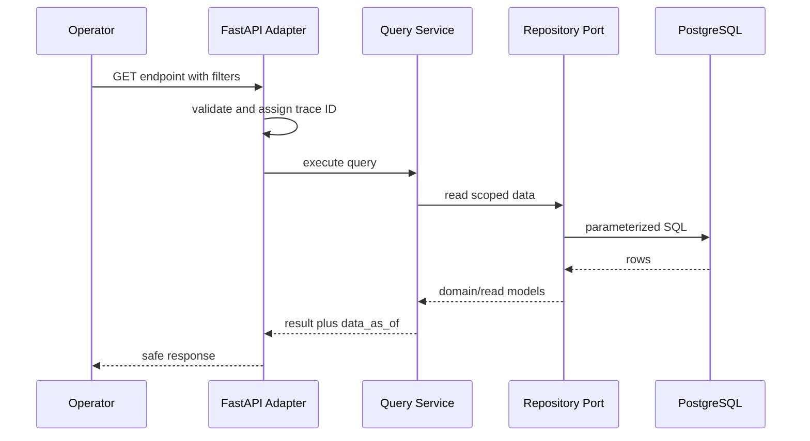

# Feature Technical Design — Monitoring API and Freshness

## 1. Overview

| Item | Detail |
|---|---|
| Feature | Monitoring API, query validation và freshness watchdog |
| Owner | P1 |
| Ticket | `[TBD]` |
| Status | W5 verified: bốn HTTP endpoint, Parquet/DuckDB export và p95 dưới tải ingest có evidence |
| Purpose | Cung cấp metrics, provider health, alerts và độ mới dữ liệu cho người vận hành |

## 2. Requirements

### Functional Requirements

- API đích gồm `/health/providers`, `/metrics/windows`, `/alerts` và `/_meta/freshness`.
- `/txns` hỗ trợ tra cứu canonical transaction phục vụ kiểm tra.
- Validate query bằng Pydantic; lỗi theo envelope `{error:{code,message,trace_id}}`.
- Mọi reporting response có `meta.data_as_of`.
- Hỗ trợ cursor pagination và sort whitelist.
- Filter theo scope; không để dữ liệu tenant/region rò chéo.
- Freshness trả lần chạy cuối, lần thành công cuối, lag, SLA và consecutive failures.

### Non-Functional Requirements

- Không trả `raw` hoặc stack trace.
- Database timeout phải trả 503 thay vì treo request.
- Đo p95 API trong lúc pipeline có tải.
- Internal endpoints phải có authentication/authorization `[Need Confirm]`.

## 3. Design

### W4-T0 query and access contracts

- `/health/providers` default sort ổn định theo
  `(region ASC, tenant_scope ASC, provider ASC)` và chỉ chấp nhận `sort=scope`.
- `/alerts` default sort `(opened_at DESC, alert_id DESC)`. Cursor là opaque
  base64url payload versioned chứa đúng hai sort keys và HMAC; malformed,
  unknown-version hoặc signature sai trả 422. Client không được tự tạo cursor.
- `/_meta/freshness` trả state theo source/scope, sort ổn định theo
  `(source_name, region, tenant_scope)` và chỉ chấp nhận `sort=scope`.
- `/metrics/windows` chỉ chấp nhận `sort=-window_start`; `/alerts` chỉ chấp nhận
  `sort=-opened_at`. Giá trị ngoài whitelist trả 422 và không được ghép vào SQL.
- Bốn list endpoint đều trả signed opaque cursor. Cursor được ký HMAC, versioned
  và bound theo endpoint; dùng cursor của endpoint khác hoặc sửa payload trả 422.
- Ba endpoint là internal API. Local Compose demo chạy unauthenticated và phải
  được ghi rõ là local-only; production authentication/tenant authorization vẫn
  `[Need Confirm]`, do đó chưa được expose qua public ingress.
- Tenant query parameter chỉ là filter, không phải authorization boundary.

Freshness item gồm `source_name`, scope, `last_run_at`, `last_success_at`,
`data_as_of`, `evaluated_at`, `lag_seconds`, `sla_seconds`, `sla_status`,
`consecutive_failures` và `trace_id`. Timestamps là UTC; timestamp chưa có trả
`null`, không dùng epoch/sentinel.

### Flow



### Processing

1. Middleware tạo hoặc nhận trace ID.
2. FastAPI và query DTO validate enum, bounds, time range, window size và limit.
3. Query service chuyển typed filter tới repository; tenant filter chưa phải authorization.
4. Repository chạy parameterized/native SQL.
5. Mapper tạo response DTO, mask raw và thêm `data_as_of`.
6. Exception handler chuyển lỗi thành public error envelope.

### Components

| Component | Change |
|---|---|
| `monitoring.adapters.http` | Routes, middleware và exception handlers |
| `MonitoringQueryService` | Application use case cho window metrics |
| `MonitoringQueryRepository` | Port query transaction và window metrics |
| `PostgresTransactionRepository` | Parameterized SQL, stable ordering và statement timeout |
| Response DTOs | Tách API schema khỏi domain entity |

## 4. API & Data

### API

| Method | Endpoint | Description |
|---|---|---|
| `GET` | `/txns` | Tra cứu canonical transaction |
| `GET` | `/health/live` | Process còn sống |
| `GET` | `/health/ready` | Database và dependency sẵn sàng |
| `GET` | `/health/providers` | Health theo provider/scope |
| `GET` | `/metrics/windows` | Window metrics |
| `GET` | `/alerts` | Alert list với filter/cursor |
| `GET` | `/_meta/freshness` | Độ mới và trạng thái pipeline |

### Request/Response

```json
{
  "data": [],
  "meta": {
    "data_as_of": "2026-09-25T03:00:00Z",
    "next_cursor": null
  }
}
```

### Database

| Table / Collection | Change |
|---|---|
| `canonical_event` | Nguồn cho `/txns` và sample details |
| `window_aggregate` | Nguồn metrics API |
| `alert` | Nguồn alerts API |
| `job_run_log` | Nguồn freshness/watchdog |

## 5. Error & Edge Cases

| Scenario | Expected Behavior |
|---|---|
| Happy path | 200, scoped data và `data_as_of` |
| Invalid enum/limit/cursor | 422 error envelope |
| Database unavailable | Ready và query endpoint trả 503 |
| Unauthorized tenant scope | 403 hoặc 404 theo security contract `[Need Confirm]` |
| Sort key không whitelist | 422; không ghép trực tiếp vào SQL |
| Raw field tồn tại | Mask hoặc bỏ khỏi response |
| Không có dữ liệu | Empty data, freshness vẫn thể hiện trạng thái nguồn |

## 6. Testing

| Test Case | Expected Result |
|---|---|
| Filter region/status | Repository nhận đúng typed filter |
| Limit ngoài 1–500 | 422 envelope |
| Repository unavailable | 503 không lộ exception |
| Raw chứa PII | Response/log không chứa giá trị gốc |
| Cursor tampered | 422 |
| Tenant A gọi dữ liệu tenant B | Không trả dữ liệu |

Local Compose endpoints không có authentication; `tenant_id` chỉ là filter, không phải authorization. Production phải đặt sau internal ingress/auth policy `[Need Confirm]`. Cursor secret mặc định chỉ dùng local demo; production phải cấu hình `MONITORING_CURSOR_SECRET`.

### W5 export và load evidence

- `bootstrap.export_monitoring_parquet` gọi đúng bốn API operator-facing, ghi
  Parquet ZSTD và data dictionary sinh từ `DESCRIBE` của DuckDB.
- Exporter đọc lại từng file bằng `read_parquet` và fail nếu row count khác API.
- `tests/bench/run_w5_api.py` phát heartbeat persistent với RabbitMQ publisher
  confirms đồng thời gọi vòng bốn API; latency chỉ được ghi trong lúc producer
  chưa kết thúc.
- Kết quả đo ngày 13/10/2026 nằm tại `tests/bench/result-w5.json`.

## 7. Open Questions

| Question | Owner | Status |
|---|---|---|
| Contract authentication và tenant authorization? | Technical Lead | `[Need Confirm]` |
| Cursor format và default sort order? | P1 | Chốt tại W4-T0 cho `/alerts`; xem mục 3 |
| SLA freshness theo từng provider? | Technical Lead | `[Need Confirm]` |
| Public/internal boundary của `/txns`? | Technical Lead | `[Need Confirm]` |
